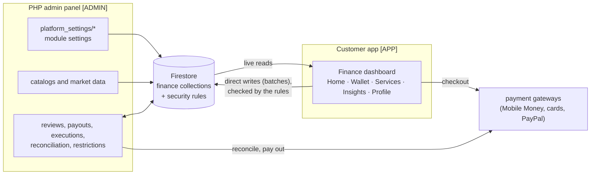

# Spideli Finance: End-to-End Feature and Flow (Admin and Customer App)

> **Superseded (15 Oct 2026)** by `SPIDELI_FINANCE_CUSTOMER_WEB_SPEC.md` and `SPIDELI_FINANCE_ADMIN_WEB_SPEC.md`, which are complete and checked against the security rules. Where this document differs, they win. Kept for history.

**Audience:** the client, the admin-panel / website team, the Cloud Functions team, app developers and testers.
**Code baseline:** branch `feature/restaurant-app-panel-parity`, 14 Oct 2026 (direct-Firestore release).
**Scope:** Spideli Finance in the **customer app** (`customer/`), and everything the **admin panel** and the **server** must provide for it.

> Everything about the app was checked against the current code. There are **no Cloud Functions** for finance: the customer app writes directly to Firestore, guarded by the security rules (`firestore.rules.draft`, finance block), and the **PHP admin panel** does every step that needs a person or a partner. Its specification is `docs/FINANCE-ADMIN-PHP-SPEC.md`; the shared data design is `.claude/FINANCE-DIRECT-FIRESTORE.md`; every field is in `.claude/FINANCE-APP-CONTRACT.md`.
>
> Labels used in this document:
> - **[APP]**: done by the customer app in this repository (direct Firestore writes).
> - **[ADMIN]**: configured, published, reviewed or completed in the PHP admin panel (Firebase Admin SDK).

---

## Table of contents

1. [Overview](#1-overview)
2. [Principles](#2-principles)
3. [Admin side](#3-admin-side)
4. [Customer app side](#4-customer-app-side)
5. [Money, payments, security and data integrity](#5-money-payments-security-and-data-integrity)
6. [Notifications](#6-notifications)
7. [Data model](#7-data-model)
8. [Testing checklist](#8-testing-checklist)
9. [Open items](#9-open-items)
10. [Source files](#10-source-files)

---

## 1. Overview

Spideli Finance is the digital finance service of the Spideli app: a wallet, payments, group savings, member lending, investments, insurance and financial guidance, for individuals and businesses.

### 1.1 The services

| Group | Service | What the user does |
|---|---|---|
| Pay and send | **Money transfer** | sends money to a Spideli user, a Mobile Money number, Wave or a bank account |
| | **Payment** (bills) | pays electricity, water, TV, internet, phone and other bills; gets prepaid tokens |
| | **Virtual card** | creates a virtual card, tops it up, freezes it, sets limits, views its details securely |
| Save and invest | **Collective savings** | saves towards a goal alone or with invited members |
| | **Tontine** | joins or runs a rotating savings group: everyone contributes each cycle, one member receives the pot |
| | **Investment** | invests in published funds, follows the portfolio, redeems; also "Funding and markets" (opportunities, indicators, exchange rates) |
| Borrow and protect | **Loan** | borrows from the members of a group (vote, funding, agreement, repayment) or lends to them; project financing for businesses |
| | **Online insurance** | compares insurance offers, requests a quote, buys a policy, pays premiums, files claims |
| Get help | **AI assistant** | a financial coach (chat) plus return and premium simulators |
| Account | **Document verification** | verifies identity (KYC) to unlock the services; business verification for companies |

### 1.2 Roles

| Role | Where | What they do |
|---|---|---|
| **Customer** | customer app | everything in section 4; a user can be at once a saver, tontine member or admin, borrower, lender, investor, policyholder, card holder and project owner |
| **Tontine admin** | customer app | the tontine's creator (and any admin): invites, sets the payout order, starts the tontine, approves payouts |
| **Savings goal owner** | customer app | creates the goal, invites, edits, cancels |
| **Platform admin / staff** | PHP admin panel | configures the modules, publishes catalogs, reviews identity, loans, disputes and financing, pays out, executes orders, reconciles payments; can freeze cards and restrict users |
| Partners | out of scope | insurers, card issuer, fund managers, billers, banks: their steps are done by the Spideli admin |

### 1.3 How the pieces fit

### 1.4 Entry point

1. **[ADMIN]** Finance appears in the service list either as the admin's own section (`serviceTypeFlag: "finance-service"`) or, without one, as the built-in **Spideli Finance** bubble (section 3.1).
2. **[APP]** The customer taps it on the service circle or in "More". It opens the **Finance dashboard** with five tabs in a bottom bar: **Home, Wallet, Services, Insights, Profile** (section 4.1). Finance is no longer inside the app's Profile screen.

---

## 2. Principles

1. **The rules decide what a customer may write.** The app writes its requests and its own money movements directly; the security rules check every field, status change and balance change (a balance moves only with its balanced ledger posting). Everything that needs a person or a partner is done by the admin.
2. **Nothing invented.** No demo data, no estimated balances. A module without its settings shows "… is not available yet". Indicators and rates come only from approved sources, with their source and period. Simulations and fees are labelled **estimates**; the binding figures are the server's.
3. **Verified identity first.** Most money services need a verified identity (`users/{uid}.kycLevel`, set by the admin only).
4. **Money moves only once.** Every paying request carries one idempotency key per intent, and a payment counts only after the provider confirms it (section 5).
5. **Integer minor units.** Every amount is an integer in the currency's smallest unit (`XAF` has none, `USD` has 2).
6. **One design system.** Every finance screen uses the finance design system (`.claude/FINANCE-DESIGN-SYSTEM.md`): navy identity, the same states (loading, empty, error with Retry, "no longer available"), inline form validation, confirmation before binding steps, English and Arabic.

---

## 3. Admin side

The admin back-office is the **PHP admin panel** (not in this repository). Its complete specification, screen by screen and write by write, is **`docs/FINANCE-ADMIN-PHP-SPEC.md`**. This section summarises what the customer flows need from it.

### 3.1 Turn Finance on in the service list

| What | Where | Effect in the app |
|---|---|---|
| A section with `serviceTypeFlag: "finance-service"` (optional) | `sections/{id}` | Used as the Finance bubble with its own name, image, colour and order. |
| Nothing (default) | — | The app adds a built-in **Spideli Finance** bubble (navy `#0B2A4A`, wallet icon, id `spideli-finance`), always on the circle and in "More". |

### 3.2 Module settings (`platform_settings/*`)

One document per module; a missing or invalid one hides that module behind "… is not available yet". Amounts are integer **minor units** per currency (`{ "XAF": 1000 }`). Signed-in users read them, so they never hold secrets.

| Document | Controls |
|---|---|
| `platform_settings/kyc` | document types and sides, verification levels (`basic`, `full`, `business`) and their documents, file types and size |
| `platform_settings/wallet` | currencies; Add money (`deposit {enabled, min, max}`); Withdraw (`withdraw {enabled, methods, min, max, feePercent, feeFixed, feeMax, delay}`); currency conversion (`convert {enabled, currencies, feePercent, maxRateAgeHours}`); re-authentication threshold |
| `platform_settings/transfers` | currencies, what pays a transfer, re-authentication threshold, channels (`internal`, `mobile_money`, `wave`, `bank`) with fees, limits, delay, operators, banks |
| `platform_settings/bills` | currencies, categories (electricity, water, TV, internet, phone, gas, school fees, taxes, products, other), payment methods, re-authentication threshold |
| `platform_settings/cards` | issuer, network, max cards, fees, funding methods and limits, limit ceilings, capabilities (`withdraw`, `renew`, `cardTransfer`, online / abroad toggles, `secureDetails`), **cardholder terms + `termsVersion`** |
| `platform_settings/savings` | purposes, currencies, frequencies, group goals, max members, early withdrawal, payment methods |
| `platform_settings/tontines` | currencies, frequencies, min / max members, payout order methods, payment methods, minimum contribution |
| `platform_settings/lending` | currencies, min / max amount, durations, frequencies, purposes, interest (flat / declining), fee %, late penalty %, voting (quorum, approval, hours), payment methods, `agreementTerms` |
| `platform_settings/investments` | currencies, asset classes, payment methods, **risk disclosure**, simulator years |
| `platform_settings/insurance` | currencies, categories, payment methods, max claim photos |
| `platform_settings/financing` | currencies, financing types, sectors, stages, document types, required documents, amounts, durations, files |
| `platform_settings/intelligence` | indicators, exchange rates, opportunity matching, **markets** (`{enabled, stocks, bonds, ipos, collections, news}`), AI coach (off) |
| `settings/authProviders` | LinkedIn (and Facebook) sign-in buttons, shown only when enabled and configured |

`paymentMethods` values: `wallet`, `mobile_money`, `wave`, `card`, `paypal` (and `bank` for payouts). They map to the **payment gateways the app already uses** for the shopping wallet, configured per region by the admin (`settings/*`): Orange Money and Flutterwave / PayStack for Mobile Money, Flutterwave for Wave, Stripe (and others) for Visa / Mastercard, PayPal.

**Live status (read-only check, 14 Oct 2026):** the eleven finance documents of the first release exist; virtual cards stay **hidden** (no `terms` / `termsVersion` until an issuer is contracted); the AI coach is **off**; transfers offer `internal` and `mobile_money` (`wave` and `bank` off). **To create:** `platform_settings/wallet` (Add money, Withdraw, Convert stay "not available yet" without it), `platform_settings/intelligence.markets`, and one `financial_accounts/platform_{CUR}` per currency (section 5).

### 3.3 Catalogs and content the admin publishes

Only `published: true` records are shown: investment funds and unit prices, insurance products, billers, financing resources, economic indicators and exchange rates (approved sources only), investment opportunities, and the new market data (`market_securities`, `market_price_history`, `ipo_listings`, `stock_collections`, `finance_news`) from a licensed data feed.

### 3.4 What waits for the admin

The customer app records the request; the admin completes it (PHP spec, sections 4-11):

| Customer request | Admin step |
|---|---|
| identity verification submitted | review, ask for more, approve (sets `users.kycLevel`) or reject |
| wallet withdrawal, external transfer, bill payment (money already taken from the wallet) | pay out / pay the biller and mark `completed` (+ token for prepaid bills), or refund (reversal) |
| gateway payments (all of them) | **reconcile** `payment_receipts` with the provider; reverse what the provider did not receive |
| card request, top-up, card → wallet, card → card, limits, deletion, renewal | do it at the card issuer and update the card |
| loan application | review, credit score, open the vote; penalties, defaults; refund stuck fundings |
| group savings withdrawal / cancellation | apply the group's rules and pay out |
| tontine payout when the beneficiary is the only admin; disputes; suspension | approve / resolve / suspend |
| fund subscription (paid) and redemption | execute at the next unit price, update holdings, settle |
| insurance quote request, accepted quote, renewal, cancellation, claim | price, activate, renew, cancel, decide and pay |
| financing application submitted | review, request information, approve, fund, close |
| blacklist (insolvency) | set `users.financeRestriction` after a documented review |

---

## 4. Customer app side

Every screen is in `customer/lib/screen_ui/finance/`. The app **writes directly to Firestore** (batches or transactions), checked by the security rules; nothing calls a Cloud Function. Every module loads its settings once (`FinConfig`): a skeleton while loading, an error with **Retry** on a failed read, "… is not available yet" without valid settings. Money buttons sit behind the **identity gate** (`FinanceKycGate`: `users/{uid}.kycLevel` must be set). A refusal of the rules shows "This action is not allowed, or is no longer possible…"; known reasons have their own message (section 5.4). A user under an admin **restriction** sees why and cannot start the restricted services.

### 4.1 The Finance dashboard

`FinanceDashboardScreen`: five tabs in a navy bottom bar (each built on first open, keeping its scroll; Back returns to Home, then leaves Finance).

| Tab | What it shows |
|---|---|
| **Home** | restriction notice (when restricted) · verification banner · **balance hero** (main wallet, other wallets, invested / saved / still to repay; actions **Add money**, Send, Pay bills, **Withdraw** when the wallet settings offer them, else Save and Invest; Retry when the balance fails) · **Needs your action** (4.2) · **Coming up** (overdue loan or next instalment, next tontine contribution, next insurance renewal) · **This month** (money in / out vs the month before) · **Your money** (savings, investments with gains and **return %**, loans, tontines, insurance) · **Recent activity** · app bar: **Messages** (unread dot), statement |
| **Wallet** | balance hero (Add money, Withdraw, Convert, Send, Pay bills, Statement) · wallet operations in progress · history of ledger transactions (search, type chips, date range, details with copy reference, Load more) |
| **Services** | Pay and send (Money transfer, Payment, Virtual card) · Save and invest (Collective savings, Tontine, Investment) · Borrow and protect (Loan, Online insurance) · Get help (AI assistant) |
| **Insights** | cash flow per month (chart), last 30 days by kind; AI assistant, Markets (indicators, rates, stocks, bonds, IPOs, collections, news), account statement |
| **Profile** | restriction notice · header (photo, name, contact, verification) · **Spideli Finance**: document verification, groups, wallets, **Messages**, account statement, **Security** (two-step verification), **Notifications** (push / SMS / e-mail choices) · then every option of the app's Profile screen (account, payment methods incl. **bank accounts**, money & rewards, dining, messages, preferences, sharing, help & legal, log out, delete account) |

**Dashboard totals** are worked out **on the device** from the user's own records (wallets, holdings, goals, tontines and their current cycle, loans and schedules, fundings, policies, claims, and the last 12 months of the ledger): `FinanceSummaryService`. One currency (the main wallet's); nothing is invented.

### 4.2 Needs your action

Tontine invitations · savings goal invitations · loans to vote on · loans collecting funds · own loan agreement to accept (urgent) · own loan overdue (urgent) · insurance quotes ready (until valid) · claims needing information (urgent). Urgent first, then the soonest due; each opens the screen where it is done; hidden when nothing waits.

### 4.3 Identity verification (KYC)

1. **[APP]** Start a level (Individual / Business): creates `kyc_applications/{id}` (`draft`).
2. **[APP]** Details form (full name, date of birth, nationality, ID number, address, city, country; company fields for a business) → saved on the application while `draft` / `additional_info_required`.
3. **[APP]** Documents ("Provide one of these"; camera or gallery; size checked): file to Storage `kyc/{uid}/{applicationId}/…`, then `kyc_documents` (`uploaded`; an older upload of the same document is `superseded`).
4. **[APP]** **Submit for review** (disabled until complete, "To continue: …") → application `submitted` + review history entry.
5. **[ADMIN]** review → `under_review` → `additional_info_required` (reason) / `approved` (sets `users.kycLevel`) / `rejected` (reason).
6. **[APP]** status, reason and history live; after a rejection **Start again** (new revision).

### 4.4 Wallet: add money, withdraw, convert

- **Add money:** amount → pay with a gateway (Mobile Money, card, PayPal… as offered for the region and currency) → one batch: `wallet_operations` (`deposit`, `completed`) + `payment_receipts` + ledger `platform → wallet`. **[ADMIN]** reconciles the receipt.
- **Withdraw:** amount (fee and "You receive" shown) → destination (saved Mobile Money, Wave or **bank account**) → re-authentication above the threshold → `wallet_operations` (`withdrawal`, `pending`) + ledger `wallet → platform` (the money leaves the wallet at once). **[ADMIN]** pays out → `completed` (payout reference), or refunds → `failed` / `reversed`.
- **Convert** (multi-currency): from / to currency, amount; rate = the latest published `exchange_rate_snapshots` (not older than `maxRateAgeHours`), fee → one batch: `wallet_operations` (`conversion`, `completed`) + ledger `wallet_A → platform_A` and `platform_B → wallet_B`.
- Every operation has a detail screen that follows its status live.

### 4.5 Money transfer

1. **[APP]** "Send to": the enabled channels; recent recipients; history (latest 50, filters).
2. **[APP]** **To a Spideli user** (`internal`): e-mail or phone → the user is looked up and their **name shown for verification** (never yourself) → amount, note, estimate → re-authentication above the threshold → payment sheet → one batch: `money_transfers` (`completed`) + ledger `sender wallet → recipient wallet (+ fee)`; the recipient's wallet is created if needed; push `transfer_received`. **Instant.**
3. **[APP]** **Mobile Money / Wave / bank** (IBAN checked): amount, estimate → payment sheet → `money_transfers` (`processing`) + ledger `→ platform`. **[ADMIN]** pays the recipient → `completed`, or refunds → `reversed`. The sender may **ask to cancel** while the admin has not started it.
4. **[APP]** receipt PDF once completed or refunded; an internal recipient sees the transfer (sender, amount received, note).

### 4.6 Payment (bills)

1. **[APP]** categories from the settings (electricity, water, TV, internet, phone, gas, school fees, **taxes**, **products**); My bills (saved accounts); history.
2. **[APP]** biller (search from 7), account (label, hint, expected length), amount by the biller's rule (`open`, `packages`; `due` billers: the amount on the bill, explained) → estimate → payment sheet → `utility_payment_requests` (`processing`) + ledger `→ platform`.
3. **[ADMIN]** pays the biller → `completed` with the biller's reference and, for prepaid, the **token** (shown large with Copy) — or refunds.

### 4.7 Virtual card

- **[APP]** card list; **Get a virtual card** (fees and limits, capabilities, terms accepted; creation fee paid when there is one) → `virtual_cards` (`requested`). **[ADMIN]** issues it (last 4 digits, expiry, holder) → `active`.
- **[APP]** actions: **Top up** (amount, fee, "You pay") → request (`pending`) + ledger `→ platform`; **Freeze** (instant) / **Unfreeze** (re-auth; not when frozen by the admin); **Limits** per payment / day / month and online / abroad (re-auth) → applied by the admin; **To wallet** and **Send to another card** (recipient by e-mail or phone; re-auth) → requests; **Renew**; **Delete** (re-auth) → `termination_requested`. **[ADMIN]** completes each at the issuer.
- **Card details** need the issuer's secure page: hidden until it is configured.

### 4.8 Collective savings

1. **[APP]** create a goal (purpose: real estate, education, travel, health, business, other; target, currency, deadline, schedule; invite members by e-mail when group goals are on) → `savings_goals` + its account `goal_{id}`; invitees **Join** (after a summary) or Decline; the owner edits name, description, deadline, schedule.
2. **[APP]** **Add money** → payment sheet → `savings_contributions` (`succeeded`) + ledger `→ goal` + `savedAmount`.
3. **[APP]** goal screen: progress bar, **progress chart** (saved at the end of each month, added and withdrawn), projection (completion date, needed per month), contributions (who paid), withdrawals, members (Message).
4. **[APP]** **Withdraw**: solo goal → straight to the wallet (ledger `goal → wallet`); group goal → request → **[ADMIN]** decides by the group's rules. **Cancel**: solo → balance back to the wallet; group → request to the admin.

### 4.9 Tontine

1. **[APP]** create (name, rules, amount per cycle, currency, frequency, members, first date, payout order fixed / random) → `tontines` (`forming`) + admin member + pot account.
2. **[APP]** the admin invites by e-mail (the invitation **carries the terms**); invitees join or decline; the admin sets the payout order (drag) and **starts**: every cycle is created with its beneficiary and due date.
3. **[APP]** each cycle: **Pay my contribution** → contribution (one per cycle and member) + ledger `→ pot` + collected amount; every member's status is visible to all (**transparency**); the last contribution creates the payout `pending_approval`.
4. **[APP]** another admin **approves the payout** → ledger `pot → beneficiary wallet`, next cycle opens (the beneficiary never approves their own; with a single admin, **[ADMIN]** Spideli approves).
5. **[APP]** history, disputes (raise one; **[ADMIN]** resolves), **group chat**.

### 4.10 Loan (member to member) and project financing

- **[APP]** apply (group = one of your tontines, amount, purpose, duration, frequency; **estimated repayments**; up to 5 photos) → `loan_applications` (`submitted`). **[ADMIN]** reviews, scores (`credit_assessments`, shown to the borrower), opens the vote.
- **[APP]** members **vote** once (counts shown live); after the deadline or when everyone voted, any participant **closes the vote** (quorum and approval from the settings) → `funding` or `rejected`.
- **[APP]** members **lend** (risk confirmation) → ledger `→ loan account`; the last lender creates the **agreement** (interest, fee, late penalty, total, schedule).
- **[APP]** the borrower **accepts** → disbursement `loan account → borrower wallet` (fee to the platform), `active`, the **repayment schedule**.
- **[APP]** **Repay** (instalment due prefilled; penalty shown) → ledger `→ loan account`, schedule updated, `repaid` at 0. Lenders **collect** their share of repayments to their wallet. **[ADMIN]** penalties, overdue, default (after review), blacklist.
- **Project financing** (companies): projects, applications (`draft` → `submitted` with declaration), documents (Storage first), withdraw; **[ADMIN]** reviews, requests information, approves, funds; resources (guides, templates, FAQ).

### 4.11 Investment and markets

- **[APP]** Portfolio (value, invested, gains, **return**, allocation, my funds, reports), Funds (catalog, search, sort, filters), Orders. Fund page: objective, key facts, fees, performance, price chart, documents, terms. **Invest**: amount (≥ minimum), estimate, **risk disclosure** + **terms** accepted, **electronic signature** → payment sheet → `investment_subscriptions` (`paid`) + ledger `→ platform`. **[ADMIN]** allocates units at the next price. **Redeem** part or all → request → **[ADMIN]** settles to the wallet. Return simulator.
- **Markets**: indicators and exchange rates (converter), **stocks and market indices** (live as the feed updates; watchlist), **bonds**, **IPOs**, **collections**, **news and analyses** — read-only, from the admin's licensed feed; "Invest through the funds" (no brokerage). **Opportunities**: investor preferences, suggestions with a match score, "I am interested" (name and e-mail shared with the owner, no money).

### 4.12 Online insurance

- **[APP]** offers by category → product (coverages, exclusions, deductible, documents) → quote request (questions, frequency, cover start; **estimated premium**) → `insurance_quotes` (`requested`). **[ADMIN]** prices it (`quoted`) or refuses.
- **[APP]** accept (terms + **electronic signature**) → payment sheet → quote `accepted` + policy `pending_activation` + first premium `paid` + ledger. **[ADMIN]** activates (policy number, documents).
- **[APP]** policy: premiums (pay), renew (when the admin set a renewal premium), auto-renew, cancel (request), documents; **claims**: declare (date, description, amount, photos), follow (`submitted → under_review → info_requested → approved → paid`), send more information, withdraw. **[ADMIN]** decides and pays.

### 4.13 Communication and the AI assistant

- **Finance chat**: a **group chat per tontine** and **direct chats** with members of your tontines and savings goals (Message button on member rows); conversation list with unread marks; real-time messages; push `finance_chat_message`.
- **Notifications**: pushes for invitations, transfers received, payouts, loan steps, chat; the Notification Center; **preferences** per channel (push, SMS, e-mail) and category — the admin side sends SMS and e-mail by them.
- **AI assistant**: return and premium simulators work; the **coach** needs a server holding the AI provider key and stays off.

### 4.14 Account security

- **Two-step verification** (Finance > Profile > Security): an SMS second factor on top of the password / Google / Apple / LinkedIn sign-in; every sign-in path and every re-authentication asks for the code. Needs Firebase Authentication with Identity Platform and SMS multi-factor turned on.
- **LinkedIn** sign-in when the admin enables it (`settings/authProviders`) and the OpenID Connect provider is set up; Facebook needs the Facebook SDK (not added).
- **Restriction** (blacklist for insolvency): shown on Home, Profile, Loans and Tontines; blocks new loans, votes, fundings, tontines and goals (scopes `loans`, `tontines`, `savings`, `transfers`, `payments`, `wallet` or `all`).

---

## 5. Money, payments, security and data integrity

### 5.1 Accounts and the ledger

- `financial_accounts`: one **wallet** per user and currency (`wallet_{uid}_{CUR}`), and pool accounts: savings goal `goal_{id}`, tontine pot `tontine_{id}`, loan `loan_{id}`, Spideli's clearing account **`platform_{CUR}`** (money received by gateways, money waiting to be paid out, fees). **The admin creates one `platform_{CUR}` per currency before going live.**
- Every money movement is a **posting** in `ledger_transactions`: 2 lines (debit → credit) or 3 (plus a fee credited to the platform), written **in one batch** with the balance change of each account (`FinanceLedger`, `customer/lib/service/finance_ledger.dart`). The rules check that the lines balance and match the balances, that a wallet never goes below zero, and that the caller may debit that account (own wallet; solo goal owner; tontine admin paying the cycle's beneficiary; borrower on disbursement; lender within their share; the platform only for a gateway deposit or a conversion).
- The admin never edits or deletes a posting: a correction is a **reversal** posting.

### 5.2 Paying (`FinancePaySheet`)

1. The user sees the figures (amount, fee, total, terms, risks), then chooses how to pay among the methods the module allows:
   - **Spideli Finance wallet** (balance shown; refused when too low);
   - a **gateway** for the region and currency: Mobile Money (Orange Money, Flutterwave, PayStack), Wave (Flutterwave), card — Visa / Mastercard (Stripe, Flutterwave, PayStack, …), PayPal.
2. Wallet: the request and its posting are written in one batch.
3. Gateway: the checkout runs first; on success, the money is **deposited into the wallet** (`wallet_operations` deposit + `payment_receipts` + posting `platform → wallet`), then the request is paid from the wallet. If the second step fails, the money is safe in the wallet and "Try again" finishes it **without charging again**.
4. The result screen shows "Payment received", "Payment started" or "Request sent" (payouts), with the reference.

> **Trust note.** Without a server, a gateway success is reported by the device. Every gateway payment leaves a `payment_receipts` record (create-only: one posting per payment) that the admin **reconciles** with the provider, reversing what the provider did not receive. Before real money at scale, have the PHP side receive the providers' webhooks and mark receipts verified.

### 5.3 Never paying twice

- One request id per **intent** (`FinanceRequestKeys`): a double tap or a retry writes the same document id, and the rules make these documents create-only; a retry first reads the request back and treats an existing one as done.
- Deterministic ids where there must be one record: a contribution per tontine cycle and member (`{cycleId}_{uid}`), a vote per loan and member, a payout per cycle, a receipt per gateway payment.
- Buttons are disabled while a write runs.

### 5.4 Re-authentication, security, errors

- Re-authentication (password, SMS code, Google, Apple, LinkedIn; two-step code when enabled) before withdrawals and transfers above the threshold, card details, unfreeze, limits, card → wallet / card, card deletion; skipped when the sign-in is under 4 minutes old (the rules accept 5).
- Card details are shown only through the issuer's secure page; screenshots are blocked on Android and the app is covered in the iOS app switcher while sensitive data is on screen.
- Refusals with their own message: `insufficient_funds`, `permission_denied`, `finance_restricted`, `state_changed`, `invalid_state`, `recipient_not_found`, `recipient_ambiguous`, `self_transfer`, `invite_self`, `already_member`, `group_full`, `invitation_closed`, `withdrawal_not_allowed`, `payout_self_approval`, `loan_no_voters`, `agreement_outdated`, `nothing_to_collect`, `terms_outdated`, `fund_closed`, `below_minimum`, `rate_unavailable`, `not_cancellable`, `payment_not_completed`, `gateway_unavailable`, `network`, `watchlist_full`, `message_invalid`, …

### 5.5 Reading efficiently

The profile, accounts and dashboard totals are shared live listeners (one per source whatever the number of screens), with Retry after a failure; lists are paged or capped; Firestore's offline cache keeps the last data on screen.

---

## 6. Notifications

Texts come from the `dynamic_notification` templates (one per `type`, placeholders such as `{amount}`); no text is in code.

| Sent by | When | Templates |
|---|---|---|
| **[APP]** (push to the other people concerned, best effort, never to the sender) | the event the customer just wrote | `transfer_received`, `savings_invite`, `tontine_invite`, `tontine_started`, `tontine_payout_pending_approval`, `tontine_payout_paid`, `tontine_dispute_raised`, `loan_approved`, `loan_rejected`, `loan_funding_open`, `loan_funded`, `loan_agreement_ready`, `loan_disbursed`, `loan_repayment_received`, `loan_lender_repayment`, `loan_repaid`, `finance_chat_message` (**new: create it**) |
| **[ADMIN]** (push + Notification Center record `source: "finance"`, SMS and e-mail by the user's preferences) | the admin's decisions and scheduled reminders | `kyc_*`, `transfer_sent / failed / reversed`, `bill_paid / token / failed / reversed`, `card_*` (security ones always), `investment_*`, `insurance_*`, `financing_*`, `loan_submitted`, `loan_vote_requested`, `loan_repayment_due / overdue`, `savings_contribution_due`, `savings_withdrawal_completed / rejected`, `tontine_contribution_due / overdue`, `intelligence_*`; wallet deposits, withdrawals, payments and transfers (spec: push for each, SMS for critical ones, e-mail receipts) |

The user's choices: `users/{uid}.financeNotificationPrefs {push, sms, email: {payments, groups, loans, investments, insurance, news}}` (Finance > Profile > Notifications); security notices are always sent. The finance screens update live from Firestore, so a missed push never leaves a screen stale.

---

## 7. Data model

Who writes: **C** = the customer app (direct writes, checked by the rules), **A** = the admin panel. Amounts are integer minor units. Full write shapes per operation: `.claude/FINANCE-DIRECT-FIRESTORE.md` and `docs/FINANCE-ADMIN-PHP-SPEC.md`.

| Area | Collection / document | Key fields | App reads it as |
|---|---|---|---|
| Settings | `platform_settings/{kyc, savings, tontines, lending, investments, insurance, cards, transfers, bills, financing, intelligence}` | see section 3.2 | any signed-in user |
| Identity | `kyc_applications/{id}` | `userId, level, accountType, status, revision, personal{}, business{}, reason, createdAt, submittedAt` | `where userId == uid` |
| | `kyc_documents/{id}` | `applicationId, userId, type, side, status (uploaded / accepted / rejected / superseded)` | per application |
| | `kyc_reviews/{id}` | `applicationId, userId, action, reason, at` | per application (history) |
| | `users/{uid}` | `kycStatus`, `kycLevel` (server-only fields) | profile stream |
| Money (C + A) | `financial_accounts/{id}` | `id, kind (wallet / savings_goal / tontine_pot / loan / platform), userId or refId, currency, balance, normalSide, status, lastTxId` | own wallets `where userId == uid` |
| | `ledger_transactions/{id}` | `type, status (posted / reversed), reference, currency, lines[{accountId, direction, amount}], userIds, accountIds, source{kind, id}, funding, gateway?, createdBy, createdAt` | `userIds array-contains uid orderBy createdAt desc`, pages of 20 (statements 200, max 2000) |
| | `wallet_operations/{id}` (C) | `type (deposit / withdrawal / conversion), status, amount, fee, total, currency, accountId, destination?, toCurrency?, rate?, receiveAmount?, gateway?, txId, reference` | own operations |
| | `payment_receipts/{method}_{ref}` (C create, A verifies) | `method, reference, txId, amount, currency, userId, verified` | admin reconciliation |
| | ~~`finance_summaries/{uid}`~~ | no longer used: the totals are worked out on the device | — |
| Savings | `savings_goals/{id}` | `ownerId, memberIds, invitedIds, name, purpose, currency, targetAmount, savedAmount, deadline, schedule{frequency, amount}, status (active / completed / cancelled)` | members and invitees |
| | `savings_contributions/{id}`, `savings_withdrawals/{id}` | `goalId, userId, amount, status, reference, createdAt` | per goal (latest 50 / 20) |
| Tontines | `tontines/{id}` | `name, rules, currency, contributionAmount, frequency, membersLimit, payoutOrderMethod, startDate, status (forming / active / completed / suspended), adminIds, memberIds, currentCycle, nextDueAt` | active members |
| | `tontine_members/{tontineId}_{userId}` | `tontineName, role, status (invited / active / declined / removed / restricted), payoutPosition, invitedByName` | invitations; members |
| | `tontine_cycles`, `tontine_contributions`, `tontine_payouts`, `tontine_disputes` | per `tontineId` (see contract section 9) | per tontine |
| Loans | `loan_applications/{id}` | `borrowerId, groupId, groupName, status, amount, fundedAmount, outstandingAmount, durationMonths, repaymentFrequency, purpose, eligibleVoterIds, lenderIds, votes{yes, no}, votingEndsAt, documents` | as borrower, voter or lender (latest 50 each) |
| | `loan_votes/{loanId}_{uid}`, `loan_agreements/{loanId}`, `loan_schedules/{loanId}`, `credit_assessments/{loanId}`, `loan_fundings`, `loan_repayments`, `loan_disbursements` | see contract section 11 | per loan |
| Investments | `investment_funds`, `investment_valuations`, `investment_holdings/{uid}_{fundId}`, `investment_subscriptions`, `investment_redemptions`, `investment_transactions`, `investment_reports` | see contract section 12 | catalog (published); the user's own records |
| Insurance | `insurance_products`, `insurance_quotes`, `insurance_policies`, `insurance_premiums`, `insurance_claims` (`insurance_partners` staff only) | see contract section 13 | catalog (published); the user's own records |
| Cards | `virtual_cards`, `card_transactions`, `card_funding_requests`, `card_limit_settings/{cardId}` (`virtual_cards_private` server only) | `last4`, expiry, holder, status, balance (never the full number or CVV) | the user's own cards |
| Transfers and bills | `money_transfers`, `transfer_beneficiaries`, `utility_billers`, `utility_saved_accounts`, `utility_payment_requests` (`utility_payment_transactions` staff only) | see contract section 15 | `participantIds` / owner |
| Project financing | `financing_projects`, `financing_applications`, `financing_documents`, `financing_reviews`, `financial_resources` | see contract section 16 | owner; published resources |
| Intelligence and coach | `economic_indicators`, `economic_indicator_history`, `exchange_rate_snapshots`, `investment_opportunities` (A); `investor_profiles/{uid}`, `opportunity_interests/{oppId}_{uid}`, `investor_watchlists/{uid}` (C); `coach_consents/{uid}`, `financial_coach_sessions` (coach off) | see contract section 17 and the design | published data; the user's own records |
| Markets (A) | `market_securities`, `market_price_history`, `ipo_listings`, `stock_collections`, `finance_news` | `published`, source, `updatedAt`, `delayed` (see the PHP spec section 11) | published only |
| Chat (C) | `finance_chats/{dm_a_b or tontine_tid}`, `…/messages/{id}` | `type, memberIds or tontineId, lastMessage, updatedAt, lastReadAt{uid}`; messages `senderId, senderName, text, createdAt` | members of the conversation / active tontine members |
| Users | `users/{uid}` | `kycLevel`, `kycStatus`, `financeRestriction` (A only); `financeNotificationPrefs`, `savedPaymentMethods` (incl. bank accounts) (C, own doc) | own doc; lookups by e-mail / phone for transfers and invitations |

**Storage (the only client writes, each registered afterwards by a function):**

| Path | Written by | Read by |
|---|---|---|
| `kyc/{uid}/{applicationId}/{type}-{side}-{epochMillis}.jpg` | the owner (create only, no overwrite) | the owner; reviewers through signed links |
| `loan_documents/{uid}/{loanId}/document-{n}-{ms}.jpg` | the borrower | reviewers and voters through signed links |
| `insurance_claims/{uid}/{claimId}/{file}` | the policyholder | the owner, staff, the insurer |
| `financing_documents/{uid}/{applicationId}/{file}` | the project owner | the owner; authorised reviewers through signed links |
| `investment_reports/{uid}/…`, `insurance_policies/{uid}/…` | server | the owner |

**Rules and indexes:** the finance block of `firestore.rules.draft` (tested with the emulator: `finance/rules-test/`) and `.claude/firestore.indexes.json` (the 38 indexes deployed 13 Oct 2026 plus the new ones). Neither is deployed by this work: merge with the live rules and deploy after review (section 9).

---

## 8. Testing checklist

**Automated:** `cd customer && flutter test` (the finance write plans, ledger postings, totals, rules of every module, layout at 320 dp with large text, right to left, dark) and the security rules in the Firestore emulator (`finance/rules-test/`, see its README).

**Before going live (admin):** `platform_settings/wallet` and `platform_settings/intelligence.markets` created; one `financial_accounts/platform_{CUR}` per currency; the `finance_chat_message` template; the payment gateways enabled for each region; the finance rules merged and deployed; Identity Platform with SMS multi-factor (two-step verification), the LinkedIn OpenID Connect provider if wanted.

**By hand, with two test accounts A and B (verified identity) on a test project or with test gateways:**

| # | Journey | Expected |
|---|---|---|
| 1 | A starts a verification, adds the documents, submits; the admin approves | status chips and history update live; A's money buttons unlock |
| 2 | A adds money with a test gateway | wallet credited at once; a `payment_receipts` record to reconcile |
| 3 | A sends money to B (internal) | instant: A debited (amount + fee), B credited, B gets a push; both see the transfer |
| 4 | A sends to a Mobile Money number; the admin pays out | `processing` → `completed`; cancel request possible before the admin starts |
| 5 | A withdraws to a saved bank account; the admin fails it | money back in A's wallet (reversal), status `failed` |
| 6 | A converts XAF → EUR | both wallets updated with the published rate and the fee |
| 7 | A pays a bill; the admin completes with a token | token shown with Copy; receipt |
| 8 | A creates a savings goal, invites B; B joins; both contribute; A (solo goal) withdraws | progress chart, contributors, `savedAmount`; group withdrawal goes to the admin |
| 9 | A creates a tontine, invites B (B sees the terms), starts it; both pay; another admin approves the payout | pot moves to the beneficiary's wallet; next cycle opens; group chat works |
| 10 | B applies for a loan in the tontine group; the admin opens the vote; A votes; vote closed; A funds; B accepts; B repays; A collects | every balance moves as shown; schedule updated |
| 11 | A subscribes to a fund (risk + terms + signature); the admin allocates units | order `paid` → `completed`; portfolio and return update |
| 12 | A requests an insurance quote; the admin prices it; A accepts and pays; the admin activates; A files a claim | statuses and documents follow |
| 13 | A requests a card; the admin issues it; A tops up, freezes, unfreezes (re-auth), sets limits, sends to B's card | requests completed by the admin |
| 14 | The admin restricts B (`loans`) | B sees the notice; new loan / vote / fund refused (app and rules) |
| 15 | A turns on two-step verification, signs out and in | the SMS code is asked at sign-in and before sensitive actions |
| 16 | A stranger account tries to read A's records or write A's wallet | refused by the rules |

---

## 9. Open items

**To do before going live (admin / operations):**
1. **Security rules:** merge the finance block of `firestore.rules.draft` with the live rules (the draft alone is 184 KB; Firestore allows 256 KB), re-run `finance/rules-test` against the merged file, then deploy. Deploy the new indexes of `.claude/firestore.indexes.json`. Nothing was deployed by this work.
2. **PHP admin panel:** build `docs/FINANCE-ADMIN-PHP-SPEC.md`. Until it exists, every request that needs the admin (withdrawals, external transfers, bills, cards, KYC decisions, executions, quotes, claims, loan reviews) stays pending.
3. **Settings and data:** create `platform_settings/wallet` (Add money, Withdraw, Convert), `platform_settings/intelligence.markets`, one `financial_accounts/platform_{CUR}` per currency, the `finance_chat_message` template; enable the payment gateways per region and currency.
4. **Gateway payments are reported by the device:** reconcile every `payment_receipts` record with the provider (PHP), ideally through the providers' webhooks.
5. **Privacy:** any signed-in user can read any `users` profile (needed today for recipient lookup, member names and push tokens). A public-profile collection with only the needed fields would narrow it.
6. **Providers to contract or configure:** card issuer (issuance, secure card details), biller APIs (account lookup), a licensed market-data feed, a broker (buying stocks / IPOs), an SMS / e-mail provider for the admin side, Identity Platform with SMS multi-factor (two-step verification), the LinkedIn OpenID Connect provider, the Facebook SDK (Facebook sign-in), a server holding the AI key (coach).

**Limits of rules without a server (left to the admin's reconciliation):** daily / monthly amounts across documents, one open request per user, the number of cards, list contents (loan schedule lines, package amounts, storage paths), the freshness of the exchange rate chosen within `maxRateAgeHours`.

**App limits:** request ids are kept in memory (an app restart before success gives a new id); the chat shows the latest 300 messages with no moderation; the iOS build was not run in this phase; the money journeys were verified by unit tests and rules emulator tests, not end to end on live data (section 8).

---

## 10. Source files

| Area | Files (under `customer/lib/`) |
|---|---|
| Entry and dashboard | `utils/finance_section.dart`, `screen_ui/finance/finance_dashboard_screen.dart`, `finance_home_screen.dart`, `finance_profile_tab.dart`, `finance_actions_screen.dart`, `service/finance_actions_service.dart`, `utils/finance_actions.dart`, `service/finance_summary_service.dart`, `utils/finance_summary_builder.dart` |
| Money core | `service/finance_ledger.dart`, `service/finance_direct.dart`, `service/finance_payment_service.dart`, `utils/finance_payment_rules.dart`, `screen_ui/finance/finance_widgets.dart` (`FinancePaySheet`), `controllers/wallet_controller.dart` (gateway hook) |
| Wallet | `service/finance_wallet_service.dart`, `utils/finance_wallet_rules.dart`, `screen_ui/finance/wallet_screens.dart`, `transactions_screen.dart` |
| Transfers and bills | `service/finance_transfer_service.dart`, `utils/finance_transfer_rules.dart`, `screen_ui/finance/transfer_screens.dart`, `bill_screens.dart` |
| Cards | `service/finance_card_service.dart`, `utils/finance_card_rules.dart`, `screen_ui/finance/card_screens.dart` |
| KYC | `service/finance_service.dart` (KYC part), `utils/finance_kyc_rules.dart`, `screen_ui/finance/kyc_screen.dart` |
| Savings and tontines | `service/finance_group_service.dart`, `utils/finance_group_rules.dart`, `screen_ui/finance/savings_screens.dart`, `tontine_screens.dart` |
| Loans and financing | `service/finance_lending_service.dart`, `utils/finance_lending_rules.dart`, `screen_ui/finance/lending_screens.dart`; `service/finance_financing_service.dart`, `utils/finance_financing_rules.dart`, `screen_ui/finance/financing_screens.dart` |
| Investments, insurance, markets | `service/finance_investment_service.dart`, `utils/finance_investment_rules.dart`, `screen_ui/finance/investment_screens.dart`; `service/finance_insurance_service.dart`, `utils/finance_insurance_rules.dart`, `screen_ui/finance/insurance_screens.dart`; `service/finance_intel_service.dart`, `utils/finance_intel_rules.dart`, `screen_ui/finance/intelligence_screens.dart`, `coach_screens.dart` |
| Chat | `service/finance_chat_service.dart`, `utils/finance_chat_rules.dart`, `screen_ui/finance/finance_chat_screens.dart` |
| Security | `screen_ui/finance/security_screens.dart`, `finance_security.dart`, `finance_restriction.dart`, `utils/finance_security_rules.dart`, `utils/mfa_challenge.dart`, `utils/auth_security_rules.dart`, `utils/social_sign_in.dart`, the sign-in controllers |
| Design system | `screen_ui/finance/fin_ds.dart`, `.claude/FINANCE-DESIGN-SYSTEM.md` |
| Rules and indexes | `firestore.rules.draft` (finance block), `finance/rules-test/`, `.claude/firestore.indexes.json` |
| Specifications | `.claude/FINANCE-DIRECT-FIRESTORE.md`, `.claude/FINANCE-APP-CONTRACT.md` (fields), `docs/FINANCE-ADMIN-PHP-SPEC.md`, `docs/FINANCE-REQUIREMENTS-CHECKLIST.md` |
