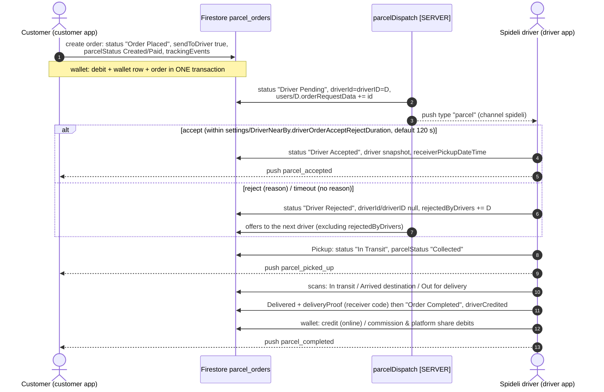
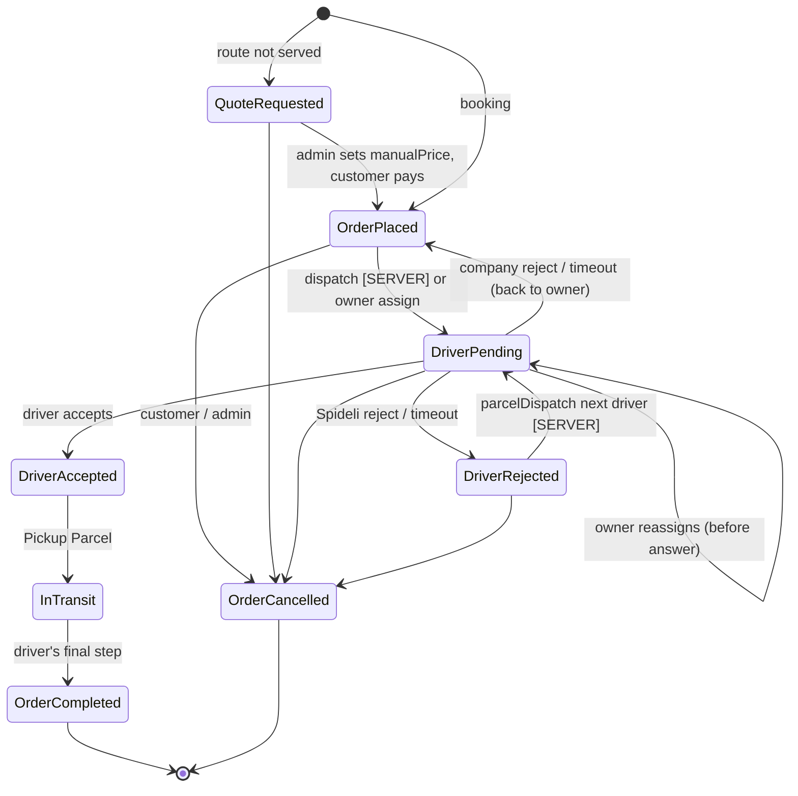

# Spideli Parcel Service: End-to-End Flow and Database Flow

**Audience:** the client, the web / admin-panel team, the Cloud Functions team, app developers.
**Code baseline:** branch `feature/restaurant-app-panel-parity`, HEAD `0d1f8a3` (13 Oct 2026).
**Scope:** the parcel / mail service in the **customer** app (`customer/`) and the **driver** app (`driver/`, which also hosts the **company owner** screens).

> Everything here was checked against the current code. Where a contract in `.claude/` says something different, the code wins and the difference is listed in [section 11](#11-where-the-code-and-the-contracts-disagree).
>
> Labels used in this document:
> - **[APP]**: done by the customer or driver app in this repository.
> - **[SERVER]**: done by a Cloud Function or server trigger. That code is **not** in this repository.
> - **[ADMIN]**: configured or written by the admin panel or website.

---

## Table of contents

1. [Overview](#1-overview)
2. [Admin prerequisites](#2-admin-prerequisites)
3. [Customer flow](#3-customer-flow)
4. [Normal Spideli driver flow](#4-normal-spideli-driver-flow)
5. [Company owner flow](#5-company-owner-flow)
6. [Company driver flow](#6-company-driver-flow)
7. [Database flow](#7-database-flow)
8. [Notifications](#8-notifications)
9. [Edge cases and rules](#9-edge-cases-and-rules)
10. [Testing checklist](#10-testing-checklist)
11. [Where the code and the contracts disagree](#11-where-the-code-and-the-contracts-disagree)
12. [Source files](#12-source-files)

---

## 1. Overview

### 1.1 The four roles

| Role | App | Account (`users/{uid}`) | What they do |
|---|---|---|---|
| **Customer** (sender) | Customer app | customer account | Books the parcel, picks **Spideli drivers** or a **delivery company**, pays, tracks it, may cancel before hand-over, and gives the receiver code to the receiver. |
| **Normal Spideli driver** (platform driver) | Driver app | `role: "driver"`, no `ownerId`, `isOwner` not true | Gets platform parcels: offers from the `parcelDispatch` Cloud Function, or picks them from the open **parcel search**. Picks up, delivers with the receiver code and is paid to their own wallet. |
| **Company owner** (fleet owner) | Driver app (owner dashboard) | `isOwner: true`, `driverType: "company"` (older: `isCompany: true`), `carrierId` = its `delivery_carriers` document | Gets every parcel booked with its company, assigns it to one of its drivers, reassigns returned parcels, edits its carrier prices, and manages driver cash and reports. Never delivers. |
| **Company driver** | Driver app | `role: "driver"`, `ownerId` = the company owner's uid, `isOwner: false` | Sees a company parcel **only** when the owner assigns it. Accepts or rejects within the countdown, then picks up and delivers like any driver. Earnings go to the **company's** wallet, and cash collected goes to the company cash ledger. |

> A company driver is still a driver. Platform (non-carrier) parcels are not hidden from them, so they can also take Spideli parcels from the parcel search or from a Cloud Function offer, if the function offers to them. The earnings for those parcels also go to the company wallet.

### 1.2 Summary

1. The customer fills in the booking form and enters the parcel weight. The weight picks the price band automatically.
2. The app shows the options:
   - **Spideli drivers**, the platform, for **Same city** only.
   - Every **delivery company** (carrier) that serves any region the sender's address is in, priced in that region.
3. **Spideli option:** the order is written `Order Placed` with `sendToDriver: true`. The **`parcelDispatch` Cloud Function [SERVER]** offers it to nearby platform drivers one at a time (`Driver Pending`). A reject or timeout writes `Driver Rejected`, and the function offers it to the next driver.
4. **Company option:** the order is written `Order Placed`, **unassigned** (`sendToDriver: false`, `driverId: null`), with `carrierId` and `carrierOwnerId`.
   - The **company owner** gets a push and assigns a driver (`Driver Pending`, `assignedBy` = owner).
   - The driver accepts, or rejects / times out. A reject or timeout returns the parcel to the **owner** (`Order Placed`), never to the public dispatch.
5. Pickup gives `In Transit` / `Collected`. Intermediate scans follow. Delivery needs the **receiver code** (`pickupCode`), and completion gives `Order Completed`, the wallet credit and the commission.

### 1.3 Flow (a): Spideli-driver parcel



ASCII fallback:

```
Customer ──(Order Placed, sendToDriver:true)──► parcel_orders
                                                   │
                         [SERVER] parcelDispatch ──┤ Driver Pending (driverId = D) + push "parcel"
                                                   │
          ┌──────────── Spideli driver D ──────────┴──────────────┐
          │ Accept → Driver Accepted (push parcel_accepted)        │
          │ Reject/Timeout → Driver Rejected → [SERVER] next driver│
          └───────────────────────────┬───────────────────────────┘
                                      ▼
   Pickup → In Transit / Collected → (In transit → Arrived destination → Out for delivery)
                                      ▼
   Delivered (receiver code) → Order Completed → wallet credit / commission → parcel_completed
```

### 1.4 Flow (b): company (carrier) parcel

```mermaid
sequenceDiagram
    autonumber
    actor C as Customer
    participant DB as Firestore parcel_orders
    actor O as Company owner (driver app)
    actor CD as Company driver (driver app)
    C->>DB: create order: "Order Placed", sendToDriver false, driverId/driverID null,<br/>carrierId, carrierOwnerId, companyOwnerId
    C-->>O: push carrier_parcel_order ({customerName}, {trackingNumber}) on driver_jobs
    Note over DB: parcelDispatch [SERVER] MUST skip (carrierId / carrierOwnerId set)
    O->>DB: TRANSACTION: "Driver Pending", driverId=driverID=CD, assignedBy=O,<br/>assignedAt=dispatchedAt=server time, users/CD.orderRequestData += id
    O-->>CD: push carrier_parcel_assigned (offer data → popup with countdown)
    alt accept
        CD->>DB: "Driver Accepted", driver snapshot
        CD-->>C: push parcel_accepted
    else reject / timeout
        CD->>DB: "Order Placed", sendToDriver false, driverId/driverID null, rejectedByDrivers += CD
        CD-->>O: push carrier_parcel_returned ({driverName}, {trackingNumber})
        O->>DB: assigns again (same driver allowed; marked "Rejected this order before")
    end
    CD->>DB: Pickup: "In Transit" / "Collected"
    CD-->>C: parcel_picked_up
    CD-->>O: carrier_parcel_picked_up
    CD->>DB: scans … Delivered (receiver code) → "Order Completed"
    CD->>DB: company wallet: credit (online) / commission + platform share (cash)<br/>company_cash_ledger "collection" (cash)
    CD-->>C: parcel_completed
    CD-->>O: carrier_parcel_delivered (+ company_cash_collected when cash)
```

ASCII fallback:

```
Customer ──(Order Placed, unassigned, carrierId, carrierOwnerId)──► parcel_orders
     └── push carrier_parcel_order ──► Company OWNER
                                         │  Orders > Parcel > "Pending" tab > Assign Driver
                                         ▼
                     Driver Pending (driverId = CD, assignedBy = owner)
                     └── push carrier_parcel_assigned ──► Company DRIVER (popup + countdown)
                                         │
              ┌──────── Accept ──────────┴──────── Reject / Timeout ───────┐
              ▼                                                            ▼
      Driver Accepted                                     Order Placed (back to OWNER)
      (parcel_accepted → customer)                        push carrier_parcel_returned
              ▼                                           owner assigns again
   Pickup → Collected (owner: carrier_parcel_picked_up)
              ▼
   … → Delivered (receiver code) → Order Completed
   (owner: carrier_parcel_delivered; cash: company_cash_collected + ledger row)
```

### 1.5 Order status lifecycle (`parcel_orders.status`)



`QuoteRequested` stands for `Quote Requested`, `OrderPlaced` for `Order Placed`, and so on (exact strings in [section 7.3](#73-state-table)).

---

## 2. Admin prerequisites

Everything in this section is **[ADMIN]**. The apps never write these documents, except where noted (carrier settings).

### 2.1 Region parcel pricing: `regions/{regionId}`

| Field | Type | Used for | Missing |
|---|---|---|---|
| `parcelPricing.volumetricDivisor` | number | volumetric weight (L x W x H / divisor) when the carrier sets none | no divisor, so the size is ignored |
| `parcelPricing.homePickupCharge` | number | pickup at the sender's door | 0 |
| `parcelPricing.pointDropoffCharge` | number | sender drops at a pickup point | 0 |
| `parcelPricing.homeDeliveryCharge` | number | delivery to the receiver's door | 0 |
| `parcelPricing.pointCollectionCharge` | number | receiver collects at a pickup point | 0 |
| `parcelPricing.intercityFixedTax` | number | fixed charge for **Other city** | 0 |
| `parcelPricing.intercountryFixedTax` | number | fixed charge for **Other country** | 0 |
| `parcelSmsFee` | number or numeric text | receiver-SMS fee (0 = free) | **50** |
| currency (through the region's currency record) | | every amount of the order, never converted | |

> **Not used any more:** `settings/ParcelPricing.intercityTax` / `volumetricDivisor`. Only **`settings/ParcelPricing.commissionAsExtra`** is still read.

### 2.2 Weight bands: `parcel_weight/{id}` (Admin > Parcel Weight)

| Field | Type | Notes |
|---|---|---|
| `title` | string | shown as "Price band: <title>" under the weight field |
| `delivery_charge` | **string** (numeric) | price **per distance unit** (km or mile, per `Constant.distanceType`) for the Spideli option |
| `minKg` / `maxKg` (also read: `min_kg` / `max_kg`) | number | `minKg <= kg <= maxKg`; `maxKg` empty means no upper limit. A weight in a gap between bands takes the next band up; a weight above every band takes the heaviest band. |

Without any `minKg` / `maxKg` the app falls back to **title matching**: the lightest band whose title number covers the weight, for example "Upto 5 kg". Please save every band with `minKg` / `maxKg`.

If the bands do not cover the weight (no band found) on **Same city**, the customer sees *"No price is set for this weight. Please contact support."* and cannot continue.

### 2.3 Delivery companies: `delivery_carriers/{carrierId}`

| Field | Type | Who edits | Meaning |
|---|---|---|---|
| `name` | string | admin, owner | must be non-empty or the carrier is ignored |
| `photo` | url | admin | logo on the selection card |
| `publish` | bool | **admin only** | `false` hides the carrier |
| `isVerified` | bool | **admin only** | an explicit `false` hides the carrier |
| `regionIds` | string[] | **admin only** | regions served. Empty means everywhere. |
| `regionPricing.<regionId>` | map | admin, owner | `baseCharge`, `perKmCharge`, `perKgCharge`, `minimumCharge`, `volumetricDivisor`, `homePickupCharge`, `pointDropoffCharge`, `homeDeliveryCharge`, `pointCollectionCharge` (number or null; null = region default) |
| `baseCharge`, `perKmCharge`, `perKgCharge`, `minimumCharge` (flat) | number | admin, owner | fallback when there is no `regionPricing` entry for the region (mirror of the first region) |
| `deliveryScopes` | string[] | admin, owner | `city` / `intercity` / `intercountry`. Missing or empty means all three. |
| `maxWeight` | number | admin, owner | carrier hidden when the chargeable kg is higher |
| `minDeliveryTime`, `maxDeliveryTime`, `deliveryTimeUnit` | number, number, `hours`/`days` | admin, owner | "Estimated time" on the card |
| `conditions` | string | admin, owner | shown as "Carrier conditions" |
| `rating` (or `reviewsSum` / `reviewsCount`) | number | admin / system | star badge |
| `ownerId` | uid | **admin only** | the company owner (binding of 9 Oct) |
| `code`, `operatingLicence*`, `commercialRegister*`, `uniqueIdNumber*` | | **admin only** | documents |

**The owner link (both sides, written by the admin):**

```
users/{companyOwnerUid}.carrierId   = "<carrierId>"        ← the app's ONLY lookup (driver app)
delivery_carriers/{carrierId}.ownerId = "<companyOwnerUid>" ← fallback for the customer app
```

- At checkout the customer app looks up `users` where `carrierId == <carrierId>`, then `deliveryCarrierId == <carrierId>`, and keeps the first **company account** (`isOwner: true`, or `driverType: "company"`, or `isCompany: true`). Otherwise it uses `delivery_carriers.ownerId`. The result is written as `carrierOwnerId` and `companyOwnerId`.
- Please write `carrierId`, not the old `deliveryCarrierId`.
- **The apps never create a carrier or link one.** An owner without `carrierId` sees *"Your carrier has not been set up yet — please contact Spideli."* in Carrier settings.

### 2.4 Company drivers

| Field on `users/{driverUid}` | Value |
|---|---|
| `role` | `"driver"` |
| `ownerId` | the company owner's uid |
| `isOwner` | **`false`, written explicitly.** The owner's driver list queries `isOwner == false`, so a driver without the field is not listed. |
| `active` | not `false` (an admin-disabled driver cannot be assigned) |
| `serviceTypes` | must contain **`parcel_delivery`** (older: `parcel-service`). Without it the driver app does not open the parcel-offer listener; only the push would show the offer. |
| `sectionIds` | the parcel section, so the owner can filter and the parcel search works |
| `isActive` | online switch (assign list shows Online / Offline; online drivers first) |
| `fcmToken` | needed for the `carrier_parcel_assigned` push |

Drivers created by the owner in the app (`driver_create_controller.dart`) get `isOwner: false`, `ownerId` = owner and `driverType: "individual"`.

### 2.5 `settings/*` documents read by the parcel flow

| Document.field | Used by | Default |
|---|---|---|
| `settings/DriverNearBy.driverOrderAcceptRejectDuration` | offer countdown (seconds) | **120** |
| `settings/DriverNearBy.minimumDepositToRideAccept` | independent driver wallet minimum to accept | 0 |
| `settings/DriverNearBy.ownerMinimumDepositToRideAccept` | company wallet minimum for its drivers to accept | 0 |
| `settings/DriverNearBy.parcelRadius` | parcel search radius (km) | 50 |
| `settings/DriverNearBy.singleOrderReceive` | read by the dispatch [SERVER] | false |
| `settings/ParcelPricing.commissionAsExtra` | add the admin commission to the carrier price | false |
| `settings/SMSGateway.isEnabled` | offer "Notify receiver via SMS" | off |
| `settings/cancellationReasons.<role>` | reason lists (customer / driver) | app defaults |
| `settings/globalSettings.order_ringtone_url` | job channel ringtone (`driver_jobs_rt_<key>`) | none |
| `settings/Version.websiteUrl` | receipt QR = `<websiteUrl>/track-parcel/<orderId>` | `spideli:parcel:<id>` |
| section document: `adminCommision {isEnabled, commissionType, amount}`, `platformFee {enable, …}` | commission, platform fee | |

### 2.6 Pickup points: `pickup_points/{id}`

`publish: true`, `regionId` (or `regionIds`), `name`, `quarter`, `town`/`city`, `location`, `openingHours`, `phone`. Only **published points of the order's region** are offered: the sender's region for drop-off, the receiver's region for collection.

> **Pickup-point operators (out of the apps):** recording `At origin pickup point` and the receiver's collection at the destination point (`Delivered`) is **[ADMIN / website]**. The driver app only waits for the first and stops at `At destination pickup point`.

### 2.7 `dynamic_notification` templates

Shape: `{type, subject, message, service_type: "Parcel Delivery Service"}`. Placeholders are `{name}`, case-insensitive. Status checked in Firestore on 13 Oct 2026: **every type in this table is live** (the ten missing ones were created the same day; edit the wording in the admin panel, keep the placeholder names):

| `type` | Recipient | Status | Placeholders the app fills |
|---|---|---|---|
| `carrier_parcel_order` | company owner | **live** (doc `q74bfr6cSZlG79KgScBe`) | `{customerName}`, `{trackingNumber}` |
| `carrier_parcel_assigned` | company driver | **live** (doc `4Zswp3kR2NUrc5hi7zaC`) | `{companyName}`, `{trackingNumber}`, `{driverName}` |
| `carrier_parcel_returned` | company owner | **live** (doc `40LhUj6tAsplut5xw85X`) | `{driverName}`, `{trackingNumber}`, `{companyName}` |
| `parcel_accepted` | customer | existing (older) | none |
| `parcel_completed` | customer | existing (older) | none |
| `parcel_rejected` | (customer) | existing (older) | **not sent by any app code today** |
| `parcel_picked_up` | customer | **live** (13 Oct) | none (data carries `parcelStatus`) |
| `parcel_in_transit` | customer | **live** (13 Oct) | none |
| `parcel_arrived_destination` | customer | **live** (13 Oct) | none |
| `carrier_parcel_picked_up` | company owner | **live** (13 Oct) | **none: the app passes no placeholder values**, so write plain text |
| `carrier_parcel_delivered` | company owner | **live** (13 Oct) | **none** (plain text) |
| `company_cash_collected` | company owner | **live** (13 Oct) | `{driverName}`, `{amount}`, `{orderId}`, `{companyName}` |
| `company_cash_settlement_submitted` | company owner | **live** (13 Oct) | `{driverName}`, `{amount}`, `{reference}`, `{companyName}` |
| `company_cash_settlement_confirmed` | company driver | **live** (13 Oct) | `{driverName}`, `{amount}`, `{reference}`, `{companyName}` |
| `company_cash_settlement_rejected` | company driver | **live** (13 Oct) | the same + `{reason}` |
| `company_cash_adjustment` | company driver | **live** (13 Oct) | the same + `{signedAmount}`, `{reason}` |

**What happens when a template is missing:**
- **Driver app sender:** nothing is sent and nothing is recorded (only logged).
- **Customer app sender** (only `carrier_parcel_order` in this flow): the push is still sent, with the fallback text *"setup notification" / "Notification setup is pending"*.

Email: `email_templates` type **`new_parcel_book`** is sent to the customer after a new booking (placeholders `{passengername}`, `{parcelid}`, `{date}`, `{sendername}`, `{senderphone}`, `{note}`, `{deliverydate}`, subject `{orderid}`).

### 2.8 SMS to the receiver [SERVER]

- **App side:** the customer app writes `sendReceiverSms`, `smsCharge`, `receiverName`, `receiverPhone` (national digits), `receiverCountryCode` (`+237`) and `smsOptOut: false` at creation. The fee is `regions/{regionId}.parcelSmsFee` (default 50). The option shows only when `settings/SMSGateway.isEnabled == true`.
- **Server side:** a trigger on `parcel_orders` (create **and** update) sends the SMS. It owns `smsSent.<event>`, `sms_log`, the wording (`settings/SMSGateway.templates`) and the events (`placed`, `atPickupPoint`, `delivered`).
- No app sends SMS or writes `smsSent`. See `.claude/PARCEL-SMS-CONTRACT.md`.

### 2.9 Cloud Function requirements [SERVER] (`parcelDispatch`, not in this repo)

| # | Requirement | Why |
|---|---|---|
| 1 | Trigger on `parcel_orders` `Order Placed` and `Driver Rejected`. Pick a driver (radius, zone, `serviceTypes` contains `parcel_delivery`, online `isActive`, not `isOwner`, not in `rejectedByDrivers`, wallet minimum, `singleOrderReceive`). Write `status: "Driver Pending"`, `driverId` = `driverID` = driver, and `users/{driver}.orderRequestData` arrayUnion id. Push `{type: "parcel", orderId, id, click_action: "FLUTTER_NOTIFICATION_CLICK", status: "Driver Pending"}` on channel `spideli`, or `driver_jobs_rt_<key>` with a ringtone. | Spideli dispatch |
| 2 | **SKIP every parcel with a non-empty `carrierId` or `carrierOwnerId`**: on `Order Placed`, on `Driver Rejected`, and after a company driver hands one back to `Order Placed`. | company parcels are assigned by the owner. Until the function skips them, the driver app bounces such an offer back to the owner unseen (extra round trip, extra `carrier_parcel_returned` push). |
| 3 | Respect `sendToDriver: false` and scheduled parcels (`isSchedule: true`, `senderPickupDateTime` in the future). | the app writes `sendToDriver: false` for scheduled and carrier parcels |
| 4 | Do not dispatch `Quote Requested`. | unpaid |
| 5 | Write `dispatchedAt` (server time) on every `Driver Pending`. A re-offer means a new `dispatchedAt` and a new push. | the app's countdown start |
| 6 | Check the status in a transaction before writing `Driver Pending`. | do not overwrite a cancel |
| 7 | Server-side timeout: treat an offer older than `driverOrderAcceptRejectDuration` as rejected. | the app times out only while it is running |
| 8 | Auto-cancel (`orderAutoCancelDuration`) with the reason fields (`cancelledBy: "admin"`/`"system"`, `cancelReason`, `cancelReasonCode`, `cancelAction`, `cancelledAt`). **Decide whether carrier parcels are excluded.** | customer sees why |
| 9 | Push text from `dynamic_notification` templates. | no fixed text |

---

## 3. Customer flow

Files: `customer/lib/screen_ui/parcel_service/book_parcel_screen.dart`, `controllers/book_parcel_controller.dart`, `parcel_carrier_selection_screen.dart`, `controllers/parcel_order_confirmation_controller.dart`, `service/parcel_shipping_service.dart`, `utils/parcel_pricing.dart`, `models/parcel_shipping_models.dart`.

### 3.1 Booking form ("Book Your Document Delivery")

The form has four steps: **Shipment**, **Sender**, **Receiver**, **Parcel**.

| Section | Fields | Rules |
|---|---|---|
| What are you sending? | **Parcel** / **Mail** (`shipmentType`) | |
| Where to? | **Same city** / **Other city** / **Other country** (`scope` = `city` / `intercity` / `intercountry`) | Other city with the same city gives *"Sender and receiver are in the same city: choose Same city"*. Other city with a different country gives *"choose Other country"*. Other country with the same country gives *"choose Other city"*. City names compare trimmed, lower-case, without accents. |
| Sender information | location (GPS prefilled), name, mobile (+ country code), email (optional), city / country (auto-filled, editable), notes | all required except email and notes |
| Receiver information | the same | the receiver's mobile is **required** with its country code (6+ digits, at most 15 with the code). Same city: the receiver must be inside a service zone. |
| **Parcel details** | **"Weight in kg"** (required), L / W / H (cm, all three or none), declared value (optional), content description | **ONE weight field.** It picks the price band automatically and shows **"Price band: <band title>"** under it (Same city). Before a weight is typed: *"Enter the parcel weight in kg. It sets the price."* The sender's band dropdown was removed on 13 Oct 2026. |
| Pickup method | **Home pickup** / **Drop-off at a pickup point** (`pickupMethod` = `home` / `pickup_point`) | a point must be chosen, published, in the sender's region |
| Delivery method | **Home delivery** / **Collection at a pickup point** (`deliveryMethod`) | receiver address first; a point in the receiver's region |
| Select delivery type | **As soon as possible** / **Scheduled** (date + time) | scheduled orders get `sendToDriver: false` |
| Upload parcel image | optional images (uploaded at checkout to Storage, URLs in `parcelImages`) | |

Validation messages include *"Please enter the parcel weight"* and *"No price is set for this weight. Please contact support."* (Same city with no band). Same city also needs a road distance of at least 0.5 (*"…should be more than 1 km."*).

### 3.2 Price calculation (tap **Continue**)

**Step 0: the order's candidate regions** (`ParcelPricing.orderRegionCandidates`), in order of preference:

1. Every existing region of the published **zones that contain the sender** (a zone often serves a country region and a city region, for example Cameroun + Yaounde-Cameroun).
2. Otherwise the published regions of the sender's country.
3. Otherwise the customer's own region.

The customer's own region comes first when it is a candidate, then the most specific region (served by the fewest zones). The first candidate is the **primary region R**, used for the Spideli option, the pickup points and the currency.

**Distance:**
- **Same city:** road route (Google Directions or OSRM), in the app's distance unit.
- **Other city / country:** straight line between the two addresses. Carriers' `perKmCharge` is always per **km**.

**Step 1: weights**

```
divisor        = carrier.regionPricing[Rc].volumetricDivisor (>0) else regions[R].parcelPricing.volumetricDivisor (>0) else none
volumetricKg   = L × W × H / divisor   (2 decimals; 0 without divisor or without all three sides)
chargeableKg   = max(weightKg, volumetricKg)   (2 decimals)
```

**Step 2a: Spideli option** (`source: "default"`, **Same city only**):

```
band          = parcel_weight band containing chargeableKg (minKg ≤ kg ≤ maxKg; gap → next band up)
carrierPrice  = distance × band.delivery_charge
```

**Step 2b: each carrier** (`source: "rate_card"`). The carrier is offered when **all** of these hold:

- `publish != false` and `isVerified != false`.
- `regionIds` is empty, **or one of the candidate regions is in `regionIds`**. The carrier is then priced in **Rc**, the first candidate it serves.
- `scope` is in `deliveryScopes` (missing or empty means all).
- `maxWeight` is unset or `>= chargeableKg`.
- The card gives a price above 0.

```
card          = regionPricing[Rc] else flat fields
carrierPrice  = max(minimumCharge, baseCharge + perKmCharge × km + perKgCharge × chargeableKg)   (2 decimals)
commission    = only if settings/ParcelPricing.commissionAsExtra && section commission enabled:
                sections/{id}.adminCommision.commissionType decides -
                Percent → amount % of carrierPrice ONLY (the delivery company's base price;
                never options, fixedTax, SMS or taxes); Fixed → amount      (ParcelPricing.withExtraCommission)
```

**Step 3: options and fixed tax**

```
pickupCharge   = home → homePickupCharge     | pickup_point → pointDropoffCharge
deliveryCharge = home → homeDeliveryCharge   | pickup_point → pointCollectionCharge
                 (carrier's regionPricing[Rc] value if set, 0 = free; else regions[Rc].parcelPricing; else 0)
fixedTax       = regions[Rc].parcelPricing.intercityFixedTax / intercountryFixedTax (city: 0) — never the carrier's
```

**Step 4: what is shown on the selection card** (`ParcelQuote.total`):

```
quote.total = carrierPrice + options + fixedTax + commission
```

**Step 5: checkout total** (`ParcelOrderConfirmationController.calculatePrice`):

```
subTotal        = carrierPrice (+ commission when charged as extra)        → parcel_orders.subTotal (string)
discount        = coupon on subTotal
orderTax        = Σ taxSetting on (subTotal − discount − commission charged as extra), never below 0
                  (ParcelPricing.taxableAmount; no tax is charged on that commission)
platformFee     = section platform fee, ONLY while platformFee.enable is true
platformTax     = Σ platformTax on platformFee (only when platformFee > 0)
TOTAL           = subTotal − discount + orderTax + platformFee + platformTax
                  + fixedTax (parcelScopeTax) + options + smsCharge (when ticked)
                → priceBreakdown.total  (what wallet / gateway / cash charges)
```

VAT, coupons, commission and the driver's credit never apply to `fixedTax`, `options` or `smsCharge`. VAT never applies to the commission charged as an extra (`priceBreakdown.commission`): every reader that recomputes the order taxes (customer `ParcelAmounts`, driver `ParcelAmounts`, `_updateWalletAmount`, the driver's order details, wallet rows and the company owner's earnings) takes it out of the taxed amount the same way. An order placed before 14 Oct 2026 was taxed on that commission: when its `priceBreakdown.total` is exactly that total, `ParcelAmounts` keeps those lines, so it still reads as charged.

**Worked example A: company parcel, Other city** (currency of region Yaounde-Cameroun, XAF):

| Input | Value |
|---|---|
| Carrier `regionPricing["yaounde-cm"]` | base 1,000 · perKm 500 · perKg 600 · minimum 2,000 · divisor 5,000 · homePickupCharge **null** · homeDeliveryCharge **0** |
| Region `parcelPricing` | homePickupCharge 500 · intercityFixedTax 5,000 |
| Straight-line distance | 240.5 km |
| Weight / size | 2 kg, 40 x 30 x 20 cm, so volumetric 24,000 / 5,000 = **4.8 kg**, chargeable **4.8 kg** |
| Commission | section 10 % (Percent), `commissionAsExtra` false |
| Taxes / platform fee | none / disabled |
| SMS | ticked, region fee 50 |

```
carrierPrice   = 1,000 + 500 × 240.5 + 600 × 4.8  = 1,000 + 120,250 + 2,880 = 124,130
pickupCharge   = carrier null → region 500 ;  deliveryCharge = carrier 0 (free)  → options = 500
fixedTax       = 5,000
card total     = 124,130 + 500 + 5,000 = 129,630
checkout TOTAL = 124,130 − 0 + 0 + 0 + 0 + 5,000 + 500 + 50 = 129,680
```

**Worked example B: Spideli parcel, Same city:** 6.4 km, 3 kg, band "1-5 kg" (`minKg` 1, `maxKg` 5, `delivery_charge` "200"), region homePickupCharge 300 and homeDeliveryCharge 200, VAT 19.25 %, platform fee 100 enabled with 19.25 % tax, SMS 50.

```
carrierPrice = 6.4 × 200 = 1,280      options = 500      fixedTax = 0
orderTax     = 1,280 × 19.25 % = 246.40
platformTax  = 100 × 19.25 % = 19.25
TOTAL        = 1,280 + 246.40 + 100 + 19.25 + 0 + 500 + 50 = 2,195.65
```

### 3.3 Choosing Spideli drivers or a company ("Choose a carrier")

- **Options:** first **"Spideli drivers" – "Standard same-city delivery"** (Same city only), then the eligible carriers, **cheapest first**.
- **Each card shows:** logo, name, estimated time, rating, and the total in **its own region's currency**. Under the cards: the breakdown and the carrier's conditions.
- **Same city, home to home, and the only option is Spideli:** the selection screen is skipped and checkout opens directly.
- **No option at all** (for example Other city with no carrier serving it): the screen shows **"Route not served"** and a **"Request a quote"** button. That creates a `Quote Requested` order with no carrier; the admin sets `manualPrice`, and the customer later pays it from My Bookings.
- **The chosen option fixes:**
  - `regionId` (Rc for a carrier, R for Spideli), and with it the currency, the payment methods, the SMS fee and the receipt;
  - `carrierId`, `carrierName` and `carrierOwnerId` (initially `delivery_carriers.ownerId`).

### 3.4 Checkout and payment

1. **Who pays.**
   - **"Receiver"** (cash on delivery by the receiver) is offered only for **Same city** without pickup points.
   - **Other city / country**, a pickup-point leg, or a quote payment means **"Sender"** pays.
   - Cash (`cod`) is refused when either leg uses a pickup point.
2. **Payment methods.** Wallet, Stripe, PayPal, Razorpay, Paystack, Flutterwave, Mercado Pago, PayFast, Paytm, Midtrans, Orange Money, Xendit and Cash, filtered for the order's region.
3. **Coupon.** From `parcel_coupons`.
4. **"Notify receiver via SMS"** (`(+50 FCFA)` or `(Free)`). Shown when the SMS gateway is enabled, it is not a quote request, and the receiver phone and country code are present.
5. **Place order** (`placeOrder`):
   - **Images.** Uploaded to Storage; the URLs go to `parcelImages`.
   - **Price fields.** `discount`, `discountType`, `discountLabel`, `platformFee` ("0.0" when disabled) and `platformTax` (`[]` when disabled).
   - **Commission.**
     - If `priceBreakdown.commission > 0` (commission charged as extra): `adminCommission` = that amount and `adminCommissionType = "Fixed"`.
     - Otherwise: the section's `adminCommision.amount` and `commissionType`.
   - **Status.** `Order Placed`, or `Quote Requested` for a quote request.
   - **Company parcel.** `sendToDriver = false`, `driverId = null`, no `driver`. **`carrierOwnerId` is resolved again** from `users.carrierId`, else `delivery_carriers.ownerId`.
   - **Payment fields.** `payment_method` (`"cod"` when the receiver pays, `""` for a quote request) and `paymentCollectByReceiver`.
   - **Zones and region.** `senderZoneId`, `receiverZoneId`; `regionId` if not already set.
   - **SMS.** `sendReceiverSms` and `smsCharge` (0 when not ticked).
   - **Shipping codes.** `trackingNumber` = `SPD-yyMMdd-XXXXXX` (unique), `qrValue` = `<websiteUrl>/track-parcel/<id>` (else `spideli:parcel:<id>`), and **`pickupCode`** = a 6-digit random number. This is the **receiver code** the driver asks for at delivery.
   - **`priceBreakdown`.** From the chosen quote, with `total` = the checkout TOTAL and `smsCharge` and `currency` added.
   - **First tracking events** (`role: "customer"`):

     | Case | Events (`parcelStatus` = the last one) |
     |---|---|
     | Cash / receiver pays | `Created` |
     | Paid now (wallet or gateway) | `Created`, `Paid` |
     | Pickup method = pickup point | `Created`, `Waiting drop-off` (with `pickupPointId` = the origin point, note `Paid` when paid) |
     | Quote request | `Created` (note `Quote requested`) |

6. **Wallet: all or nothing.** One Firestore transaction (`FireStoreUtils.payFromWallet`):
   1. re-reads `users/{uid}.wallet_amount` and refuses if it is too low;
   2. writes the new `wallet_amount`;
   3. writes the `wallet/{txId}` row (`note: "Parcel Amount debited"`, `isTopUp: false`);
   4. writes the order and its events.

   If the balance is too low or the device is offline, nothing is written and the screen stays for a retry (*"Payment failed. No money was taken from your wallet…"*).
7. **Other gateways.** The gateway charges first, **then** `placeOrder` saves the order (a known-fields `set`). This is not atomic (see [section 9](#9-edge-cases-and-rules)).
8. **After the save:**
   - `users/{uid}.regionIds` += `regionId`;
   - **company parcel:** push **`carrier_parcel_order`** to `users/{carrierOwnerId}.fcmToken`;
   - the success screen;
   - the **`new_parcel_book`** email.

### 3.5 What the customer sees (My Bookings, order details, tracking)

| `status` | My Bookings tab | Chip / details label |
|---|---|---|
| `Quote Requested` | New | "Waiting for a quote", then "Quote ready - pay to confirm" once `manualPrice` is set |
| `Order Placed` | New | the tracking status once it moved past Created / Paid, else "Order Placed" |
| `Driver Pending`, `Driver Rejected` | New | **"Looking for a driver"** (never "Rejected") |
| `Driver Accepted`, `Order Shipped`, `In Transit` (and `Order Accepted`) | In transit | `parcelStatus` (`Collected`, `In transit`, `Arrived destination`, `Out for delivery`, …) |
| `Order Completed` | Completed | `Delivered` |
| `Order Cancelled`, `Order Rejected` | Cancelled | "Cancelled by Customer / Admin · <reason>" |

- **Driver details.** The driver is shown only once a driver **accepted**: never at `Order Placed`, `Driver Pending`, `Driver Rejected` or `Quote Requested`.
- **Tracking screen ("Track a parcel").** Look up by tracking number (`SPD-…`), QR scan, or order id. It shows:
  - the current status (`parcelStatus` else `status`);
  - "Carrier: <carrierName>";
  - the collection point;
  - the **tracking history** (`trackingEvents`) and a map of the events that carry `lat` / `lng`;
  - "Receipt (PDF)".
- **Receiver code.** The order details show the **receiver code** (`pickupCode`) with a copy button. The PDF receipt prints *"Receiver code (give to the driver or at the pickup point)"* and the QR.

### 3.6 Cancellation and refunds

- **Allowed** (`ParcelCancellation.canCancel`):
  - `status` is `Order Placed`, `Quote Requested`, `Driver Pending` or `Driver Rejected`, **and**
  - the parcel is still with the sender: `parcelStatus` is empty, `Created`, `Paid` or `Waiting drop-off`.
  - Once a driver accepted, the customer cannot cancel (*"A driver has already accepted this parcel"*).
- **Reason.** Mandatory (`settings/cancellationReasons.customer`; "Other" needs at least 3 characters of text).
- **Write.** One transaction on the live order:

  ```json
  {
    "status": "Order Cancelled",
    "driverId": null, "driverID": null,            // only from Order Placed / Driver Pending / Driver Rejected / Quote Requested
    "cancelReason": "Changed my plans", "cancelReasonCode": "Changed my plans",
    "cancelledBy": "customer", "cancelledByName": "…", "cancelledAt": "<server time>", "cancelAction": "cancelled",
    "parcelStatus": "Cancelled",
    "trackingEvents": "arrayUnion({status: Cancelled, at, by: <customer>, role: customer})"
  }
  ```

- **Refund** (after the transaction, as separate writes):
  - **Paid online only:** not cash (`cod`), not receiver-pays, not an unpaid quote.
  - **Amount:** `ParcelAmounts.total`, **minus `smsCharge` if the server already sent an SMS** (`smsSent` holds a `true` or timestamp value).
  - **Writes:** `wallet/{id}` (`isTopUp: true`, note *"Refund for cancelled parcel order"*), then `users/{uid}.wallet_amount` += refund.

---

## 4. Normal Spideli driver flow

Files: `driver/lib/services/incoming_offer_service.dart`, `dispatch_offer_rules.dart`, `dispatch_offer_service.dart`, `controllers/parcel_search_controller.dart`, `controllers/parcel_home_controller.dart`, `services/parcel_tracking_service.dart`, `services/parcel_flow_rules.dart`, `utils/parcel_amounts.dart`.

### 4.1 How an offer arrives (Cloud Function dispatch)

**[SERVER] `parcelDispatch` writes:**

```jsonc
// parcel_orders/{id}
{ "status": "Driver Pending", "driverId": "<driver>", "driverID": "<driver>", "dispatchedAt": "<server time>"  /* requested */ }
// users/{driver}
{ "orderRequestData": "arrayUnion(<orderId>)" }
```

The function then sends the push `{type: "parcel", orderId, id, click_action: "FLUTTER_NOTIFICATION_CLICK", status: "Driver Pending"}` on channel `spideli`.

**The driver app finds the offer in two ways:**
1. **The push.** In the foreground the dialog opens over any screen. In the background or when closed, a tap opens it.
2. **Live listeners**, for drivers whose `serviceTypes` contain `parcel_delivery`:
   - a query `parcel_orders where status == "Driver Pending" && driverId == me`;
   - document listeners for every id in `orderRequestData`.

A **company owner account** (`isOwner: true`) never runs these listeners.

### 4.2 The offer popup and countdown

- **Content:**
  - pickup and drop addresses;
  - the **fare**: the total the customer was charged (`ParcelAmounts.total`, SMS fee included);
  - distance and weight;
  - the receiver's name (`receiverName`, else `receiver.name`);
  - **Accept**, **Reject** (reason sheet) and a countdown ring.
- **Window:** `settings/DriverNearBy.driverOrderAcceptRejectDuration` seconds (default **120**).
- **Start:** the earliest of:
  - the push send time (if no more than 10 s old on arrival);
  - `dispatchedAt` (or `driverDispatchedAt`, `lastDispatchedAt`, `dispatchTime`, `driverPendingAt`, `offeredAt`);
  - the first time this device saw the offer (kept in SharedPreferences).
- **Accept gates.** A blocked accept writes nothing. The gates are:
  - a freelance driver with documents still pending;
  - an independent driver whose `wallet_amount` is below `minimumDepositToRideAccept`;
  - a company driver whose company `wallet_amount` is below `ownerMinimumDepositToRideAccept`.

### 4.3 Accept, reject and timeout writes (each one a transaction on the live order)

| Action | Precondition | `parcel_orders/{id}` | `users/{me}` | Push |
|---|---|---|---|---|
| **Accept** | `Driver Pending` naming me, or open search (`Order Placed`, nobody named, not a carrier parcel) | `status: "Driver Accepted"`, `driverId` = `driverID` = me, `driver` = my profile snapshot, `receiverPickupDateTime` = now | `inProgressOrderID` arrayUnion id, `orderRequestData` arrayRemove id | **`parcel_accepted`** to the customer (data `{type: "parcel_order", orderId}`) |
| **Reject** (reason required) | `Driver Pending` naming me (or a hand assignment `Order Placed` naming me) | `status: "Driver Rejected"`, `driverId: null`, `driverID: null`, `rejectedByDrivers` arrayUnion me, `driverRejections` arrayUnion `{driverId, reason, code, at, afterAccept: false}` | `orderRequestData` arrayRemove | none |
| **Timeout** | still `Driver Pending` naming me | the same **without** `driverRejections` | `orderRequestData` arrayRemove | none |
| Late accept after the window | | treated as a timeout, never accepted late | | |

After `Driver Rejected` the **[SERVER]** function offers the parcel to the next driver, excluding `rejectedByDrivers`.

### 4.4 Parcel search (driver takes an open parcel)

The "Search parcel" screen takes source, destination and date. The query:

```
parcel_orders where sectionId in <driver.sectionIds> and status == "Order Placed"
              geo: sourcePoint within settings/DriverNearBy.parcelRadius km (default 50)
```

The results are then filtered in memory. A parcel is listed only if:
- `senderPickupDateTime` is on the searched day;
- `senderZoneId` or `receiverZoneId` is the driver's `zoneId`;
- the receiver is within the radius of the searched destination (if one was given);
- it **names nobody else**, the driver is **not in `rejectedByDrivers`**, and it is **not a carrier parcel** (`carrierId` / `carrierOwnerId` empty);
- the region rule passes: same city means the driver's region; other city / country means the origin **or** destination region.

**Accept** from the search requires verified documents and **online** (`isActive: true`). It uses the same accept transaction (`fromOpenSearch: true`); if another driver was offered the parcel meanwhile, the app says *"This order is no longer available."*

### 4.5 Pickup ("Pickup Parcel" button, guarded)

`ParcelTrackingService.onLegacyPickup`:

1. **Refused** if the pickup method is `pickup_point` and the sender has not dropped the parcel off yet (*"The sender has not dropped the parcel off at the origin pickup point yet."*).
2. **Transaction** (`ParcelPickupRules.pickupFields`): only if the order names me and `status` is `Driver Accepted` / `Order Shipped` (or already `In Transit`, which writes nothing), and `parcelStatus` is not `Cancelled` / `Returned`. It writes `status: "In Transit"`. Otherwise: *"This parcel can no longer be picked up."*
3. **Tracking.** `parcelStatus: "Collected"` (home pickup), or `"In transit"` when the parcel was at the origin point. The event is `{status, at, by: me, role: "driver", lat, lng}` (arrayUnion).
4. **Push.** Template **`parcel_picked_up`** to the customer. If the driver belongs to a company, the owner also gets **`carrier_parcel_picked_up`**.

### 4.6 In transit (scan steps)

**"Parcel run"** lists the driver's (and the fleet's) in-progress parcels; **Scan** reads the QR, tracking number or id. The next allowed steps (`nextActions`, never backwards):

| Current `parcelStatus` | Next allowed |
|---|---|
| `Created` / `Paid` (home pickup) | `Collected` |
| `Waiting drop-off` (point) | none (waiting for the pickup-point operator: `At origin pickup point` **[ADMIN / website]**) |
| `Collected` / `At origin pickup point` | `In transit` (+ final leg on Same city) |
| `In transit` | `Arrived destination` (+ final leg on Same city) |
| `Arrived destination` | final leg: `Out for delivery` (home) / `At destination pickup point` (point) |
| `Out for delivery` | `Delivered` (with proof) |

- **Each step writes** `parcelStatus` and a `trackingEvents` arrayUnion `{status, at, by, role: "driver", lat, lng, pickupPointId?}`. The first step after `Driver Accepted` also sets `status: "In Transit"`.
- **Customer pushes:** `In transit` sends `parcel_in_transit` and `Arrived destination` sends `parcel_arrived_destination` (data `{type: "parcel_order", orderId, parcelStatus}`).
- **Who may record what:** fleet members (owner or the company's drivers) may record intermediate hand-over scans. Only the **assigned driver** records the final step.

### 4.7 Delivery with the receiver code (POD)

**"Deliver Parcel" button** (or the `Delivered` scan step):
- **Same city, home to home, already picked up:** completes in one go.
- **Any other parcel:** only when the next scan step is the final one. Otherwise *"Scan the parcel to update its status"*.

**Proof** (`showParcelProofSheet`):
- **The order has a `pickupCode`** (every order placed by the current customer app): the driver **must type the code the receiver gives**. A wrong code gives *"Invalid code"*. A photo is **not** an alternative. Proof: `deliveryProof: {type: "otp", at, by}`.
- **Older orders without a code:** a photo, uploaded to `parcelDeliveryProof/<orderId>/…`. Proof: `deliveryProof: {type: "photo", photoUrl, at, by}`.
- **Delivery to a pickup point:** a confirmation dialog *"Hand over at the pickup point"*. The final step is `At destination pickup point`, and the receiver later collects with the same code at the point **[ADMIN / website]**.

**Write 1:** `parcelStatus: "Delivered"` (or `At destination pickup point`), plus `deliveryProof` and the tracking event.

### 4.8 Completion, wallet and commission (`completeOrder`)

1. **Claim, once per order** (transaction). Refused if `driverCredited == true`, or the order is completed, cancelled or rejected, or `parcelStatus` is `Cancelled` / `Returned`. Writes `{status: "Order Completed", driverCredited: true}`.
2. `users/{me}.inProgressOrderID` arrayRemove id.
3. **Wallet** (`_updateWalletAmount`). The wallet user is the **driver** (Spideli), or the **company owner** for a company driver. The amounts, with `ParcelAmounts` and `adminComm` = commission on (subTotal − discount):

   | Payment | Credit | Debits (each a `wallet` row + `wallet_amount` change) |
   |---|---|---|
   | Online (wallet, card, …) | `subTotal − discount + orderTax + options`, note *"Booking amount credited"* | commission, note *"Admin commission deducted"* |
   | Cash (`cod`) | nothing (the driver holds the cash = `ParcelAmounts.total`) | commission; *"Parcel fixed tax deducted"* (`parcelScopeTax`); *"Parcel receiver SMS fee deducted"* (`smsCharge`); *"Parcel platform fee deducted"* (platform fee + its taxes) |

   Both paths net the same amount: `courierNet = total − (platformFee + platformTax + fixedTax + smsCharge) − commission`.
4. **Pushes.** `parcel_completed` to the customer. If the driver has a company: `carrier_parcel_delivered` to the owner.
5. **Company cash.** For a company driver paid in cash: a `company_cash_ledger` row of type `collection` and the push `company_cash_collected` ([section 6](#6-company-driver-flow)).
6. **Referral.** On the customer's first parcel order, the referral amount is credited (`updateParcelReferralAmount`).

Example A paid online with a 10 % commission: credit 124,630 (124,130 + 500 options), commission debit 12,413, so the courier nets **112,217**. In cash the courier holds 129,680 and is debited 12,413 + 5,000 + 50, again **112,217**.

---

## 5. Company owner flow

Files: `driver/lib/app/owner_screen/owner_dashboard_screen.dart`, `owner_order_list.dart`, `controllers/owner_order_list_controller.dart`, `services/carrier_parcel_rules.dart`, `services/carrier_parcel_service.dart`, `app/owner_screen/carrier_settings_screen.dart`, `controllers/carrier_settings_controller.dart`, `models/delivery_carrier_model.dart`, `services/company_cash_service.dart`, `app/owner_screen/owner_cash_settlements_screen.dart`, `company_reports_screen.dart`.

### 5.1 New order push

- **Template:** **`carrier_parcel_order`**, sent by the customer app on the job channel `driver_jobs` (`driver_jobs_rt_<key>` with the ringtone).
- **Data:** `{type: "carrier_parcel_order", orderId, trackingNumber}`.
- **Text (live template):** *"New parcel order {trackingNumber}"* / *"{customerName} booked a parcel with your company. Tracking number: {trackingNumber}. Open Orders to assign a driver."*
- **Tap:** opens the owner's **Orders** page.
- No notification record is written for the owner; the Orders list is the record.

### 5.2 Orders page (owner dashboard > Orders > parcel section)

The parcel section appears when the owner has a `carrierId`, or `parcel_delivery` in `serviceTypes`, or the section in `sectionIds`.

**Query** (one-time fetch, refreshed by **Search** and after each assignment):

```
parcel_orders where carrierOwnerId == me
parcel_orders where companyOwnerId == me
parcel_orders where carrierId == users/{me}.carrierId
parcel_orders where driverId == <each company driver> orderBy createdAt desc
```

| Tab | Filter |
|---|---|
| All | everything above |
| **Pending** | waiting for the owner: `Order Placed` or `Driver Rejected`, no `driverId` |
| **Assigned** | `Driver Pending` with a driver (offered, not answered) |
| In Transit | `Driver Accepted` / `Order Shipped` / `In Transit` with a driver |
| Delivered | `Order Completed` |
| Cancelled | `Order Cancelled` / `Order Rejected` |

Each card shows one of: *"Waiting for driver assignment"*, *"Waiting for <name> to accept"*, or *"Driver: <name>"*. The **Assign Driver** / **Reassign** button is shown when the parcel can be assigned.

### 5.3 Assign and reassign rules

**Choosing a driver.** The list contains the company's drivers (`users where ownerId == me and isOwner == false`, `role` driver, `active != false`), online first, then by name. It has a search box, Online / Offline labels, a **"Rejected this order before"** mark and an "Assigned" badge.

**`CarrierParcelRules.assignCheck`** (read inside the transaction):

| Order state | Result | Message |
|---|---|---|
| not this company's (`carrierOwnerId` / `companyOwnerId` ≠ me and `carrierId` ≠ my `carrierId`) | refused | "This order is no longer available." |
| `Order Completed` / `Order Cancelled` / `Order Rejected` | refused | the same |
| `Driver Accepted` / `Order Shipped` / `In Transit` | refused | "A driver already accepted this order." |
| `Quote Requested` | refused | "This quote is not paid yet." |
| `Driver Pending` to the **same** driver | refused | "This order is already waiting for this driver." |
| `Order Placed`, `Driver Rejected`, or `Driver Pending` (another driver, not answered) | **OK** | "Order sent to the driver. Waiting for the driver to accept." |

**Transaction writes** (`CarrierParcelService.assign`):

```jsonc
// parcel_orders/{id}   (tx.update)
{
  "status": "Driver Pending",
  "driverId": "<driver>", "driverID": "<driver>",
  "assignedBy": "<ownerUid>",
  "assignedAt": "<serverTimestamp>", "dispatchedAt": "<serverTimestamp>",
  "sendToDriver": false,
  "rejectedByDrivers": "arrayRemove(<driver>)",
  "driver": "<deleted>"
}
// users/{driver}   (same transaction)
{ "orderRequestData": "arrayUnion(<orderId>)" }
// users/{replacedDriver}   (after, best effort, only on a reassign)
{ "orderRequestData": "arrayRemove(<orderId>)" }
```

### 5.4 Push to the driver

- **Template:** **`carrier_parcel_assigned`**, sent to the driver's **live** `fcmToken` on `driver_jobs`.
- **Data:** the parcel-offer data `{type: "parcel", orderId, id, click_action: "FLUTTER_NOTIFICATION_CLICK", status: "Driver Pending"}`, which opens the popup with its countdown.
- **Text:** *"New parcel from {companyName}"* / *"{companyName} assigned you parcel {trackingNumber}. Accept or reject it before the time runs out."*
- **Placeholders:**
  - `{companyName}` = `companyName`, else the owner's name;
  - `{trackingNumber}` = the tracking number, else the order id;
  - `{driverName}`.
- **No template or no token:** no push, but the driver still sees the offer from the Firestore listener.

### 5.5 Returned parcels

When the driver rejects or lets the timer run out, the parcel goes back to `Order Placed` with nobody named ([section 6.3](#63-reject-or-timeout-back-to-the-owner)):

- **Push to the owner:** **`carrier_parcel_returned`** (data `{type: "carrier_parcel_order", orderId}`, `driver_jobs`).
- **Text:** *"Parcel {trackingNumber} not taken"* / *"{driverName} did not take parcel {trackingNumber}. Open Orders to assign another driver."*
- **In Orders:** the parcel is back in **Pending**. The owner may assign any driver again, including the one who rejected it (marked).

### 5.6 Progress pushes

These go on `driver_notifications_channel`, data `{type: "carrier_parcel_status", orderId}`; a tap opens Orders.

| Event | Template | Placeholders |
|---|---|---|
| Driver recorded `Collected` | `carrier_parcel_picked_up` | none |
| Order completed | `carrier_parcel_delivered` | none |
| Company driver collected cash | `company_cash_collected` | `{driverName}`, `{amount}`, `{orderId}`, `{companyName}` |

**Recipient:** `carrierOwnerId`, else the driver's `ownerId`. These pushes are never sent to yourself.

### 5.7 Carrier settings (owner dashboard > Carrier settings)

- **Linking:** the owner must have `users.carrierId`. Otherwise: *"Your carrier has not been set up yet — please contact Spideli."*
- **Save:** a Firestore **`update()` with field paths** of the **changed** keys only (`DeliveryCarrierModel.updatePaths`), never a `set()`.

| Editable by the owner | Admin only (shown, never written) |
|---|---|
| `name`, `countryCode`, `phone`, `email`, `conditions` | `isVerified`, `publish`, `ownerId`, `code`, `regionIds` |
| `maxWeight`, `minDeliveryTime`, `maxDeliveryTime`, `deliveryTimeUnit` (`hours`/`days`) | `operatingLicence`, `commercialRegister`, `uniqueIdNumber` (+ `…File`) |
| `deliveryScopes` (at least one) | region fixed charges (`intercityFixedTax`, `intercountryFixedTax` on `regions`) |
| `regionPricing.<R>.<key>` for each R in `regionIds`: the 4 prices + 5 values (number ≥ 0, blank = `null` = region default, 0 = free) | |
| flat `baseCharge` / `perKmCharge` / `perKgCharge` / `minimumCharge` = mirror of the **first** region | |

Example update:

```js
delivery_carriers/{carrierId}.update({
  "regionPricing.yaounde-cm.perKmCharge": 450,
  "perKmCharge": 450,                     // first region mirrored
  "regionPricing.yaounde-cm.homePickupCharge": null,
  "deliveryScopes": ["city", "intercity"]
})
```

### 5.8 Cash, settlements and reports

**`company_cash_ledger` rows:**

| `type` | Written by | `status` |
|---|---|---|
| `collection` | the company driver's app at cash completion | `confirmed` |
| `settlement` | the driver (Cash settlement) | `pending`, then `confirmed` / `rejected` by the owner |
| `adjustment` | the owner (`isCredit` true/false, reason) | `confirmed` |

- **Outstanding cash per driver:** confirmed collections + credit adjustments − confirmed settlements − debit adjustments (never below 0). Pending settlements are shown apart.
- **Settlement answers:**
  - Confirm: a transaction, owner only, writes `confirmedAt` and `verifiedBy`. Push `company_cash_settlement_confirmed`.
  - Reject: requires a reason (`rejectionReason`). Push `company_cash_settlement_rejected`.
  - Adjustment: push `company_cash_adjustment`.
- **Company wallet:** `users/{owner}.wallet_amount` receives the online credits and the commission and platform-share debits of all its drivers' parcels.
- **Reports & Performance:** "Net Company Revenue" uses `ParcelAmounts.courierNet`.
- **Parcel run:** in-progress parcels of the whole fleet. The owner can record hand-over scans; only the assigned driver records the final step.

---

## 6. Company driver flow

### 6.1 What the company driver sees

- **Only owner-assigned company parcels.** Rules (`CarrierParcelRules`):
  - A carrier parcel is **never** listed in the parcel search.
  - It is **never** accepted unless it names the driver **and** carries `assignedBy` == `carrierOwnerId`.
  - A `Driver Pending` carrier parcel naming the driver **without** the owner's `assignedBy` (for example a dispatch function that does not skip carrier parcels yet) is **never shown**. It is answered at once with the timeout write ([section 6.3](#63-reject-or-timeout-back-to-the-owner)), so it returns to the owner.
- **Platform parcels:** like any driver ([section 4](#4-normal-spideli-driver-flow)).

### 6.2 The offer

- **Delivery:** the `carrier_parcel_assigned` push and/or the Firestore listener (`status == "Driver Pending" && driverId == me`, `orderRequestData`).
- **Popup:** the same as for a Spideli driver, including the countdown (`dispatchedAt` = `assignedAt` = server time).
- **Accept gate:** the **company's** `wallet_amount` must be at least `ownerMinimumDepositToRideAccept`.

**Accept** (transaction): exactly as in [section 4.3](#43-accept-reject-and-timeout-writes-each-one-a-transaction-on-the-live-order): `Driver Accepted`, `driverId` / `driverID` / `driver` snapshot (the snapshot carries `ownerId`), and `receiverPickupDateTime`. Then `inProgressOrderID` arrayUnion and `orderRequestData` arrayRemove, and the customer gets **`parcel_accepted`**.

### 6.3 Reject or timeout: back to the owner

```jsonc
// parcel_orders/{id}  (transaction; instead of "Driver Rejected")
{
  "status": "Order Placed",
  "sendToDriver": false,
  "driverId": null, "driverID": null,
  "rejectedByDrivers": "arrayUnion(<me>)",
  "driverRejections": "arrayUnion({driverId, reason, code, at, afterAccept: false})"   // manual reject only
}
// users/{me}
{ "orderRequestData": "arrayRemove(<orderId>)", "inProgressOrderID": "arrayRemove(<orderId>)" }
```

Then the owner gets **`carrier_parcel_returned`** (recipient: `carrierOwnerId`, else the driver's own `ownerId`). `assignedBy` and `assignedAt` stay on the order until the next assignment overwrites them.

### 6.4 Pickup, transit and delivery

These are identical to [sections 4.5 to 4.7](#45-pickup-pickup-parcel-button-guarded): Pickup, then `In Transit` / `Collected`, then scans, then `Delivered` with the receiver code, then completion. The owner gets `carrier_parcel_picked_up` and `carrier_parcel_delivered`.

### 6.5 Earnings

| Payment | Effect |
|---|---|
| Online | **Company wallet** (`users/{ownerId}.wallet_amount`) credited `subTotal − discount + orderTax + options`, then debited the commission |
| Cash | The driver holds `ParcelAmounts.total`. The **company wallet** is debited commission + fixed tax + SMS fee + platform fee and taxes. A **`company_cash_ledger`** row is written: `{type: "collection", status: "confirmed", ownerId, driverId, driverName, orderId, orderType: "parcel", amount: total, paymentMethod: "cod", createdAt, confirmedAt, notes}` (checked for duplicates by `orderId` + `type`). The owner gets `company_cash_collected`. |
| Handing cash to the owner | Driver app > Cash settlement: a `settlement` row with `status: "pending"` and the push `company_cash_settlement_submitted` to the owner |

---

## 7. Database flow

### 7.1 Collections involved

| Collection / document | Read by | Written by | Purpose |
|---|---|---|---|
| `parcel_orders/{orderId}` | customer, driver, owner, admin, [SERVER] | customer (create, cancel, quote pay), driver (accept / reject / steps / complete), owner (assign), [SERVER] (dispatch, SMS fields), admin (manualPrice, point events, cancel) | the order |
| `users/{uid}` | all | each app for its own user; the owner writes **only** `orderRequestData` of its driver | profiles, wallet, links, offers |
| `users/{customerId}/notifications/{id}` | customer | driver app (`parcel_accepted`, `parcel_picked_up`, … records), customer | Notification Center |
| `wallet/{txId}` | apps, admin | customer (debit, refund), driver (credits, debits) | wallet ledger |
| `company_cash_ledger/{txId}` | owner, company drivers | driver app | cash collected / settled / adjusted |
| `delivery_carriers/{carrierId}` | customer, owner | admin; owner (allowed fields only) | companies, prices |
| `regions/{regionId}` | customer, driver | admin | `parcelPricing`, `parcelSmsFee`, currency |
| `zone/{id}` | customer, driver | admin | zones and their `regionIds` |
| `parcel_weight/{id}` | customer | admin | bands |
| `parcel_categories`, `parcel_coupons` | customer | admin | category, coupons |
| `pickup_points/{id}` | customer, driver | admin | drop-off / collection points |
| `dynamic_notification/{id}` | customer, driver | admin | push texts |
| `email_templates` (`new_parcel_book`) | customer | admin | booking email |
| `settings/*` | apps | admin | [section 2.5](#25-settings-documents-read-by-the-parcel-flow) |
| `sms_log`, `parcel_orders.smsSent` | [SERVER] | [SERVER] | SMS |

### 7.2 `parcel_orders` field reference

Writers: **C** = customer app, **D** = driver app (assigned driver), **O** = company owner (driver app), **F** = Cloud Function [SERVER], **A** = admin / website, **S** = SMS trigger [SERVER].

| Field | Type | Writer | When |
|---|---|---|---|
| `id` | string | C | creation |
| `sectionId` | string | C | creation |
| `regionId` | string | C | creation (option's region; currency follows) |
| `author` | map (customer snapshot) | C | creation |
| `authorID` | string | C | creation |
| `createdAt` | Timestamp | C | creation |
| `status` | string | C, F, O, D, A | every step ([section 7.3](#73-state-table)) |
| `sendToDriver` | bool | C, O, D | creation (`true` Spideli now; `false` scheduled / carrier / quote), assign, return |
| `isSchedule` | bool | C | creation |
| `senderPickupDateTime` | Timestamp | C | creation (now or the scheduled time) |
| `receiverPickupDateTime` | Timestamp | C, D | creation (now), accept (now) |
| `sender`, `receiver` | map `{address, name, phone "(+237) 6…", email?}` | C | creation |
| `receiverName`, `receiverPhone`, `receiverCountryCode` | string | C | creation |
| `senderLatLong`, `receiverLatLong` | map `{latitude, longitude}` | C | creation |
| `sourcePoint`, `destinationPoint` | map `{geopoint, geohash}` | C | creation (pickup-point location when a point is used) |
| `senderZoneId`, `receiverZoneId` | string | C | checkout |
| `distance` | string (4 decimals, app unit) | C | creation |
| `parcelType`, `parcelCategoryID` | string | C | creation |
| `parcelWeight` | string | C | Spideli: band title; carrier: `"<kg> kg"` |
| `parcelWeightCharge` | string / null | C | Spideli: band `delivery_charge` |
| `weightKg` | number | C | creation |
| `dimensions` | map `{l, w, h}` cm | C | creation (if any side given) |
| `declaredValue`, `contentDescription` | string | C | creation (optional) |
| `parcelImages` | string[] | C | checkout |
| `note`, `receiverNote` | string | C | creation |
| `shipmentType` | `parcel` / `mail` | C | creation |
| `scope` | `city` / `intercity` / `intercountry` | C | creation |
| `origin`, `destination` | map `{city, country, countryCode}` | C | creation |
| `pickupMethod`, `deliveryMethod` | `home` / `pickup_point` | C | creation |
| `originPickupPointId`, `destinationPickupPointId` | string | C | creation (app names) |
| `dropoffPointId` (sender's point), `pickupPointId` (receiver's point) | string | C | creation (spec names) |
| `trackingNumber` | `SPD-yyMMdd-XXXXXX` | C | checkout |
| `qrValue` | URL / `spideli:parcel:<id>` | C | checkout |
| `pickupCode` | 6-digit string | C | checkout: **the receiver code** |
| `subTotal` | string | C | checkout (quote payment: `manualPrice`) |
| `discount`, `discountType`, `discountLabel` | string | C | checkout (`"null"` strings when no coupon) |
| `taxSetting` | TaxModel[] | C | creation |
| `platformFee` | string | C | checkout (`"0.0"` when disabled) |
| `platformTax` | TaxModel[] | C | checkout (`[]` when disabled) |
| `adminCommission`, `adminCommissionType` | string | C | checkout |
| `payment_method` | string (`wallet`, `stripe`, …, `cod`, `""` quote) | C | checkout |
| `paymentCollectByReceiver` | bool | C | checkout |
| `parcelScopeTax` | number | C | checkout (fixed intercity / intercountry tax; absent when 0) |
| `priceBreakdown` | map | C | checkout ([section 7.6](#76-pricebreakdown-example)) |
| `sendReceiverSms`, `smsCharge` | bool, number | C | checkout / quote payment |
| `smsOptOut` | bool | C (`false` once), S, A | creation |
| `smsSent` | map `{placed, atPickupPoint, delivered}` | **S only** | when an SMS is sent |
| `quoteRequested` | bool | C | quote request |
| `manualPrice` | number | **A** | when the admin prices a quote |
| `carrierId`, `carrierName` | string | C | creation (company option) |
| `carrierOwnerId`, `companyOwnerId` | string (same value) | C | creation / checkout (resolved owner) |
| `driverId`, `driverID` | string / null | C (null), F, O, D, customer cancel | dispatch, assign, accept, reject |
| `driver` | map (driver snapshot) | D (accept); O deletes on assign | accept |
| `assignedBy`, `assignedAt` | uid, Timestamp | O | assignment |
| `dispatchedAt` | Timestamp | O (assign); F (requested) | offer start |
| `rejectedByDrivers` | string[] | D (arrayUnion own uid), O (arrayRemove the chosen driver) | reject / timeout / assign |
| `driverRejections` | `[{driverId, reason, code, at, afterAccept}]` | D | manual reject |
| `parcelStatus` | string ([section 7.3](#73-state-table)) | C, D, A | every tracking step |
| `trackingEvents` | `[{status, at, by, role, pickupPointId?, note?, lat?, lng?}]` (arrayUnion, newest last) | C, D, A | every tracking step |
| `deliveryProof` | `{type: "otp" \| "photo", photoUrl?, at, by}` | D | final step |
| `driverCredited` | bool | D | completion claim |
| `cancelReason`, `cancelReasonCode`, `cancelledBy`, `cancelledByName`, `cancelledAt`, `cancelAction` | string / Timestamp | C, A, F | final cancel |

> **Never written by the apps:** `smsSent`, `manualPrice`, and `smsOptOut` after creation. **Never written as a whole model** after creation: every later write is field-level (transaction `update` / `set` with merge fields).

### 7.3 State table

| # | Step | Writer | `status` | `parcelStatus` | `trackingEvents` += | Other fields |
|---|---|---|---|---|---|---|
| 1a | Booking, cash / receiver pays | C | `Order Placed` | `Created` | `Created` (customer) | everything in [section 7.2](#72-parcel_orders-field-reference) |
| 1b | Booking paid online / wallet | C | `Order Placed` | `Paid` | `Created`, `Paid` | wallet tx in the same transaction |
| 1c | Booking with origin pickup point | C | `Order Placed` | `Waiting drop-off` | `Created`, `Waiting drop-off` (pickupPointId, note `Paid`) | |
| 1d | Quote request | C | `Quote Requested` | `Created` | `Created` (note `Quote requested`) | `quoteRequested: true`, `sendToDriver: false`, `payment_method: ""`, no `priceBreakdown` |
| 1e | Quote priced | A | `Quote Requested` | | | `manualPrice` |
| 1f | Quote paid | C | `Order Placed` | `Paid` (if paid) | `Paid` / `Waiting drop-off` | `subTotal = manualPrice`, `priceBreakdown.source: "manual"`, `sendToDriver = !isSchedule`, SMS fields |
| 2s | Spideli dispatch | F | `Driver Pending` | unchanged | none | `driverId`, `driverID`, (`dispatchedAt`); `users.orderRequestData` += |
| 2c | Company assignment | O | `Driver Pending` | unchanged | none | `driverId`, `driverID`, `assignedBy`, `assignedAt`, `dispatchedAt`, `sendToDriver: false`, `rejectedByDrivers` −= driver, `driver` deleted; `users/{driver}.orderRequestData` += |
| 3a | Accept | D | `Driver Accepted` | unchanged | none | `driverId`, `driverID`, `driver`, `receiverPickupDateTime`; `users/{me}`: `inProgressOrderID` +=, `orderRequestData` −= |
| 3b | Spideli reject (reason) | D | `Driver Rejected` | unchanged | none | `driverId`/`driverID` null, `rejectedByDrivers` +=, `driverRejections` += |
| 3c | Spideli timeout | D | `Driver Rejected` | unchanged | none | same, without `driverRejections` |
| 3d | Company reject / timeout | D | `Order Placed` | unchanged | none | `sendToDriver: false`, nulls, `rejectedByDrivers` +=, (`driverRejections` += on reject) |
| 4 | Pickup | D | `In Transit` | `Collected` (or `In transit` from the origin point) | `Collected` (driver, lat / lng) | |
| 4p | Dropped at the origin point | A | unchanged | `At origin pickup point` | yes | `pickupPointId` |
| 5 | Scan: in transit | D | `In Transit` | `In transit` | yes | |
| 6 | Scan: arrived | D | `In Transit` | `Arrived destination` | yes | |
| 7 | Scan: out for delivery | D | `In Transit` | `Out for delivery` | yes | |
| 8 | Delivered (home) | D | `In Transit`, then **`Order Completed`** | `Delivered` | `Delivered` | `deliveryProof`; then (tx) `status`, `driverCredited: true` |
| 8p | Handed to the destination point | D | `Order Completed` | `At destination pickup point` | yes (`pickupPointId`) | completion as in 8 |
| 9p | Receiver collects at the point | A | unchanged | `Delivered` | yes | (pickup code checked by the operator) |
| X | Customer cancel | C | `Order Cancelled` | `Cancelled` | `Cancelled` (customer) | reason fields; `driverId`/`driverID` null if not accepted |
| Xa | Admin cancel / auto-cancel | A / F | `Order Cancelled` / `Order Rejected` | (`Cancelled`) | | reason fields (requested from F) |

### 7.4 Write log: one company parcel, booking to delivery

Example A (Other city, Afrilight, wallet). Ids are shortened: order `pcl_9f2c`, customer `cus_A`, owner `own_AF`, drivers `drv_K` (rejects) and `drv_M` (delivers).

**T0: customer places the order (one transaction with the wallet debit)**

```jsonc
// parcel_orders/pcl_9f2c
{
  "id": "pcl_9f2c", "sectionId": "sec_parcel", "regionId": "yaounde-cm", "createdAt": "2026-10-13T09:00:00Z",
  "author": { "id": "cus_A", "firstName": "Awa", "lastName": "N.", "fcmToken": "…" }, "authorID": "cus_A",
  "status": "Order Placed", "sendToDriver": false, "isSchedule": false,
  "driverId": null, "driverID": null,
  "senderPickupDateTime": "2026-10-13T09:00:00Z", "receiverPickupDateTime": "2026-10-13T09:00:00Z",
  "sender":   { "address": "Bastos, Yaoundé", "name": "Awa N.", "phone": "(+237) 690000001" },
  "receiver": { "address": "Akwa, Douala",   "name": "Paul M.", "phone": "(+237) 677123456" },
  "receiverName": "Paul M.", "receiverPhone": "677123456", "receiverCountryCode": "+237",
  "senderLatLong": { "latitude": 3.89, "longitude": 11.51 }, "receiverLatLong": { "latitude": 4.05, "longitude": 9.70 },
  "sourcePoint": { "geopoint": "GeoPoint(3.89, 11.51)", "geohash": "s0…" },
  "destinationPoint": { "geopoint": "GeoPoint(4.05, 9.70)", "geohash": "s0…" },
  "senderZoneId": "zone_yde", "receiverZoneId": "zone_dla",
  "distance": "240.5000", "parcelType": "Documents", "parcelCategoryID": "cat_doc",
  "parcelWeight": "2 kg", "parcelWeightCharge": null, "weightKg": 2, "dimensions": { "l": 40, "w": 30, "h": 20 },
  "shipmentType": "parcel", "scope": "intercity",
  "origin": { "city": "Yaoundé", "country": "Cameroon", "countryCode": "CM" },
  "destination": { "city": "Douala", "country": "Cameroon", "countryCode": "CM" },
  "pickupMethod": "home", "deliveryMethod": "home",
  "trackingNumber": "SPD-261013-7KQ4MZ", "qrValue": "https://spideli.example/track-parcel/pcl_9f2c", "pickupCode": "483920",
  "carrierId": "car_afrilight", "carrierName": "Afrilight", "carrierOwnerId": "own_AF", "companyOwnerId": "own_AF",
  "subTotal": "124130.0", "discount": "0.0", "discountType": "null", "discountLabel": "null",
  "taxSetting": [], "platformFee": "0.0", "platformTax": [],
  "adminCommission": "10", "adminCommissionType": "Percent",
  "payment_method": "wallet", "paymentCollectByReceiver": false,
  "parcelScopeTax": 5000,
  "sendReceiverSms": true, "smsCharge": 50, "smsOptOut": false,
  "priceBreakdown": { "source": "rate_card", "currency": "XAF", "actualKg": 2, "volumetricKg": 4.8, "chargeableKg": 4.8,
    "volumetricDivisor": 5000, "carrierPrice": 124130, "extraKgCharge": 0, "options": 500, "pickupCharge": 500,
    "deliveryCharge": 0, "fixedTax": 5000, "smsCharge": 50, "commission": 0, "total": 129680 },
  "parcelStatus": "Paid",
  "trackingEvents": [
    { "status": "Created", "at": "09:00:00", "by": "cus_A", "role": "customer" },
    { "status": "Paid",    "at": "09:00:00", "by": "cus_A", "role": "customer" }
  ]
}
// users/cus_A        { "wallet_amount": <old − 129680> }
// wallet/wtx_1       { "id": "wtx_1", "user_id": "cus_A", "amount": 129680, "isTopUp": false, "order_id": "pcl_9f2c",
//                      "payment_method": "wallet", "payment_status": "success", "transactionUser": "customer",
//                      "note": "Parcel Amount debited", "regionId": "yaounde-cm", "date": "…" }
// after commit: users/cus_A.regionIds arrayUnion "yaounde-cm"; push carrier_parcel_order → own_AF; email new_parcel_book
// [SERVER] SMS trigger: sends "placed" if enabled → smsSent.placed = true
```

**T1: owner assigns `drv_K`** (`own_AF` transaction)

```jsonc
// parcel_orders/pcl_9f2c (changed fields)
{ "status": "Driver Pending", "driverId": "drv_K", "driverID": "drv_K", "assignedBy": "own_AF",
  "assignedAt": "09:04:10", "dispatchedAt": "09:04:10", "sendToDriver": false }
// users/drv_K { "orderRequestData": ["pcl_9f2c"] }
// push carrier_parcel_assigned → drv_K (offer popup, 120 s)
```

**T2: `drv_K` rejects** ("Vehicle problem")

```jsonc
// parcel_orders/pcl_9f2c
{ "status": "Order Placed", "sendToDriver": false, "driverId": null, "driverID": null,
  "rejectedByDrivers": ["drv_K"],
  "driverRejections": [{ "driverId": "drv_K", "reason": "Vehicle problem", "code": "Vehicle problem", "at": "09:05:02", "afterAccept": false }],
  "assignedBy": "own_AF", "assignedAt": "09:04:10", "dispatchedAt": "09:04:10" }   // unchanged leftovers
// users/drv_K { "orderRequestData": [] }
// push carrier_parcel_returned → own_AF
```

**T3: owner assigns `drv_M`**

```jsonc
{ "status": "Driver Pending", "driverId": "drv_M", "driverID": "drv_M", "assignedBy": "own_AF",
  "assignedAt": "09:06:30", "dispatchedAt": "09:06:30", "sendToDriver": false, "rejectedByDrivers": ["drv_K"] }
// users/drv_M { "orderRequestData": ["pcl_9f2c"] } ; push carrier_parcel_assigned → drv_M
```

**T4: `drv_M` accepts**

```jsonc
{ "status": "Driver Accepted", "driverId": "drv_M", "driverID": "drv_M",
  "driver": { "id": "drv_M", "firstName": "Marc", "ownerId": "own_AF", "…": "…" },
  "receiverPickupDateTime": "09:07:01" }
// users/drv_M { "inProgressOrderID": ["pcl_9f2c"], "orderRequestData": [] }
// push parcel_accepted → cus_A (+ users/cus_A/notifications record)
```

**T5: Pickup Parcel**

```jsonc
{ "status": "In Transit", "parcelStatus": "Collected",
  "trackingEvents": "arrayUnion({status: Collected, at: 09:40, by: drv_M, role: driver, lat: 3.89, lng: 11.51})" }
// push parcel_picked_up → cus_A ; push carrier_parcel_picked_up → own_AF
```

**T6 to T8: scans**

```jsonc
{ "parcelStatus": "In transit",          "trackingEvents": "arrayUnion({status: In transit, …})" }          // parcel_in_transit → cus_A
{ "parcelStatus": "Arrived destination", "trackingEvents": "arrayUnion({status: Arrived destination, …})" } // parcel_arrived_destination → cus_A
{ "parcelStatus": "Out for delivery",    "trackingEvents": "arrayUnion({status: Out for delivery, …})" }
```

**T9: Delivered with code `483920`, then completion**

```jsonc
// write 1 (update)
{ "parcelStatus": "Delivered", "deliveryProof": { "type": "otp", "at": "15:12", "by": "drv_M" },
  "trackingEvents": "arrayUnion({status: Delivered, at: 15:12, by: drv_M, role: driver, lat, lng})" }
// write 2 (transaction claim)
{ "status": "Order Completed", "driverCredited": true }
// users/drv_M     { "inProgressOrderID": [] }
// wallet/wtx_2    { "user_id": "own_AF", "amount": 124630, "isTopUp": true,  "note": "Booking amount credited", "transactionUser": "driver", … }
// users/own_AF    { "wallet_amount": +124630 }
// wallet/wtx_3    { "user_id": "own_AF", "amount": 12413,  "isTopUp": false, "note": "Admin commission deducted", … }
// users/own_AF    { "wallet_amount": −12413 }
// push parcel_completed → cus_A ; push carrier_parcel_delivered → own_AF
// [SERVER] SMS trigger: "delivered" event if enabled
```

If the same parcel had been **cash** (`payment_method: "cod"`), T9 would instead write:
- no credit;
- debits from `own_AF`: 12,413 commission, 5,000 *"Parcel fixed tax deducted"*, 50 *"Parcel receiver SMS fee deducted"*;
- `company_cash_ledger/ccl_1 = {type: "collection", status: "confirmed", ownerId: "own_AF", driverId: "drv_M", orderId: "pcl_9f2c", orderType: "parcel", amount: 129680, paymentMethod: "cod", …}`;
- push `company_cash_collected` to `own_AF`.

### 7.5 Write log: one Spideli parcel (short)

Example B, same city, receiver pays cash, driver `drv_S`.

```jsonc
// T0 customer
{ "status": "Order Placed", "sendToDriver": true, "carrierId": null /* absent */, "driverId": null,
  "payment_method": "cod", "paymentCollectByReceiver": true, "subTotal": "1280.0",
  "parcelWeight": "1-5 kg", "parcelWeightCharge": "200", "weightKg": 3, "scope": "city",
  "priceBreakdown": { "source": "default", "carrierPrice": 1280, "options": 500, "fixedTax": 0, "smsCharge": 50, "total": 2195.65, "currency": "XAF", "…": "…" },
  "parcelStatus": "Created", "trackingEvents": [{ "status": "Created", "role": "customer", "…": "…" }] }
// T1 [SERVER] parcelDispatch
{ "status": "Driver Pending", "driverId": "drv_S", "driverID": "drv_S", "dispatchedAt": "…" }   // + users/drv_S.orderRequestData += id, push "parcel"
// T2 drv_S timeout → { "status": "Driver Rejected", "driverId": null, "driverID": null, "rejectedByDrivers": ["drv_S"] }
// T3 [SERVER] offers drv_T → { "status": "Driver Pending", "driverId": "drv_T", "driverID": "drv_T" }
// T4 drv_T accepts → { "status": "Driver Accepted", "driver": {…}, "receiverPickupDateTime": "…" }   // parcel_accepted
// T5 pickup → { "status": "In Transit", "parcelStatus": "Collected" }                              // parcel_picked_up
// T6 deliver (code) → { "parcelStatus": "Delivered", "deliveryProof": {"type": "otp", …} } then { "status": "Order Completed", "driverCredited": true }
// wallet (users/drv_T): −commission, −19.25 −100 "Parcel platform fee deducted", −50 "Parcel receiver SMS fee deducted"   // parcel_completed
```

### 7.6 `priceBreakdown` example

```jsonc
{
  "source": "rate_card",          // "default" (Spideli band), "rate_card" (carrier), "manual" (paid quote)
  "currency": "XAF",              // the order region's currency code
  "actualKg": 2,
  "volumetricKg": 4.8,            // 0 without divisor / sides
  "chargeableKg": 4.8,
  "volumetricDivisor": 5000,      // null when none
  "carrierPrice": 124130,
  "extraKgCharge": 0,             // reserved, always 0
  "options": 500,                 // pickupCharge + deliveryCharge
  "pickupCharge": 500,
  "deliveryCharge": 0,
  "fixedTax": 5000,               // = parcelScopeTax
  "smsCharge": 50,
  "commission": 0,                // > 0 only with commissionAsExtra
  "total": 129680                 // what the customer was charged (checkout TOTAL)
}
```

A paid quote writes `{source: "manual", carrierPrice: manualPrice, extraKgCharge: 0, fixedTax: 0, commission: 0, options: 0, pickupCharge: 0, deliveryCharge: 0, total, smsCharge, currency}`.

### 7.7 `users` fields used by the flow

| Field | Who | Meaning |
|---|---|---|
| `role` | all | `driver` / customer |
| `isOwner`, `driverType`, `isCompany` | admin, driver app | company account |
| `ownerId` | admin, owner (driver creation) | a company driver's company |
| `carrierId` (older `deliveryCarrierId`) | **admin only** | owner's carrier |
| `companyName` | owner | `{companyName}` placeholder |
| `serviceTypes` | driver app | must include `parcel_delivery` |
| `sectionIds`, `zoneId`, `zoneIds` | driver app / admin | search, filters |
| `isActive` | driver (online switch) | online |
| `active` | admin | enabled |
| `fcmToken` | each app for itself | pushes |
| `wallet_amount` | wallet transactions | balance (company owner = company wallet) |
| `orderRequestData` | F, O (assign), D (answer) | pending offers |
| `inProgressOrderID` | D | accepted active jobs |
| `regionIds` (customer) | customer app | regions the customer ordered in |

---

## 8. Notifications

| Event | Template (`dynamic_notification.type`) | Recipient | Channel (Android) | Data | Placeholders | Sender |
|---|---|---|---|---|---|---|
| Company parcel placed (or quote paid) | `carrier_parcel_order` | company owner (`users/{carrierOwnerId}.fcmToken`) | `driver_jobs` / `driver_jobs_rt_<key>` | `{type: "carrier_parcel_order", orderId, trackingNumber}` | `{customerName}`, `{trackingNumber}` | customer app |
| Spideli offer | (function's own) | chosen driver | `spideli` / `driver_jobs_rt_<key>` | `{type: "parcel", orderId, id, click_action, status: "Driver Pending"}` | n/a | **[SERVER]** `parcelDispatch` |
| Owner assigns | `carrier_parcel_assigned` | company driver (live token) | `driver_jobs` (+ ringtone) | `{type: "parcel", orderId, id, click_action: "FLUTTER_NOTIFICATION_CLICK", status: "Driver Pending"}` | `{companyName}`, `{trackingNumber}`, `{driverName}` | driver app (owner) |
| Company driver rejects / times out | `carrier_parcel_returned` | company owner | `driver_jobs` (+ ringtone) | `{type: "carrier_parcel_order", orderId}` | `{driverName}`, `{trackingNumber}`, `{companyName}` | driver app (driver) |
| Driver accepts | `parcel_accepted` | customer (`users/{authorID}.fcmToken`, else `author.fcmToken`) + Notification Center record | `high_importance_channel` | `{type: "parcel_order", orderId, notificationId}` | none | driver app |
| `Collected` | `parcel_picked_up` | customer + record | `high_importance_channel` | `{type: "parcel_order", orderId, parcelStatus}` | none | driver app |
| `Collected` | `carrier_parcel_picked_up` | owner (`carrierOwnerId`, else driver's `ownerId`; not self) | `driver_notifications_channel` | `{type: "carrier_parcel_status", orderId}` | **none** | driver app |
| `In transit` | `parcel_in_transit` | customer + record | `high_importance_channel` | `{type: "parcel_order", orderId, parcelStatus}` | none | driver app |
| `Arrived destination` | `parcel_arrived_destination` | customer + record | `high_importance_channel` | same | none | driver app |
| Completed | `parcel_completed` | customer + record | `high_importance_channel` | `{type: "parcel_order", orderId}` | none | driver app |
| Completed | `carrier_parcel_delivered` | owner (same rule) | `driver_notifications_channel` | `{type: "carrier_parcel_status", orderId}` | **none** | driver app |
| Cash collected by company driver | `company_cash_collected` | owner | `driver_notifications_channel` | `{type: "company_cash_collection", orderId, driverId, amount}` | `{driverName}`, `{amount}`, `{orderId}`, `{companyName}` | driver app |
| Settlement submitted | `company_cash_settlement_submitted` | owner | `driver_notifications_channel` | `{type: "company_settlement_submitted", settlementId, driverId, amount}` | `{driverName}`, `{amount}`, `{reference}`, `{companyName}` | driver app (driver) |
| Settlement confirmed | `company_cash_settlement_confirmed` | company driver | `driver_notifications_channel` | `{type: "company_settlement_confirmed", settlementId}` | `{driverName}`, `{amount}`, `{reference}`, `{companyName}` | driver app (owner) |
| Settlement rejected | `company_cash_settlement_rejected` | company driver | `driver_notifications_channel` | `{type: "company_settlement_rejected", settlementId}` | the same + `{reason}` | driver app (owner) |
| Cash adjustment | `company_cash_adjustment` | company driver | `driver_notifications_channel` | `{type: "company_cash_adjustment", adjustmentId}` | the same + `{signedAmount}`, `{reason}` | driver app (owner) |
| Booking email | `new_parcel_book` (email template) | customer email | email | n/a | `{passengername}`, `{parcelid}`, `{date}`, `{sendername}`, `{senderphone}`, `{note}`, `{deliverydate}`, `{orderid}` | customer app |
| Receiver SMS `placed` / `atPickupPoint` / `delivered` | `settings/SMSGateway.templates.<event>` | receiver phone | SMS | n/a | `{receiver}`, `{sender}`, `{code}`, `{point}` | **[SERVER]** SMS trigger |

**Not sent by the apps today:**
- `parcel_rejected`: a template exists, but no app code uses it.
- Any push to the customer when the owner assigns or a company driver rejects. The customer only sees the status ("Looking for a driver" / "Order Placed").
- Any push to the owner or driver when the **customer cancels**.
- Any push for `Out for delivery`.

---

## 9. Edge cases and rules

### 9.1 Rejects, timeouts and reassignment

| Case | Behaviour |
|---|---|
| Spideli driver rejects / times out | `Driver Rejected`, driver excluded (`rejectedByDrivers`); **[SERVER]** offers the next driver. The customer sees "Looking for a driver". |
| Company driver rejects / times out | `Order Placed`, back to the owner's **Pending** tab, `carrier_parcel_returned`. The same driver can be chosen again (assign removes them from `rejectedByDrivers`). |
| Company driver's phone is off | The app times out only while running, so the offer can stay `Driver Pending` indefinitely. **The owner can Reassign while `Driver Pending`**: the replaced driver's `orderRequestData` is cleaned (best effort), and their app drops it on its next run. |
| Owner reassigns at the moment the first driver accepts | Both writes are transactions. Whichever commits first wins; the other is refused ("A driver already accepted this order." or "This order is no longer available."). |
| Late accept (window over) | Answered as a timeout, never accepted. |
| Cloud Function wrongly offers a carrier parcel (`Driver Pending` without the owner's `assignedBy`) | The driver app never shows it and immediately writes the "back to owner" fields, and the owner gets `carrier_parcel_returned`. **Fix on the server: skip carrier parcels.** |
| Retried accept tap / second device | The transaction sees it is already this driver's job: nothing is written, the job opens. |
| Pickup Parcel tapped after an admin cancel | Refused in the transaction: *"This parcel can no longer be picked up."* |
| Completion tapped twice / two screens | `driverCredited` is claimed once in a transaction, so nobody is paid twice. |

### 9.2 Cancellations at each stage

| Stage | Customer can cancel? | Notes |
|---|---|---|
| `Quote Requested` | yes | nothing to refund |
| `Order Placed` (Spideli or company, incl. back-to-owner) | yes | refund if paid online |
| `Driver Pending` (dispatch or owner offer) | yes | `driverId` / `driverID` cleared. The offered driver's popup disappears (no longer pending). **The owner gets no push.** |
| `Driver Rejected` | yes | |
| `Driver Accepted` and later | **no** | admin only |
| `parcelStatus` `Collected` / at origin point or later | **no** | "already handed over" |

**Refund caveat:** the refund (`wallet` row + `wallet_amount`) is written **after** the cancel transaction, as two separate writes. If the app dies between them, the order is cancelled without a refund, and admin must fix it by hand. **Recommendation:** a server-side refund trigger, or one transaction.

### 9.3 Configuration problems

| Problem | Effect |
|---|---|
| Carrier with no linked owner (no `users.carrierId`, no `delivery_carriers.ownerId`) | The parcel is written with `carrierId` but an empty `carrierOwnerId`. No owner push. The function must skip it (because `carrierId` is set), so it **stays `Order Placed` until the admin acts or the customer cancels**. An owner who later gets that `carrierId` will see it (the query is by `carrierId`). |
| Carrier owner has no `fcmToken` | No push; the parcel is still in Orders > Pending. |
| A template is missing | Driver app: no push, no record (the step still happens). Customer app (`carrier_parcel_order`): sent with the "setup notification / Notification setup is pending" fallback text. |
| Carrier not offered | Check `publish`, `isVerified`, that `regionIds` contains a region of the zones around the **sender**, `deliveryScopes`, `maxWeight` against the chargeable kg, a price in `regionPricing[Rc]` or the flat fields, and a non-empty `name`. |
| No band for the weight (Same city) | "No price is set for this weight. Please contact support." |
| Region without `parcelPricing` | No divisor (size ignored), charges 0, fixed tax 0. |
| Company driver without `isOwner: false` or `parcel_delivery` | Not in the owner's driver list / no live offer listener. |
| Company wallet below `ownerMinimumDepositToRideAccept` | The company's drivers cannot accept any offer. |

### 9.4 Offline and failed writes

- **Wallet checkout:** all or nothing; offline means nothing is taken.
- **Card / mobile-money gateways:** the charge happens **before** the order save. A failed save after a successful charge leaves money without an order. **Recommendation:** gateway webhook / server order creation.
- **Owner push after booking:** sent only after the commit; a failure never undoes the order.
- **Completion:**
  - The claim (`Order Completed` + `driverCredited`) and the wallet rows are **separate writes**. If the app dies after the claim, the credit is lost: a retry sees `driverCredited` and does not pay again.
  - The `company_cash_ledger` duplicate check is a query, not a transaction.
  - Admin should reconcile both.
- **Tracking steps:** the order is re-read before each step, and a step never goes backwards ("This parcel is already at …").

### 9.5 Firestore rules (`firestore.rules.draft`: **not deployed**)

Needed for this flow:

1. **Owner assignment branch on `parcel_orders`.** The caller is the order's `carrierOwnerId`, or its `carrierId` == caller's `users.carrierId`. Old status is `Order Placed` / `Driver Rejected` / `Driver Pending`; new status is `Driver Pending` naming a driver whose `users.ownerId` == caller, with `assignedBy` == caller; it may shrink `rejectedByDrivers` and delete `driver`.
2. On `users/{driver}`: the fleet owner may change **only** `orderRequestData`.
3. The driver's hand-back to `Order Placed` (names nobody, adds only its own uid to `rejectedByDrivers`).
4. **Nobody but the admin / server writes:**
   - `smsSent`, and `smsOptOut` after creation;
   - `manualPrice`;
   - `users.carrierId`, and `delivery_carriers.ownerId` / `publish` / `isVerified` / `regionIds`.
5. `delivery_carriers` updates by the linked owner are limited to the fields in [section 5.7](#57-carrier-settings-owner-dashboard--carrier-settings), with `regionPricing` keys only for regions in `regionIds`.
6. `company_cash_ledger`: the driver creates `collection` / `settlement` rows for itself; only the `ownerId` confirms, rejects or adjusts.

### 9.6 Composite indexes needed

| Collection | Query | Index |
|---|---|---|
| `parcel_orders` | `authorID ==`, `sectionId ==`, `orderBy createdAt desc` (My Bookings) | `authorID ASC, sectionId ASC, createdAt DESC` |
| `parcel_orders` | `driverId ==`, `orderBy createdAt desc` (owner Orders per driver) | `driverId ASC, createdAt DESC` |
| `parcel_orders` | `sectionId in`, `status ==`, `orderBy sourcePoint.geohash` + range (parcel search) | `sectionId ASC, status ASC, sourcePoint.geohash ASC` |
| `parcel_orders` | `carrierOwnerId ==` / `companyOwnerId ==` / `carrierId ==` / `trackingNumber ==` | single-field (automatic) |
| `parcel_orders` | `status == "Driver Pending"` + `driverId ==` (offer listener), `driverId ==` + `status in […]` (ongoing) | equality only (merged single-field) |
| `company_cash_ledger` | `ownerId ==` or `driverId ==` (sorted on the device); `orderId ==` + `type ==` | single-field |
| `users` | `ownerId ==` + `isOwner == false`; `carrierId ==` | equality only |

### 9.7 Other rules worth knowing

- **Same-city Spideli price** uses the app's distance unit (km or miles) times `delivery_charge`. Carrier `perKmCharge` is always per km.
- **Currency** is the option's region currency and is never converted.
- **Spideli option** exists only for **Same city**. Other city / Other country are served only by companies, or by a quote request.
- **Scheduled Spideli parcels** have `sendToDriver: false`. When they are dispatched is up to **[SERVER]**.
- **Fixed tax and SMS fee** are never credited to the courier. In cash they are debited from the courier's (or company's) wallet.
- **Pickup-point legs** cannot be paid in cash.
- **Company owner accounts** never get offers and never deliver.

---

## 10. Testing checklist

Use a test region with `parcelPricing` set, weight bands with `minKg` / `maxKg`, a published, verified carrier serving that region with `regionPricing`, an owner linked both ways, and two company drivers (online, `parcel_delivery`, `isOwner: false`).

### 10.1 Customer

- [ ] Typing 3 kg shows "Price band: <band>" (Same city); clearing it shows "Enter the parcel weight in kg. It sets the price."; Continue without a weight gives "Please enter the parcel weight".
- [ ] A weight above or between bands picks the next band up / the heaviest.
- [ ] Same city, home to home, no carrier available: checkout opens directly with the Spideli price = distance × band charge.
- [ ] Same city with a carrier: "Choose a carrier" lists "Spideli drivers" first, then the carriers, cheapest first, each in its region's currency.
- [ ] Other city: only carriers; a carrier whose `regionIds` contains **either** the city region or the country region of the sender is offered; a carrier of another region is not.
- [ ] `maxWeight` below the chargeable kg, `deliveryScopes` without the scope, `publish: false`, `isVerified: false`: each hides the carrier.
- [ ] Dimensions raise the chargeable kg only when the divisor is set; a half-filled size is refused.
- [ ] Checkout total = [section 3.2](#32-price-calculation-tap-continue) formula; the SMS checkbox adds `parcelSmsFee` (or "Free").
- [ ] Wallet with too low a balance: nothing is written; with enough: order + `wallet` row + balance in one go.
- [ ] Company booking: the order has `carrierId`, `carrierOwnerId` = `companyOwnerId` = owner, `sendToDriver: false`, `driverId: null`; the owner gets `carrier_parcel_order` with the customer name and tracking number filled.
- [ ] Tracking number, QR (URL when `websiteUrl` is set), receiver code shown, receipt PDF.
- [ ] Cancel at Order Placed / Driver Pending: reason required, `Order Cancelled` + `Cancelled` event, online payment refunded (minus SMS once `smsSent`); not possible after Driver Accepted.
- [ ] No route served: "Request a quote", then admin sets `manualPrice`, then pay, then `Order Placed`.

### 10.2 Normal Spideli driver

- [ ] [SERVER] offer arrives as a push and as a popup; the countdown matches `driverOrderAcceptRejectDuration`.
- [ ] Accept: `Driver Accepted`, the job appears on the parcel home, the customer gets `parcel_accepted`.
- [ ] Reject with a reason: `Driver Rejected` + `driverRejections`; timeout: no reason; the next driver is offered [SERVER].
- [ ] Parcel search lists only `Order Placed`, same day, zone, radius, not passed, **no carrier parcels**; accept requires online + verified documents.
- [ ] Pickup Parcel: `In Transit` / `Collected`, customer `parcel_picked_up`; refused after an admin cancel.
- [ ] Deliver: a wrong code gives "Invalid code"; the correct code gives `Delivered`, then `Order Completed`, then wallet rows (online: credit + commission; cash: commission + fixed tax + SMS + platform fee).
- [ ] Other city parcel: Deliver is refused until Arrived destination and Out for delivery are scanned.

### 10.3 Company owner

- [ ] Owner without `carrierId`: Carrier settings shows "Your carrier has not been set up yet…".
- [ ] Carrier settings: changing one price writes only that path (+ flat mirror for the first region); admin fields are read-only.
- [ ] New company parcel is in Orders > Parcel > **Pending**; Assign Driver lists only the company's drivers (online first).
- [ ] Assign: `Driver Pending`, `assignedBy` = owner, `dispatchedAt` set, the driver's `orderRequestData` contains the id, the driver gets `carrier_parcel_assigned` ("{companyName} assigned you parcel {trackingNumber}…").
- [ ] Assign the same driver again: "already waiting for this driver"; Reassign to another: the old driver's offer disappears.
- [ ] After a driver rejects / times out: the parcel is back in Pending, `carrier_parcel_returned` with the driver's name, the driver marked "Rejected this order before".
- [ ] Assign refused for an accepted, cancelled or unpaid-quote parcel.
- [ ] `carrier_parcel_picked_up` / `carrier_parcel_delivered` received (once the templates exist).
- [ ] Cash parcel by a company driver: ledger `collection` row, `company_cash_collected`; confirm / reject a settlement; adjustment; company wallet movements.
- [ ] The owner never sees a parcel offer popup.

### 10.4 Company driver

- [ ] Never sees a company parcel in the parcel search, assigned or not.
- [ ] Sees the offer popup only after the owner assigns; accept works; the customer gets `parcel_accepted`.
- [ ] Reject: the order goes to `Order Placed` (not `Driver Rejected`), `sendToDriver: false`, nulls, own uid in `rejectedByDrivers`.
- [ ] Timeout: the same without `driverRejections`.
- [ ] A `Driver Pending` carrier parcel written without `assignedBy` (simulate the function) is never shown and returns to the owner.
- [ ] Company wallet below `ownerMinimumDepositToRideAccept` blocks accept.
- [ ] Pickup / deliver / completion: earnings and debits land on the **owner's** wallet; a cash parcel creates the ledger row.
- [ ] Cash settlement submit: the owner gets `company_cash_settlement_submitted`; confirm / reject comes back to the driver.

---

## 11. Where the code and the contracts disagree

The code wins in each case.

| # | Contract says | Code does |
|---|---|---|
| 1 | `COMPANY-CARRIER-LINK.md` §5.1: "every carrier path — normal, scheduled, **quote request, quote payment**" | A quote request is only offered when **no** option exists ("Route not served"), and it is created with no carrier. So a quote parcel is always a Spideli parcel (after payment `sendToDriver = !isSchedule`). The carrier code path for quotes exists but is not reachable from the app. |
| 2 | §5.1 / PUSH-CHANNELS: owner push data `{type, orderId}` | `{type: "carrier_parcel_order", orderId, trackingNumber}` |
| 3 | §5.1: "a missing template follows the customer app's usual template behaviour" | Concretely: the customer app sends the push with the fallback text "setup notification" / "Notification setup is pending". The driver app sends nothing. |
| 4 | PUSH-CHANNELS: `carrier_parcel_assigned` placeholders `{companyName}`, `{trackingNumber}` | `{driverName}` is also filled. |
| 5 | §5.5 suggests templates for `carrier_parcel_picked_up` / `carrier_parcel_delivered` | The driver app passes **no placeholder values** for these two: use plain text. |
| 6 | `PARCEL-PRICING.md` "Weight band: moves up, never down … with no kg typed the chosen band's top weight stands for the parcel" | Since 13 Oct the customer no longer chooses a band. The weight is **required**, and the band is derived from it (`selectedWeight`). The "chosen band" fallback is unreachable. |
| 7 | `parcel_rejected` listed as an existing parcel template | Not used anywhere in the customer or driver app. |
| 8 | `DRIVER-DISPATCH-CONTRACT.md` §7 lists `Order Accepted` among the parcel "in transit" statuses | The customer app files `Order Accepted` under In transit, but no current app writes it for parcels. |
| 9 | PARCEL-SMS-CONTRACT §3 lists the fields the driver app writes | The driver app additionally writes `assignedBy`, `assignedAt`, `dispatchedAt`, `sendToDriver` (owner assign / return) and `driverCredited`. |

---

## 12. Source files

| Area | Files |
|---|---|
| Booking form | `customer/lib/screen_ui/parcel_service/book_parcel_screen.dart`, `customer/lib/controllers/book_parcel_controller.dart` |
| Pricing | `customer/lib/utils/parcel_pricing.dart`, `customer/lib/models/parcel_shipping_models.dart`, `customer/lib/models/parcel_weight_model.dart` |
| Carrier selection | `customer/lib/screen_ui/parcel_service/parcel_carrier_selection_screen.dart` |
| Checkout / save | `customer/lib/controllers/parcel_order_confirmation_controller.dart`, `customer/lib/service/parcel_shipping_service.dart`, `customer/lib/utils/wallet_checkout.dart`, `customer/lib/utils/carrier_owner_link.dart`, `customer/lib/service/parcel_receiver_sms.dart` |
| Order model | `customer/lib/models/parcel_order_model.dart`, `driver/lib/models/parcel_order_model.dart` |
| Customer tracking / cancel | `customer/lib/screen_ui/parcel_service/parcel_tracking_screen.dart`, `customer/lib/utils/booking_status_tabs.dart`, `customer/lib/service/parcel_cancellation.dart`, `customer/lib/controllers/parcel_order_details_controller.dart` |
| Offers | `driver/lib/services/incoming_offer_service.dart`, `dispatch_offer_rules.dart`, `dispatch_offer_service.dart`, `driver/lib/app/incoming_offer/incoming_offer_dialog.dart` |
| Company parcels | `driver/lib/services/carrier_parcel_rules.dart`, `carrier_parcel_service.dart`, `driver/lib/controllers/owner_order_list_controller.dart`, `driver/lib/app/owner_screen/owner_order_list.dart` |
| Search | `driver/lib/controllers/parcel_search_controller.dart`, `driver/lib/services/parcel_dispatch_service.dart` |
| Pickup / steps / completion | `driver/lib/services/parcel_tracking_service.dart`, `parcel_flow_rules.dart`, `driver/lib/controllers/parcel_home_controller.dart`, `driver/lib/app/parcel_screen/parcel_tracking/*` |
| Amounts | `driver/lib/utils/parcel_amounts.dart` |
| Company cash | `driver/lib/services/company_cash_service.dart`, `company_cash_push.dart`, `driver/lib/models/company_cash_model.dart` |
| Carrier settings | `driver/lib/app/owner_screen/carrier_settings_screen.dart`, `driver/lib/controllers/carrier_settings_controller.dart`, `driver/lib/models/delivery_carrier_model.dart` |
| Push senders | `customer/lib/service/send_notification.dart`, `driver/lib/constant/send_notification.dart` |
| Contracts | `.claude/PARCEL-PRICING.md`, `COMPANY-CARRIER-LINK.md`, `DRIVER-DISPATCH-CONTRACT.md`, `PARCEL-SMS-CONTRACT.md`, `POD-OTP-CONTRACT.md`, `PUSH-CHANNELS.md`, `CANCEL-REASON-CONTRACT.md`, `firestore.rules.draft` |
