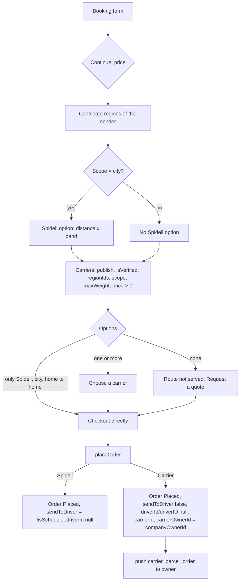
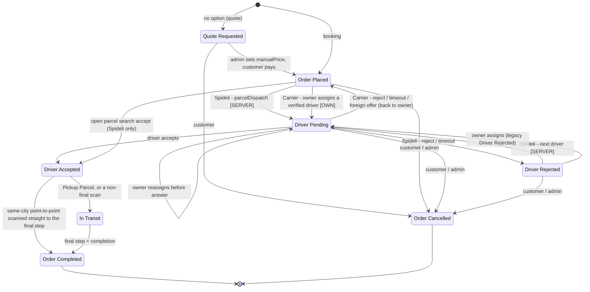
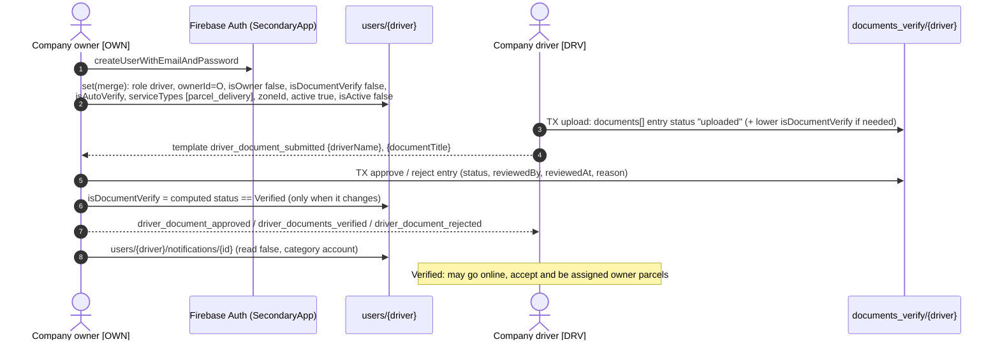
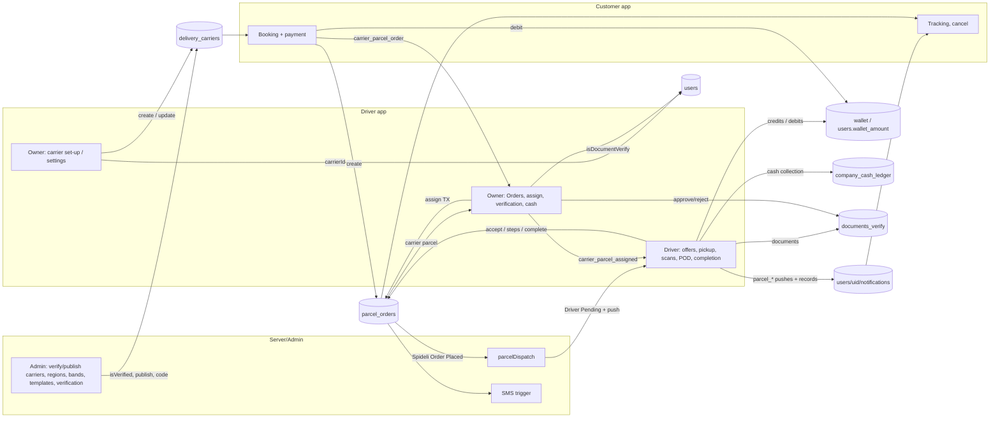
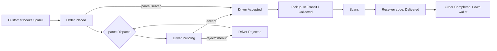

# Spideli Parcel Management and Delivery Flow (as built)

> **Verified on 13 Oct 2026 against commit `1c1f55ca`** (branch `feature/restaurant-app-panel-parity`).
> Every collection, field, status, notification type, template placeholder and rule below was read in this repository's code at that commit. The live `dynamic_notification` collection was compared with a read-only snapshot of all **72** documents taken the same day.
>
> **The code is the source of truth.** Where a contract in `.claude/` says something different, the difference is listed in [section 10](#10-where-the-code-and-the-contracts-disagree).
>
> **Not in this repository, so not verified here:** the Cloud Functions (`parcelDispatch`, the receiver-SMS trigger, `deleteUser`), the admin panel and website, the live Firestore rules and the live Firestore indexes. Statements about them are marked **[SERVER]** or **[ADMIN]** and describe only what the apps expect from them.
>
> This is a documentation-only revision. It replaces the version verified at `a0eaf11` earlier the same day. That version predates the carrier set-up screen, the computed company-driver verification status, the document-verification templates and the "verified drivers only" assignment rule. No application code, data or configuration was changed to write it.

Companion document: [`docs/PARCEL-FLOW.md`](PARCEL-FLOW.md). It has longer pricing examples, a full `parcel_orders` field reference and a write log. It stays valid except where this document corrects it ([section 10.2](#102-corrections-to-docsparcel-flowmd)).

**Labels used in this document**

| Label | Meaning |
|---|---|
| **[CUST]** | Customer app (`customer/`) |
| **[DRV]** | Driver app (`driver/`): a normal (platform) driver or a company driver |
| **[OWN]** | Driver app, company **owner** screens (the "Parcel Company App") |
| **[SERVER]** | Cloud Function or server trigger (not in this repository) |
| **[ADMIN]** | Admin panel or website (not in this repository) |
| IMPLEMENTED / PARTIAL / MISSING | Status labels used in section 9 |

File paths are relative to the repository root. `driver/lib/` and `customer/lib/` are sometimes shortened to `driver/…` and `customer/…` in tables.

---

## Table of contents

0. [The four roles and the apps](#0-the-four-roles-and-the-apps)
1. [Parcel order creation and service selection](#1-parcel-order-creation-and-service-selection)
2. [Order assignment flow](#2-order-assignment-flow)
3. [Company onboarding, driver registration and verification](#3-company-onboarding-driver-registration-and-verification)
4. [Pickup and delivery workflow](#4-pickup-and-delivery-workflow)
5. [Application interactions](#5-application-interactions)
6. [Firebase collections and data flow](#6-firebase-collections-and-data-flow)
7. [Dynamic notification flow](#7-dynamic-notification-flow)
8. [End-to-end workflow](#8-end-to-end-workflow)
9. [Existing issues and missing integrations](#9-existing-issues-and-missing-integrations)
10. [Where the code and the contracts disagree](#10-where-the-code-and-the-contracts-disagree)
11. [Glossary](#11-glossary)
12. [Source-file index](#12-source-file-index)

---

## 0. The four roles and the apps

| Role | App | `users/{uid}` markers | Job in the parcel flow |
|---|---|---|---|
| **Customer** (sender) | Customer app | customer account | Books the parcel. Picks **Spideli drivers** or a **delivery company** (carrier). Pays, tracks, and may cancel before hand-over. Gives the receiver code to the receiver. |
| **Normal driver** (Spideli / platform driver) | Driver app | `role: "driver"`, no `ownerId`, `isOwner` not `true` | Gets platform parcels from the `parcelDispatch` Cloud Function **[SERVER]** or from the open **parcel search**. Picks up, delivers with the receiver code, and is paid into its own wallet. |
| **Company owner** (fleet owner, "Parcel Company App") | Driver app, owner dashboard | `isOwner: true`, `driverType: "company"`; `serviceTypes` holds `parcel_delivery` (or `parcel-service`); `carrierId` = its `delivery_carriers` document | Owners registered with the Parcel service set up their own carrier (section 3.1) or have one bound by **[ADMIN]**. The owner gets every parcel booked with its carrier and assigns it to a **verified** driver. It reassigns returned parcels, verifies its drivers' documents, edits carrier prices and manages the drivers' cash. It never gets offers and never delivers. |
| **Company driver** | Driver app | `role: "driver"`, `ownerId` = owner uid, `isOwner: false` | Sees a carrier parcel only after the owner assigns it. Accepts or rejects within the countdown, then picks up and delivers like any driver. Earnings go to the **owner's** wallet. Cash collected goes to `company_cash_ledger`. |

> A company driver is still a driver. Platform parcels without a carrier are not hidden from it: it can take them from the parcel search, or get a `parcelDispatch` offer if the function chooses it. Their earnings also go to the owner's wallet (`ParcelAmounts.walletUserFor`, `driver/lib/services/parcel_tracking_service.dart:489-490`).

---

## 1. Parcel order creation and service selection

Files:
- `customer/lib/screen_ui/parcel_service/book_parcel_screen.dart`
- `customer/lib/controllers/book_parcel_controller.dart`
- `customer/lib/screen_ui/parcel_service/parcel_carrier_selection_screen.dart`
- `customer/lib/controllers/parcel_order_confirmation_controller.dart`
- `customer/lib/service/parcel_shipping_service.dart`
- `customer/lib/utils/parcel_pricing.dart`
- `customer/lib/models/parcel_shipping_models.dart`
- `customer/lib/utils/carrier_owner_link.dart`

### 1.1 The booking form [CUST]

| Section | Fields | Rules (code) |
|---|---|---|
| What are you sending? | Parcel / Mail → `shipmentType` = `parcel` / `mail` | |
| Where to? | Same city / Other city / Other country → `scope` = `city` / `intercity` / `intercountry` | Checked inline in `validateFields` (`book_parcel_controller.dart:370-392`), and only for Other city / Other country (country codes and `cityMatches`). Same city compares no cities: it requires the receiver to be inside a delivery zone (`:346`). Switching to Same city clears a receiver outside the zones (`book_parcel_screen.dart:216-222`). `ParcelPricing.scopeFor` exists but is used only by tests. |
| Sender | location (GPS prefilled), name, mobile **with country code**, email (optional), city / country, note | The sender must be inside a published zone for every scope (`book_parcel_screen.dart:87`, `:104`). The GPS prefill skips this check (`book_parcel_controller.dart:280-301`). Saved as `sender: {address, name, phone: "(+237) 6…", email}` plus `senderLatLong`. |
| Receiver | the same | The receiver mobile is required with its code. It is also written flat as `receiverName`, `receiverPhone` (national digits) and `receiverCountryCode` (`+237`) (`book_parcel_controller.dart:593-595`). |
| **Parcel details** | **one "Weight in kg" field** (required for every scope), L / W / H in cm (all three or none), declared value, content description | The weight selects the band (`selectedWeight`, `:197-204`). When the bands have no kg limits, it matches on the band title instead. `parcelWeight` = the band title for Spideli, otherwise `"<kg> kg"`. `parcelWeightCharge` is written for Spideli only (`:551-552`). Same city shows "Price band: <band title>" under the field (`book_parcel_screen.dart:241-252`). Validation: "Please enter the parcel weight" (`:337`). The later checks at `:352-357` are unreachable. |
| Pickup method | Home pickup / Drop-off at a pickup point → `pickupMethod` = `home` / `pickup_point` | Pickup points are offered only when `publish == true`, active, named, and their `regionIds`/`regionId` contains the region (`parcel_shipping_models.dart:107`). |
| Delivery method | Home delivery / Collection at a pickup point → `deliveryMethod` | The collection point uses `destinationRegionId ?? originRegionId` (`book_parcel_screen.dart:330`). With a pickup point, the dispatch `sourcePoint` / `destinationPoint` move to the point's coordinates (`book_parcel_controller.dart:631-638`). |
| Delivery type | As soon as possible / Scheduled (date + time) → `isSchedule`, `senderPickupDateTime` | A scheduled Spideli parcel is written with `sendToDriver: false`. Nothing in the apps sets it back to `true`; that is **[SERVER]**. |
| Photos | optional images | Uploaded to Storage at checkout. URLs go in `parcelImages`. |
| Receiver SMS (checkout) | "Notify receiver via SMS" | Offered only when `settings/SMSGateway.isEnabled == true`, the order is not a quote request, and the receiver phone and code exist. Fee = `regions/{id}.parcelSmsFee` (default 50). Written as `sendReceiverSms` and `smsCharge`. The SMS itself is sent by **[SERVER]**. |

### 1.2 Price calculation (tap **Continue**, `bookNow`, `book_parcel_controller.dart:407-466`)

1. `RegionService.ensureLoaded()` runs first. It loads `regions/{id}.parcelPricing` for every candidate region (`:414-420`).
2. **Candidate regions** (`ParcelPricing.orderRegionCandidates`, `parcel_pricing.dart:527-554`), in this order:
   1. every existing region of the published **zones that contain the sender**. Regions that no longer exist are dropped, but only when the region data is loaded.
   2. else the published regions of the sender's country (matched on the sender's geocoded ISO code);
   3. else the customer's own region (`RegionService.customerRegionId`). This is null when the customer's region is ambiguous (`customer/lib/utils/region_service.dart:425-437`).

   Candidates are sorted with the customer's own region first if it is a candidate, then the most specific region (the one served by the fewest zones). The first candidate is the **primary region R**: it sets the Spideli option, the pickup points and the currency.
3. **Distance:** Same city uses the road route (Google Directions or OSRM); other scopes use a straight line. Same city must be at least 0.5 in the app's distance unit. The error text says "should be more than 1 km" (`:445-447`), which does not match the check.
4. **Weights:** `volumetricKg = L×W×H / divisor`; `chargeableKg = max(weightKg, volumetricKg)`. The divisor is the carrier's `regionPricing[Rc].volumetricDivisor`, else `regions/{Rc}.parcelPricing.volumetricDivisor`; Spideli uses `regions/{R}`.
5. **Spideli option** (`source: "default"`, **Same city only**): `price = distance (km or mi, the app's unit) × band.delivery_charge`. The band is the `parcel_weight` document whose `minKg ≤ chargeableKg ≤ maxKg`; a gap takes the next band up.
6. **Carrier options** (`source: "rate_card"`, `ParcelCarrierOption.carrierOffers`, `parcel_shipping_models.dart:264-284`):
   - `price = max(minimumCharge, baseCharge + perKmCharge × km + perKgCharge × chargeableKg)`. Carriers always price per km (`book_parcel_controller.dart:483`).
   - The rate card is `regionPricing[Rc]`, else the flat fields (`parcel_pricing.dart:199-203`).
   - Then add the pickup / delivery option charges and the fixed intercity / intercountry tax. All three come from `regions/{Rc}` (`parcel_pricing.dart:603-611`).
   - Commission is added only when `settings/ParcelPricing.commissionAsExtra` and the section commission are both on.
   - A carrier price of 0 or less means the carrier is not offered (`:445`).
7. **Checkout total** (`calculatePrice`, `parcel_order_confirmation_controller.dart:225-241`):
   `TOTAL = (subTotal − discount) + platformFee + taxes + fixedTax + options + smsCharge`.

### 1.3 Choosing "Spideli drivers" or a delivery company

**Which carriers are offered** (`DeliveryCarrierModel.isEligible` + `servedRegion`, `parcel_shipping_models.dart:193-213`, `:264-284`). The whole `delivery_carriers` collection is read and filtered in the app (`parcel_shipping_service.dart:47-64`). A carrier is offered only when **all** of these hold:

| Rule | Field | Code |
|---|---|---|
| Has a name | `name` non-empty | `parcel_shipping_service.dart:54` |
| Published | `publish != false` | `parcel_shipping_models.dart:167-168`, `:194` |
| Not explicitly unverified | `isVerified` is not boolean `false` (missing counts as verified; the **string** `"false"` also passes) | `:167-168` |
| Serves a candidate region | `regionIds` empty (priced in the first candidate, or on its flat prices when there is none), **or** contains at least one candidate. It is then priced in `Rc` = the **first** candidate it serves. A carrier that lists regions is skipped when none is a candidate. | `:207-213`, `:265-266` |
| Handles the scope | `scope` in `deliveryScopes` (missing / empty = all three) | `:195` |
| Can carry the weight | `maxWeight` 0 / unset (= no limit) or `≥ chargeableKg` (volumetric included) | `:198` |
| Has a price | the rate card gives a price `> 0` | `parcel_pricing.dart:445`, `:606` |

> A carrier an owner creates in the driver app starts with `isVerified: false` and `publish: false` (section 3.1). It is **not offered** until **[ADMIN]** verifies and publishes it.

**What the customer sees** ("Choose a carrier", `parcel_carrier_selection_screen.dart`):

- **"Spideli drivers": "Standard same-city delivery"** first (Same city only), then the carriers, **cheapest first** (`parcel_shipping_models.dart:284`).
- Each card shows logo, name, estimated time, rating and the total **in the currency of the option's own region** (`regionId` = `Rc` for a carrier, `R` for Spideli).
- **The selection screen is skipped** when the shipment is Same city, home → home, and the only option is Spideli (`isLegacyShape`, `book_parcel_controller.dart:75`, `:456-459`). Checkout opens directly.
- **No option at all** (for example Other city with no carrier) shows "Route not served" and **"Request a quote"** (`parcel_carrier_selection_screen.dart:84-117`). This writes a `Quote Requested` order with **no carrier**. **[ADMIN]** sets `manualPrice` and the customer pays it later.

**What the chosen option writes on the order** (`goToCart`, `book_parcel_controller.dart:532-641`):
- `regionId`, which also sets the currency, payment methods and SMS fee;
- `carrierId`, `carrierName`, and `carrierOwnerId` (first from `delivery_carriers.ownerId`);
- `sendToDriver`: `false` for a carrier or a scheduled parcel, else `true`.

### 1.4 Placing the order (`placeOrder`, `parcel_order_confirmation_controller.dart:285-460`)

| Step | What is written | Code |
|---|---|---|
| Payment rules | "Receiver pays" (`payment_method: "cod"`, `paymentCollectByReceiver`) is allowed only on Same city without pickup points. Cash is refused when a pickup point is used. A quote request writes `payment_method: ''`. | `:92-95`, `:290-293`, `:344` |
| Status | `Order Placed`, or `Quote Requested` | `:324` |
| **Carrier parcel** | `sendToDriver: false`, `driverId: null`, **`driverID: null`** (carrier parcels only, `CarrierOwnerLink.unassignedFields`), no `driver`. **`carrierOwnerId` is resolved again**: first `users where carrierId == <carrierId>` (limit 20), keeping the first **company account** (`isOwner`, `driverType: company` or `isCompany`). Then `where deliveryCarrierId == …`, only if none was found, counting only users whose `carrierId` is empty. Last, `delivery_carriers.ownerId`. | `:325-336`; `parcel_shipping_service.dart:74-84`, `:280-283`; `carrier_owner_link.dart:36`, `:49-53` |
| Spideli parcel | `driverId: null` only (`toJson` has no `driverID`) | `customer/lib/models/parcel_order_model.dart:389` |
| `companyOwnerId` | always the same value as `carrierOwnerId` | `parcel_order_model.dart:354-355` |
| Region / zones | `regionId ??= parcelRegionId`, `senderZoneId`, `receiverZoneId` | `:347` |
| Commission | With `commissionAsExtra`: `adminCommission` = the commission amount from `priceBreakdown`, and `adminCommissionType: 'Fixed'`. Otherwise the section's commission. | `:315-323` |
| Price record | `priceBreakdown` (with `.total`, `.smsCharge`, `.currency`, `.source`) | `:381-388` |
| Codes | `trackingNumber` = `SPD-yyMMdd-XXXXXX` (checked unique); `qrValue` = `<websiteUrl>/track-parcel/<id>`, else `spideli:parcel:<id>`; **`pickupCode`** = 6 random digits (**the receiver code**) | `parcel_shipping_service.dart:145-183` |
| First tracking events | `Created`, then `Paid` (paid now) or `Waiting drop-off` (pickup point). `parcelStatus` = the last event. Customer events have `role: 'customer'`. | `:390-397` |
| Write mode | `setKnownFields` (a merge of the known fields). `smsOptOut: false` and `trigger_delevery` are written on create only. | `:291`, `:406` |
| Wallet payment | the debit, the `wallet` row and the order in **one transaction** (`FireStoreUtils.payFromWallet`) | `:414-452` |
| Other gateways | the gateway charges first, then the order is saved (not atomic) | `:454-455` |
| Paying a priced quote | `status` → `Order Placed`, `sendToDriver = !isSchedule`, `priceBreakdown.source: 'manual'`. Events are appended with `arrayUnion`, with no new `Created` event. | `:337-339`, `:366-380`; `parcel_shipping_service.dart:292-294` |
| After save | `users/{uid}.regionIds += regionId`. **Carrier parcel, not a quote request: push `carrier_parcel_order` to the owner.** Then the success screen and the booking email `new_parcel_book` (also sent for quote requests). | `:401-412` |



ASCII fallback:

```
Form ─► Continue ─► candidate regions ─► [city? Spideli price] + eligible carriers
   ├─ only Spideli (city, home→home) ─► checkout
   ├─ none ─► "Route not served" ─► Request a quote (Quote Requested, no carrier)
   └─ list ─► "Choose a carrier" ─► checkout
checkout ─► placeOrder
   ├─ Spideli : Order Placed, sendToDriver = !isSchedule, driverId null
   └─ Carrier : Order Placed, sendToDriver false, driverId/driverID null,
                carrierId, carrierName, carrierOwnerId = companyOwnerId
                └─► push carrier_parcel_order ─► company owner (not for a quote request)
```

---

## 2. Order assignment flow

### 2.1 Normal (Spideli) parcels: Cloud Function dispatch [SERVER] + offer popup [DRV]

**What `parcelDispatch` must do.** It is not in this repository (`firebase.json` references `functions/`, which is absent). These requirements come from `.claude/DRIVER-DISPATCH-CONTRACT.md` and from the app code that reads its results:

| # | Requirement | Why the app needs it |
|---|---|---|
| 1 | Start on `parcel_orders` with `status` `Order Placed` and `Driver Rejected`. | Only these are dispatchable. |
| 2 | **Skip every parcel with a non-empty `carrierId` or `carrierOwnerId`.** Respect `sendToDriver: false` (scheduled / carrier / quote) and `Quote Requested`. | The driver app hands straight back to the owner any carrier parcel it was offered without the owner's `assignedBy` (`incoming_offer_service.dart:668-672`, `:752-759`). |
| 3 | Pick a driver: `serviceTypes` contains `parcel_delivery` (or `parcel-service`), online, not `isOwner`, not in `rejectedByDrivers`, meets the wallet minimums, and respects `settings/DriverNearBy.singleOrderReceive`. | Matches the listeners and gates in the app. |
| 4 | In a transaction that re-checks the status, write `status: "Driver Pending"`, `driverId` = `driverID` = driver and **`dispatchedAt` (server time)**, plus `users/{driver}.orderRequestData` arrayUnion id. | The countdown starts from `dispatchedAt`. |
| 5 | Push `{type: "parcel", orderId, id, click_action: "FLUTTER_NOTIFICATION_CLICK", status: "Driver Pending"}` on channel `spideli`. | Opens the offer dialog. |
| 6 | After `Driver Rejected`, offer the next driver. Time out offers server-side once they are older than `driverOrderAcceptRejectDuration`. | The app times out only while it is running. |

**How the driver app shows the offer** (`driver/lib/services/incoming_offer_service.dart`):

- It runs for every driver account and is **not started for an owner** (`isOwner == true`).
- Sources:
  - one live query per served module: `parcel_orders where driverId == me && status == "Driver Pending"`;
  - a document listener for every id in `users/{me}.orderRequestData`;
  - the push.
- **Popup** (`app/incoming_offer/incoming_offer_dialog.dart`):
  - shows the pickup and drop addresses, the fare (= the total the customer was charged), distance, weight and receiver name;
  - **Accept**, and **Reject** (opens the reason sheet);
  - a countdown of `settings/DriverNearBy.driverOrderAcceptRejectDuration` seconds (default 120).
- **Accept gates** (`DispatchGateRules.check`, `dispatch_offer_rules.dart:635-652`; `_gate`, `incoming_offer_service.dart:860-880`):
  - **Documents:** applied to timed offers. For a **freelance** driver (no `vendorID`) it uses the account flag. For a **company driver** it uses the computed verification status (section 3.4), `incoming_offer_service.dart:869-872`. Untimed hand-assigned offers skip the documents gate.
  - **Wallet:** a driver with `ownerId` needs the **owner's** `wallet_amount ≥ ownerMinimumDepositToRideAccept`. An independent driver needs its own `wallet_amount ≥ minimumDepositToRideAccept`.

**Answer writes** (all in a transaction on the live order, `driver/lib/services/dispatch_offer_service.dart`):

| Action | Allowed when (`acceptCheck` / `canReject`, `dispatch_offer_rules.dart:480-531`) | `parcel_orders/{id}` | `users/{me}` | Push |
|---|---|---|---|---|
| Accept | (a) `Driver Pending` naming me; (b) `Order Placed` naming me (a hand assignment, `:507`); (c) a "legacy request": `Driver Pending` naming nobody, with the id in my `orderRequestData` (`:497-499`); (d) open search: `Order Placed`, nobody named, **not** a carrier parcel. A carrier parcel is accepted only if `CarrierParcelRules.ownerAssignedTo` holds: it names me **and** `assignedBy` = the owner (`:494`; `carrier_parcel_rules.dart:144-150`). | `status: "Driver Accepted"`, `driverId` = `driverID` = me, `driver` = my profile, `receiverPickupDateTime` = now (`:125-146`) | `inProgressOrderID` += id, `orderRequestData` −= id | `parcel_accepted` → customer (`:150`, `:295-297`) |
| Accept, already mine | `Driver Accepted` / `Order Shipped` / `In Transit` naming me | nothing (`held`, `:148-153`) | | none |
| Reject (with reason), Spideli | `Driver Pending` / `Order Placed` naming me, or a legacy request | `status: "Driver Rejected"`, `driverId`/`driverID` null, `rejectedByDrivers` += me, `driverRejections` += `{driverId, reason, code, at, afterAccept:false}` (`rejectFields`, `:547-553`) | `orderRequestData` −= id, `inProgressOrderID` −= id (`dispatch_offer_service.dart:221-226`) | none |
| Timeout, Spideli | still `Driver Pending` naming me | same, without `driverRejections` (`:181`, `:205`) | same | none |
| Reject / timeout, **carrier parcel** | same | **`status: "Order Placed"`**, `sendToDriver: false`, `driverId`/`driverID` null, `rejectedByDrivers` += me (+ `driverRejections` on a manual reject) (`carrier_parcel_rules.dart:235-242`) | same | `carrier_parcel_returned` → owner (`dispatch_offer_service.dart:208-220`) |
| Late accept | window over | answered as a timeout | | |

**Open parcel search** (`driver/lib/controllers/parcel_search_controller.dart`):

- **Query:** `parcel_orders where sectionId in <my sectionIds> and status == "Order Placed"` (`:182`).
- **Filters** (`:194-235`):
  - needs `senderPickupDateTime`;
  - `senderZoneId` or `receiverZoneId` must equal my zone;
  - the pickup must be on the searched date;
  - the destination must be within `settings/DriverNearBy.parcelRadius` km (default 50) of the searched destination;
  - a scope-aware region rule: intercity and intercountry parcels are also shown to drivers of the destination region (`services/parcel_dispatch_service.dart:59-71`);
  - `DispatchOrderRules.listedInParcelSearch`: names nobody else, not passed by me, **not a carrier parcel**.
- **Accept gates:**
  - verified documents and online (`isActive`);
  - the wallet: the owner's `wallet_amount ≥ ownerMinimumDepositToRideAccept`, or my own `≥ minimumDepositToRideAccept`. This is checked in the screen (`app/parcel_screen/parcel_search_screen.dart:200-223`).
- There is **no "pass" action** for parcels (section 10.1 #5).

### 2.2 Company (carrier) parcels: owner assignment [OWN] → company driver [DRV]

**1. Order arrives unassigned** ([section 1.4](#14-placing-the-order-placeorder-parcel_order_confirmation_controllerdart285-460)): `Order Placed`, `sendToDriver: false`, `driverId`/`driverID` null, `carrierId`, `carrierOwnerId` = `companyOwnerId`. The owner gets the push `carrier_parcel_order`.

**2. Owner's Orders page** (owner dashboard → Orders → parcel section; `driver/lib/controllers/owner_order_list_controller.dart`, `app/owner_screen/owner_order_list.dart`).

The page is a **one-time fetch, not live** (`FireStoreUtils.getParcelOrdersBySection`, `driver/lib/utils/fire_store_utils.dart:1939-1996`). It is refetched after each assignment and when the owner taps Search (`owner_order_list_controller.dart:117-119`, `:341`). The `sectionId` argument is ignored for parcels. Queries:

```
parcel_orders where carrierOwnerId == me
parcel_orders where companyOwnerId == me
parcel_orders where carrierId == users/{me}.carrierId        (if set)
parcel_orders where driverId == <each of my drivers> orderBy createdAt desc
```

- **Tabs:** All, **Pending** (`Order Placed` / `Driver Rejected` with nobody named), **Assigned** (`Driver Pending` with a driver), **In Transit**, **Delivered**, **Cancelled**.
- **Card text:** "Waiting for driver assignment", "Waiting for <name> to accept", or "Driver: <name>".
- **Buttons:** **Assign Driver** / **Reassign**.
- **Section visibility:** the parcel section shows only when the owner's `serviceTypes` holds the literal `'parcel_delivery'` (`owner_order_list_controller.dart:76`). See section 9.2, P20.

**3. Driver picker** (`owner_order_list.dart:766-843`):

- **Source:** `users where ownerId == me and isOwner == false` (`fire_store_utils.dart:606-609`; an equality filter, so drivers with no `isOwner` field never appear).
- **Filter:** `CarrierParcelRules.isAssignableDriver`: same `ownerId`, not an owner, `role` driver, `active != false` (`carrier_parcel_rules.dart:268-274`).
- **Sort:** verified first, then online, then by name (`carrier_parcel_service.dart:50-57`).
- **Each row:** Online / Offline, "Rejected this order before", phone.
- **Unverified drivers:** the row shows **"Documents not verified"** and a **"Not verified"** badge **instead of the Assign button** (`owner_order_list.dart:819-843`).

**4. Assign transaction** (`CarrierParcelService.assign`, `driver/lib/services/carrier_parcel_service.dart:70-171`)

Inside the transaction it reads the order, the driver's live `users/{driver}` and `documents_verify/{driver}` (`:103-115`). It then applies `CarrierParcelRules.assignCheck` (`carrier_parcel_rules.dart:184-199`):

| State | Result | Owner sees |
|---|---|---|
| Not this company's order (`carrierOwnerId`/`companyOwnerId` ≠ me and `carrierId` ≠ my `carrierId`), or the driver document is missing (`gone`) | refused | "This order is no longer available." |
| `Order Completed` / `Order Cancelled` / `Order Rejected` | refused | same |
| `Driver Accepted` / `Order Shipped` / `In Transit` | refused | "A driver already accepted this order." |
| `Quote Requested` | refused | "This quote is not paid yet." |
| `Driver Pending` to the same driver | refused | "This order is already waiting for this driver." |
| **Driver not verified** (`driverNotVerified`) | refused | a message that depends on the driver's status (`notVerifiedMessageKey`, `carrier_parcel_rules.dart:253-264`) |
| **Documents could not be read** (`verificationUnavailable`) | refused | "Could not check this driver's documents. Please try again." (`owner_order_list_controller.dart:332-335`) |
| `Order Placed`, `Driver Rejected`, `Driver Pending` (another driver), and the driver is verified | **OK** | "Order sent to the driver. Waiting for the driver to accept." |

Writes (`assignFields`, `carrier_parcel_rules.dart:217-230`):

```jsonc
// parcel_orders/{id}  (tx.update)
{ "status": "Driver Pending", "driverId": "<driver>", "driverID": "<driver>",
  "assignedBy": "<ownerUid>", "assignedAt": "<serverTimestamp>", "dispatchedAt": "<serverTimestamp>",
  "sendToDriver": false, "rejectedByDrivers": "arrayRemove(<driver>)", "driver": "<deleted>" }
// users/{driver}  (same transaction)
{ "orderRequestData": "arrayUnion(<orderId>)" }
// users/{replacedDriver}  (after the transaction, best effort, reassign only)
{ "orderRequestData": "arrayRemove(<orderId>)" }
```

`carrierOwnerId` is **not** written here; it comes from the customer. Then the push `carrier_parcel_assigned` goes to the driver's **live** `fcmToken` on the job channel (`carrier_parcel_service.dart:145-166`):
- data: the parcel-offer data `{type: "parcel", orderId, id, click_action, status: "Driver Pending"}`;
- placeholders: `{companyName}` (the carrier's name), `{trackingNumber}` (else the order id) and `{driverName}`.

**5. Company driver answers** (same popup and countdown as section 2.1; `dispatchedAt` = `assignedAt`):

- **Accept:** only if the order names the driver **and** `assignedBy` == the order's owner, and the driver passes the gates (computed verification status, owner's wallet minimum). The writes are the same as a normal accept. The customer gets `parcel_accepted`. The **owner gets no push** (section 9.3, M4).
- **Reject / timeout:** the parcel goes back to the **owner**, never to dispatch (`returnToOwnerFields`, `carrier_parcel_rules.dart:235-242`):

  ```jsonc
  { "status": "Order Placed", "sendToDriver": false, "driverId": null, "driverID": null,
    "rejectedByDrivers": "arrayUnion(<me>)",
    "driverRejections": "arrayUnion({...})"   // manual reject only
  }
  // users/{me}: orderRequestData −= id, inProgressOrderID −= id
  ```

  Then the owner gets `carrier_parcel_returned` (`carrier_parcel_service.dart:175-199`). The recipient is `carrierOwnerId`, else the driver's `ownerId`. `assignedBy` / `assignedAt` stay until the next assignment overwrites them.
- **Foreign offer:** a `Driver Pending` carrier parcel that names the driver **without** the owner's `assignedBy` (for example from a dispatch function that does not skip carrier parcels). It is never shown. It is answered at once with the timeout write, so it returns to the owner (`incoming_offer_service.dart:668-672`, `:752-759`).

**6. Reassign / unassign / cancel**

- **Reassign** is allowed while the order is `Order Placed`, `Driver Rejected` or `Driver Pending` (not yet answered). Choosing the **same** pending driver is refused. A driver who rejected earlier may be chosen again: they are removed from `rejectedByDrivers`.
- The owner has **no unassign and no cancel** action (section 9.3).

### 2.3 Statuses and transitions

`parcel_orders.status` is the order lifecycle. `parcel_orders.parcelStatus` is the tracking step; each step also appends to `trackingEvents`. The constants are in `driver/lib/constant/constant.dart:98-107` and `customer/lib/constant/constant.dart:142-151`.

| `status` | Set by | Meaning |
|---|---|---|
| `Quote Requested` | [CUST] | No option for the route; waits for `manualPrice` [ADMIN] |
| `Order Placed` | [CUST]; [DRV] company hand-back, and automatic return of a foreign offer | Booked, nobody named. Spideli: waiting for dispatch. Carrier: waiting for the owner. |
| `Driver Pending` | [SERVER] dispatch; [OWN] assign | Offered to one driver |
| `Driver Rejected` | [DRV] normal reject / timeout | Back to dispatch |
| `Driver Accepted` | [DRV] | The driver took it |
| `In Transit` | [DRV] the Pickup Parcel transaction, **or** a scan of a non-final step while `Driver Accepted` (any fleet member, not in a transaction, `parcel_tracking_service.dart:284-286`) | Picked up |
| `Order Completed` | [DRV] final step | Delivered, or handed to the destination point; earnings paid |
| `Order Cancelled` | [CUST], [ADMIN], [SERVER] | Cancelled |
| `Order Rejected`, `Order Shipped` | read by the apps, **not written by any app** for parcels | panel / legacy values |

| `parcelStatus` (rank) | Written by |
|---|---|
| `Created` (0), `Paid` (1), `Waiting drop-off` (1) | [CUST] at booking |
| `Collected` (2) | [DRV] pickup (home) or scan |
| `At origin pickup point` (2) | [ADMIN] / pickup-point operator |
| `In transit` (3), `Arrived destination` (4), `Out for delivery` (5) | [DRV] scans (any fleet member for intermediate steps) |
| `At destination pickup point` (5) | [DRV] final step when `deliveryMethod = pickup_point` |
| `Delivered` (6) | [DRV] final step (home), or [ADMIN] when the receiver collects at the point |
| `Returned` (7), `Cancelled` (7) | `Cancelled`: [CUST] cancel. `Returned`: no app writes it. |

Ranks are in `ParcelTrackingStatus.rank`, `driver/lib/services/parcel_tracking_service.dart:17-57`. A step is never written backwards.



ASCII fallback:

```
            (no option)                      (booking)
   [*] ──► Quote Requested ──(paid)──► Order Placed ◄──────────────┐ carrier reject/timeout/foreign
                                         │      │                   │ (back to owner)
                     Spideli: dispatch   │      │ Carrier: owner     │
                     [SERVER]            ▼      ▼ assigns verified   │
                                       Driver Pending ───────────────┘
                     reject/timeout ◄─────┘   │  ▲ owner reassigns
                 Driver Rejected ─(next)──────┘  │
                                              accept
                                                 ▼
          (search accept, Spideli) ──────► Driver Accepted ─Pickup/scan─► In Transit ─final step─► Order Completed
  Cancel (customer/admin): from Quote Requested, Order Placed, Driver Pending, Driver Rejected ─► Order Cancelled
```

---

## 3. Company onboarding, driver registration and verification

Files:
- Owner sign-up and carrier: `driver/lib/controllers/signup_controller.dart`, `driver/lib/utils/carrier_setup_form.dart`, `driver/lib/controllers/carrier_setup_controller.dart`, `driver/lib/app/owner_screen/carrier_setup_screen.dart`, `driver/lib/controllers/carrier_settings_controller.dart`, `driver/lib/app/owner_screen/carrier_settings_screen.dart`, `driver/lib/services/carrier_dispatch_service.dart`, `driver/lib/controllers/owner_dashboard_controller.dart`
- Drivers: `driver/lib/controllers/driver_create_controller.dart`, `driver/lib/app/owner_screen/driver_create_screen.dart`
- Verification: `driver/lib/utils/document_verification.dart`, `driver/lib/services/driver_document_status.dart`, `driver/lib/services/driver_document_status_service.dart`, `driver/lib/services/driver_online_status.dart`, `driver/lib/controllers/verification_details_upload_controller.dart`, `driver/lib/services/owner_verification_service.dart`, `driver/lib/services/owner_verification_rules.dart`, `driver/lib/app/owner_screen/owner_driver_verification_list_screen.dart`, `driver/lib/app/owner_screen/owner_driver_verification_screen.dart`, `driver/lib/utils/fire_store_utils.dart`

### 3.1 Company owner and its carrier

**Owner sign-up** (`signup_controller.dart:440-489`). "Company" on the sign-up form writes:
- `isOwner: true`, `driverType: "company"`;
- `companyName`, `companyAddress`, `operatingLicence`, `commercialRegister`, `uniqueIdNumber`;
- `zoneIds` / `zoneId`, `sectionIds`;
- `serviceTypes` from the chosen sections (a parcel section gives `parcel_delivery`).

`active` follows `settings/DriverNearBy.auto_approve_driver`. Without auto-approval the owner goes back to the login screen to wait (`:515-523`).

**Who has carrier screens at all** (`CarrierSetupForm.offersCarrier`, `driver/lib/utils/carrier_setup_form.dart:26-33`): `isOwner` **and** `serviceTypes` (normalised) contains `parcel_delivery`. For any other owner:
- no **Carrier settings** entry in the drawer (`owner_dashboard_screen.dart:241-254`);
- no carrier reminder on the owner home;
- no automatic set-up;
- Carrier settings, if reached anyway, says "Carrier settings are for parcel delivery companies only." (`carrier_settings_screen.dart:39-44`);
- the create step refuses (`carrier_setup_controller.dart`, `submit`).

**"Set up your carrier"** (IMPLEMENTED 13 Oct 2026). `CarrierSetupForm.needsSetup` = `offersCarrier` and `carrierId` is empty. For such an owner:

1. **Automatic opening:** the dashboard's live `users/{me}` listener opens `CarrierSetupScreen` **once per app launch** (`owner_dashboard_controller.dart:39-63`). This happens right after sign-up when auto-approved, otherwise at the first login after approval. The owner home shows "You have not set up your carrier yet." with a **Set up your carrier** button (`owner_home_screen.dart:88-110`). Carrier settings shows the same button in its empty state.
2. **The form** (`carrier_setup_screen.dart`, rules in `carrier_setup_form.dart:65-103`):

   | Field | Required |
   |---|---|
   | Carrier name (pre-filled from `companyName`) | yes |
   | Phone + dial code | yes |
   | Email | no (must be valid if given) |
   | Logo photo | no |
   | Regions served (published `regions`) | at least one |
   | **Pricing per region**, one card per ticked region, "Prices for <region> (<currency>)": base price, **Distance price (per km)**, **Weight price (per kg)**, minimum price | **yes, for every ticked region. Without them the carrier is not created.** |
   | Volumetric divisor, home pickup, point drop-off, home delivery, point collection (per region) | no (blank = region default, 0 = free) |
   | Delivery scopes | at least one |
   | Max weight, min / max delivery time, unit, conditions | no |
   | Operating licence, commercial register, unique ID (pre-filled from sign-up) + one photo each | no |

3. **Write** (`CarrierDispatchService.createOwnCarrier`, `carrier_dispatch_service.dart:68-95`), **one batch**:
   - `delivery_carriers/{new}` with the form fields, `regionIds`, `deliveryScopes` and `regionPricing.<R>.*`;
   - the flat prices, copied from the first region;
   - the registration numbers and `…File` URLs, and `photo`;
   - `ownerId` = owner, **`isVerified: false`, `publish: false`**, `createdFrom: "driver_app"`, `id`, `createdAt`, `updatedAt`;
   - and `users/{owner}.carrierId` = the new id.

   If a carrier with `ownerId == owner` already exists, that one is bound instead and the newly entered form is discarded (section 9.2, P21). Photos go to Storage at `carrierDocuments/{ownerId}/…`.
4. **Visibility:** customers are offered the carrier only after **[ADMIN]** verifies and publishes it (section 1.3).

**Carrier settings** (`carrier_settings_screen.dart`, `carrier_settings_controller.dart`):
- shows the verification state and "Published / Not published";
- the owner edits name, phone, email, delivery scopes, prices (per region, or flat for a carrier with no `regionIds`), max weight, delivery times and conditions;
- the regions, carrier code and registration documents are shown read-only;
- saving uses a field-path `update()` of the changed keys only (`DeliveryCarrierModel.updatePaths`; `saveCarrierSettings`, `carrier_dispatch_service.dart`).

**Admin binding** is still possible, and is the only path for an owner that is not registered with Parcel or that an admin links: `users/{owner}.carrierId` ↔ `delivery_carriers/{id}.ownerId` **[ADMIN]**.

### 3.2 How a company driver account is created

**Only the owner creates company drivers** (IMPLEMENTED). Owner home → the add button (hidden while the owner itself is pending verification, `owner_home_screen.dart:234`) → `DriverCreateScreen` → `DriverCreateController.signUp` (`driver_create_controller.dart:297-329`):

1. Creates the Firebase Auth account (email + password) on a **secondary Firebase app** named `SecondaryApp`, so the owner stays signed in.
2. Reads `settings/document_verification_settings`.
3. Writes `users/{newUid}` with `set(merge)`, then opens `wallet_amount: 0`, `orderRequestData: []`, `inProgressOrderID: []` if absent.
4. Signs the secondary app out.

Fields written by `_applyCommonFields` (`driver_create_controller.dart:392-434`):

| Field | Value |
|---|---|
| `firstName`, `lastName`, `email` (lower-case), `phoneNumber`, `countryCode`, `countryISOCode` | form |
| `role` | `"driver"` |
| `active` | `true` (on create and on every edit) |
| `isActive` | `false` on create only (offline); an edit never changes it |
| **`isDocumentVerify`** | **`false`** on create (`DocumentVerification.initialFlags`) |
| **`isAutoVerify`** | `true` only when the admin switched driver verification off (`settings/document_verification_settings.isDriverVerification == false`), else `false` |
| `zoneId` | one zone out of the company's zones |
| `isOwner` | **`false`** (explicit) |
| **`ownerId`** | the owner's uid |
| `driverType` | `"individual"` |
| `regionId` | the owner's `regionId` when the driver has none |
| `sectionIds`, `sectionNames` | chosen among the owner's sections |
| **`serviceTypes`** | from the chosen sections' `serviceTypeFlag`; a parcel section gives **`parcel_delivery`** |
| `vehicleDetails` | per cab / rental section only |
| `appIdentifier`, `provider: "email"`, `createdAt` | |

An edit never writes `isDocumentVerify`, `isActive`, `fcmToken`, `orderRequestData` or `inProgressOrderID`. Delete goes through the **`deleteUser` Cloud Function** **[SERVER]**.

**Self sign-up "under an owner"** is MISSING. The driver sign-up offers only **Individual** or **Company** (`signup_controller.dart:456`, `:470`). An Individual sign-up writes no `ownerId`. A self-registered driver becomes a company driver only if **[ADMIN]** sets `ownerId`.

### 3.3 Document submission by the company driver

1. **Required document types:** `documentTypesFor(user)` (`fire_store_utils.dart:1097-1104`, built on the normalised `serviceModules`).
   - The types are `"driver"`, plus `"vehicle"` for a cab or rental driver (`"owner"` for an owner account).
   - The query `documents where type in [...] and enable == true` (`:1113-1140`) is filtered by `DriverDocumentStatus.requiredOf`.
   - `documents/{id}` fields: `title`, `type`, `enable`, `frontSide`, `backSide`, `expireAt` (bool).
2. **Upload:** the images go to Storage at `driverDocument/<uid>/…`. The entry is `{documentId, frontImage, backImage, status: "uploaded", expireAt?}`. Any review reason and reviewer fields are cleared (`driver/lib/models/driver_document_model.dart:65-69`).
3. **Save** is **one transaction** (`FireStoreUtils.uploadDriverDocument`, `fire_store_utils.dart:1280-1337`). `documents_verify/{uid}` = `{id, type: "driver", documents: [ … ]}`, and the entry for the same `documentId` is replaced. The transaction:
   - refuses a record whose `type` belongs to another holder;
   - for a company driver, **lowers** `users.isDocumentVerify` to `false` when the computed status is no longer Verified. It never raises it.
4. **Owner notified:** only when the driver has an `ownerId`. This uses the template **`driver_document_submitted`** (`verification_details_upload_controller.dart:120-139`):
   - data `{type: "driver_document_submitted", driverId, documentId}`;
   - placeholders `{driverName}`, `{documentTitle}`;
   - sent on the general driver channel;
   - a tap opens the owner's review screen for that driver (`owner_verification_rules.dart:306-317`, `driver/lib/utils/notification_service.dart:765-771`).
5. **Status of each entry** (`DriverDocumentStatus.entryStatus`, `driver_document_status.dart:152-158`): `not_submitted` (no entry or no image), `pending` (`uploaded`), `approved`, `rejected` (checked first), `expired` (`expireAt` passed). A rejected or expired document can be uploaded again.

### 3.4 Computed verification status and owner review [OWN]

**Overall status of a company driver** is computed from the **required** documents only:

| Status | When |
|---|---|
| **Not submitted** | no required document uploaded |
| **Pending** | some required document missing or waiting for review |
| **Action required** | a required document rejected or expired |
| **Verified** | every required document approved |

When no document is required, the status falls back to the flag (`owner_verification_rules.dart:261`). `isAutoVerify == true`, or the admin's verification setting being off, counts as verified (`document_verification.dart:44-48`).

**Where it is the gate** for a company driver (`document_verification.dart:63-72`):
- accepting offers (`incoming_offer_service.dart:869-872`);
- going online (`driver_online_status.dart:134-145`);
- the owner's assignment (section 2.2).

`users.isDocumentVerify` is **kept in sync** with it. A freelance driver is still gated by the flag.

**List screen** (owner dashboard menu **"Driver Verification"** → `OwnerDriverVerificationListScreen`, `owner_driver_verification_list_screen.dart:66-90`, `:182-203`):
- **live:** a `users where ownerId == me` snapshot plus a watch on each driver's documents;
- each driver shows its computed status;
- count tiles and filter chips: **All, Not submitted, Pending, Action required, Verified**.

**Detail screen** (`owner_driver_verification_screen.dart`, live, `:94`):
- the required documents with each entry's status;
- **Approve** needs an uploaded, non-expired entry;
- **Reject** needs an uploaded entry or a status, and a mandatory reason (`owner_verification_rules.dart:211-215`);
- **Approve All** approves only entries waiting for review, never missing, rejected or expired ones (`:260-278`). When nothing is waiting it is refused and the outstanding titles are listed (`screen:217-226`).

**Writes** (`driver/lib/services/owner_verification_service.dart:135-189`). Every action runs in **one transaction** that re-checks `ownerId`.

| Action | `documents_verify/{driverId}` | `users/{driverId}` | Push to the driver (template) | Record `users/{driverId}/notifications/{id}` |
|---|---|---|---|---|
| Approve one | entry `status: "approved"`, `reviewedBy`, `reviewedAt` | `isDocumentVerify` = (overall == Verified), written **only when it changes** | `driver_documents_verified` when this completes the set, else `driver_document_approved` (`:81-86`) | `{id, title, body, type: <template>, category: "account", orderId: "", status, data, read: false, createdAt, source: "driver"}` (`owner_verification_rules.dart:73-95`) |
| Reject one | entry `status: "rejected"`, `rejectReason` = `rejectionReason` = `reason`, `reviewedBy`, `reviewedAt` | `isDocumentVerify: false` when it changes | `driver_document_rejected` (`:100`) | same shape |
| Approve all | each waiting entry `approved` | as "Approve one" | `driver_documents_verified`, or one `driver_document_approved` per document when still incomplete (`:117-124`) | same shape |

Push data: `{type: "document_verification", status: "approved" | "all_approved" | "rejected", documentId?, reason?, notificationId?}`. A driver's tap opens its own documents.

**Owner vs admin verification**

| Aspect | Owner (driver app) | Admin panel [ADMIN] |
|---|---|---|
| Who it covers | drivers with `ownerId == owner` | every holder (`documents_verify/{holderId}`) |
| Required types | `driver`, plus `vehicle` for cab / rental drivers (`owner_verification_service.dart:43-44`) | per role (not verifiable here) |
| Account flag | `users/{driverId}.isDocumentVerify` = computed status, true or false | sets `isDocumentVerify` (and, per `.claude/BUG-REPORT-01-ADMIN.md`, `isActive`); not verifiable here |
| The owner's own documents | **not** reviewed by the app; [ADMIN] only | |

### 3.5 Verification sequence



ASCII fallback:

```
Owner ─(SecondaryApp Auth)─► users/{driver}: ownerId, isOwner false, isDocumentVerify false, serviceTypes, zoneId
Driver ─TX─► documents_verify/{driver}: entry "uploaded" ─► push driver_document_submitted ─► Owner
Owner ─TX─► approve/reject ─► isDocumentVerify = (status == Verified) ─► push driver_document_* ─► Driver (+ record)
Verified ─► online, offers, owner assignment allowed
```

---

## 4. Pickup and delivery workflow

The code is the same for normal and company drivers (`driver/lib/services/parcel_tracking_service.dart`, `driver/lib/controllers/parcel_home_controller.dart`, `driver/lib/app/parcel_screen/parcel_tracking/*`). The differences are listed in [4.6](#46-normal-vs-company-driver-differences).

**The driver's parcel home** lists `Driver Accepted` / `In Transit` / `Order Shipped` orders with `driverId == me`, live (`driver/lib/utils/fire_store_utils.dart:552-588`). **Scan** is on that home screen; **Parcel run** is opened from the parcel dashboard (`app/parcel_screen/parcel_dashboard_screen.dart:260-266`).

### 4.1 Pickup ("Pickup Parcel", `onLegacyPickup`, `parcel_tracking_service.dart:326-357`)

1. **Refused** when `pickupMethod == "pickup_point"` and the parcel is not yet at the origin point: "The sender has not dropped the parcel off at the origin pickup point yet."
2. **Transaction** `ParcelPickupRules.pickupFields` (`driver/lib/services/parcel_flow_rules.dart:21-31`):
   - the order must name me;
   - `status` must be `Driver Accepted` / `Order Shipped` (already `In Transit` writes nothing);
   - `parcelStatus` must not be `Cancelled` / `Returned`.

   It writes `status: "In Transit"`. Otherwise: "This parcel can no longer be picked up."
3. **Tracking step:** `Collected` (home pickup), or `In transit` (taken from the origin point). `trackingEvents` gets arrayUnion `{status, at, by, role: "driver", lat, lng}` (`_writeStatus`, `:237-291`). If this step's write fails, the error is swallowed (`:350-352`, section 9.2).
4. **Pushes:**
   - customer: `parcel_picked_up` (for `Collected`) or `parcel_in_transit` (for `In transit`);
   - owner: `carrier_parcel_picked_up`, **only for `Collected`** (`:297-303`).

### 4.2 Scans ("Parcel run" + Scan)

**Scan input** (`:86-117`): a `spideli:parcel:<id>` value, a `…/track-parcel/{id}` URL, a `trackingNumber` (raw or upper-case), or a raw order id.

**Next steps** (`nextActions`, `:172-212`): `Collected` / `At origin pickup point` → `In transit` (+ the final leg on Same city) → `Arrived destination` (+ the final leg on Same city) → the final leg: `Out for delivery` (home) or `At destination pickup point` (point) → `Delivered`.

`nextActions` refuses an unpriced quote (`quoteRequested && manualPrice == null`) and a parcel the sender has not yet dropped at the origin point (`:185-190`). If the final step was recorded but completion failed, the final step is offered again (`awaitingCompletion`, `:176`, `:219-224`).

**Who may scan:** fleet members (the owner and its drivers, `myCompanyId`, `:135-151`) may record intermediate scans of a fleet parcel. The manifest covers the driver plus every user with `ownerId == company` (`:617-637`). Only the **assigned** driver records the final step.

A scan of a non-final step while `status == Driver Accepted` also sets `status: In Transit`. This is a plain update, not a transaction (`:284-286`).

| Step | Customer push (`ParcelStatusPush.customerTemplate`, `parcel_flow_rules.dart:41-50`) |
|---|---|
| `Collected` | `parcel_picked_up` |
| `In transit` | `parcel_in_transit` |
| `Arrived destination` | `parcel_arrived_destination` |
| `Out for delivery`, `At destination pickup point`, `Delivered` | none (completion sends `parcel_completed`) |

Data of these pushes: `{type: "parcel_order", orderId, parcelStatus}`. Each push also writes the customer's Notification Center record.

### 4.3 Delivery with the receiver code (POD)

"Deliver Parcel" (`completeParcel`, `parcel_home_controller.dart:127-170`; `prepareLegacyDeliver`, `parcel_tracking_service.dart:359-372`):

- **Same city, home → home, already picked up:** completes in one go. Any other parcel completes only when the next scan step is the final one; otherwise "Scan the parcel to update its status". A coded home delivery from the home button with no screen context is refused with "Open the parcel and complete it from there" (`:143-147`).
- **Proof sheet** (`app/parcel_screen/parcel_tracking/parcel_proof_sheet.dart`):
  - **With a `pickupCode`:** the driver **must type the receiver's code**. The field is numeric, max 6 digits (`:189-190`). It is compared **on the device** with the order's `pickupCode` (`:99-113`). A wrong code shows "Invalid code", with no attempt limit. Proof: `deliveryProof: {type: "otp", at, by}`.
  - **Without a code:** a photo, only for "contract" parcels (`hasTrackingContract`: has `parcelStatus` / `trackingNumber` / `qrValue`, `models/parcel_order_model.dart:308`). Proof: `{type: "photo", photoUrl, at, by}`, photo at `parcelDeliveryProof/<orderId>/…`. A **legacy parcel with no code completes from "Deliver Parcel" with no proof** (`parcel_home_controller.dart:158-163`).
  - **Scan path:** `Delivered` always opens the proof sheet (`parcel_scan_result_screen.dart:32-35`).
- **Delivery to a pickup point:** the driver confirms "Hand over at the pickup point". The final step is `At destination pickup point`. The receiver later collects with the same code at the point **[ADMIN / website]**.
- The **order-POD contract** (`.claude/POD-OTP-CONTRACT.md`, `order_pod`) explicitly does **not** apply to parcels.

### 4.4 Completion, wallet and commission (`completeOrder`, `parcel_tracking_service.dart:415-463`)

1. **Claim once** (transaction `_claimCompletion`; rules `ParcelCompletionRules.claimDecision`, `parcel_flow_rules.dart`). Refused if `driverCredited == true`, the order is cancelled / rejected, or `parcelStatus` is `Cancelled` / `Returned`. It writes `{status: "Order Completed", creditPending: true}`. An order already `Order Completed` with `creditPending: true` and naming this driver is **resumed** instead (its earnings are still owed).
2. `users/{me}.inProgressOrderID` −= id (`:406-411`).
3. **Wallet** (`_updateWalletAmount`). The wallet user is the driver, or the **owner** for a driver with `ownerId`. Each movement is paid **once per order** with `WalletOnce` (row id `parcel_<purpose>_<orderId>`: `credit`, `commission`, `fixed_tax`, `sms_fee`, `platform_fee`; the row and the balance in one transaction), so a retry pays only what is missing:

   | Payment | Credit (`wallet` row, `isTopUp: true`) | Debits (a `wallet` row each, then `users/{walletUser}.wallet_amount`) |
   |---|---|---|
   | Online | `subTotal − discount + orderTax + options`, note "Booking amount credited" | "Admin commission deducted" (written even when it is 0) |
   | Cash (`payment_method == "cod"`) | none (the driver holds the cash = `ParcelAmounts.total`) | commission; "Parcel fixed tax deducted"; "Parcel receiver SMS fee deducted"; "Parcel platform fee deducted" |
4. **Pushes**: `parcel_completed` → customer; `carrier_parcel_delivered` → owner (`:436-440`).
5. **Company cash** (a cash parcel by a driver with `ownerId`): a `company_cash_ledger` row `type: "collection"`, plus `company_cash_collected` → owner (`:447-454`; `company_cash_service.dart:27-94`).
6. **Referral** on the customer's first parcel: once per order, row `referral_parcel_<orderId>` (`_payOrderReferral`, `fire_store_utils.dart`).
7. **Credited**: only after steps 3, 5 and 6 succeed is the order marked `{driverCredited: true, creditPending: false}`. If any of them fails, the order stays `creditPending` and the assigned driver's app finishes it the next time the parcel home opens (`resumePendingCredits`). Pushes (step 4) are sent once, on the first run.

### 4.5 Customer communication during the trip

| Channel | What | Code |
|---|---|---|
| Push + Notification Center record | `parcel_accepted`, `parcel_picked_up`, `parcel_in_transit`, `parcel_arrived_destination`, `parcel_completed` (no placeholders) | `driver/lib/constant/send_notification.dart:166-180` (send), `:351-389` (record) |
| Live screens | My Bookings, order details, and "Track a parcel" (tracking number, QR, id) with `trackingEvents` and a map. My Bookings shows "Looking for a driver" while `Driver Pending` / `Driver Rejected`. A carrier parcel waiting for its owner shows "Order Placed". | `customer/lib/utils/booking_status_tabs.dart:46-51` |
| Chat | customer ↔ assigned driver, `chat/{orderId}` + `chat/{orderId}/thread/{msgId}`. Chat and Call appear only once a driver has accepted and before completion. Chat push data: `{type: 'orderChat', chatType: 'driver', orderId, senderId, senderName}`. | `customer/lib/screen_ui/parcel_service/parcel_order_details.dart:195-196`, `:241-283`; `customer/lib/controllers/chat_controller.dart:117-128`, `:187-204`; `driver/lib/controllers/chat_controller.dart:151` (`SendNotification.sendChatFcmMessage`, `send_notification.dart:304`) |
| Phone | call the driver | `parcel_order_details.dart` |
| Receiver SMS | `placed`, `atPickupPoint`, `delivered` events, if `sendReceiverSms` | **[SERVER]** trigger on `parcel_orders`. The apps only write `sendReceiverSms`, `smsCharge`, `receiverName`, `receiverPhone`, `receiverCountryCode`, `smsOptOut: false`. |
| Receipt / receiver code | the order details show `pickupCode` with a copy button; a receipt PDF with a QR | `customer/lib/utils/parcel_receipt_pdf.dart` |
| Email | `email_templates` type `new_parcel_book` to the customer (and the admin if `isSendToAdmin`) after a new booking | `customer/lib/service/fire_store_utils.dart:2298-2316` |

The company owner has **no chat** with the customer or its driver in the parcel flow.

### 4.6 Normal vs company driver differences

| Topic | Normal driver | Company driver |
|---|---|---|
| Offer source | `parcelDispatch` [SERVER] or parcel search | owner assignment for carrier parcels; platform parcels as a normal driver |
| Documents gate | `isDocumentVerify` / `isAutoVerify` flag | computed status (Not submitted / Pending / Action required / Verified) for offers, going online, and being assigned |
| Reject / timeout result | `Driver Rejected` → next driver | carrier parcel: `Order Placed` → owner (`carrier_parcel_returned`) |
| Accept wallet gate | own `wallet_amount ≥ minimumDepositToRideAccept` | owner's `wallet_amount ≥ ownerMinimumDepositToRideAccept` |
| Earnings | own wallet | owner's wallet |
| Cash collected | kept; debits on its own wallet | `company_cash_ledger` `collection` + `company_cash_collected`; settles with the owner |
| Owner pushes | none | `carrier_parcel_picked_up` (only `Collected`), `carrier_parcel_delivered`. Also sent for platform parcels the company driver carries (via the driver's `ownerId`). Never sent when the owner itself scans. |

### 4.7 Company cash ledger (`driver/lib/services/company_cash_service.dart`)

| `type` | Written by | `status` | Push |
|---|---|---|---|
| `collection` | driver app at cash completion (`:27-94`) | `confirmed` | `company_cash_collected` → owner |
| `settlement` | driver, Cash settlement screen (`:97-145`, `app/driver_cash_settlement_screen.dart`) | `pending` → `confirmed` / `rejected` by the owner (transaction, owner only, `:147-255`) | `company_cash_settlement_submitted` → owner; `…_confirmed` / `…_rejected` → driver |
| `adjustment` | owner (`:257-310`) | `confirmed` | `company_cash_adjustment` → driver |

Row fields: `id`, `ownerId`, `driverId`, `driverName`, `orderId`, `orderType: "parcel"`, `type`, `amount`, `isCredit`, `paymentMethod`, `status`, `createdAt`, `confirmedAt`, `verifiedBy`, `rejectionReason`, `notes`. Every company-cash push fills `{companyName}` with the carrier's name (`:84`, `:135`, `:327`).

---

## 5. Application interactions

### 5.1 Responsibility matrix

| Stage | Customer app | Normal driver | Owner (Parcel Company App) | Company driver | Server / admin |
|---|---|---|---|---|---|
| Company onboarding | | | registers as Company with Parcel; **sets up its own carrier** (unverified, unpublished); edits carrier settings | | verifies / publishes carriers, sets `code`; can still bind carriers; regions, bands, pickup points, templates, settings |
| Driver onboarding | | self sign-up, uploads documents | creates drivers, reviews their documents (computed status) | uploads documents | reviews other holders' documents; `active`; `ownerId` for self sign-ups |
| Booking | form, price, option, payment, order create, owner push | | receives `carrier_parcel_order` | | SMS `placed` |
| Assignment | sees "Looking for a driver" / "Order Placed" | offer popup / search | assigns **verified** drivers, reassigns | accepts / rejects | `parcelDispatch` (Spideli) |
| Pickup / transit | tracking, pushes | pickup, scans | pushes; can scan fleet parcels | pickup, scans | origin point drop-off scan |
| Delivery | gives the receiver code | code, completion, wallet | `carrier_parcel_delivered`, cash pushes | code, completion, owner wallet, cash ledger | receiver collection at a point, SMS `delivered` |
| Cancel | cancel + refund (before hand-over) | | (no action) | | admin cancel, auto-cancel |

### 5.2 Normal (Spideli) parcel

```mermaid
sequenceDiagram
    autonumber
    actor C as Customer app
    participant DB as parcel_orders
    participant CF as parcelDispatch [SERVER]
    actor D as Normal driver
    C->>DB: create: Order Placed, sendToDriver true, parcelStatus Created/Paid, pickupCode
    CF->>DB: Driver Pending, driverId=driverID=D, dispatchedAt; users/D.orderRequestData += id
    CF-->>D: push type "parcel" (channel spideli)
    alt accept
        D->>DB: Driver Accepted, driver snapshot
        D-->>C: parcel_accepted (+ notifications record)
    else reject / timeout
        D->>DB: Driver Rejected, rejectedByDrivers += D
        CF->>DB: next driver
    end
    D->>DB: In Transit / Collected
    D-->>C: parcel_picked_up
    D->>DB: In transit, Arrived destination, Out for delivery
    D-->>C: parcel_in_transit, parcel_arrived_destination
    D->>DB: Delivered + deliveryProof(otp), then Order Completed + driverCredited
    D->>DB: wallet rows (own wallet)
    D-->>C: parcel_completed
```

### 5.3 Company parcel

```mermaid
sequenceDiagram
    autonumber
    actor C as Customer app
    participant DB as parcel_orders
    actor O as Owner (Parcel Company App)
    actor CD as Company driver
    C->>DB: create: Order Placed, sendToDriver false, driverId/driverID null, carrierId, carrierOwnerId
    C-->>O: carrier_parcel_order (driver_jobs)
    O->>DB: TX (reads driver + documents_verify): Driver Pending, driverId=CD, assignedBy=O, assignedAt=dispatchedAt; users/CD.orderRequestData += id
    O-->>CD: carrier_parcel_assigned (offer data, popup + countdown)
    alt accept (Verified, owner wallet minimum)
        CD->>DB: Driver Accepted
        CD-->>C: parcel_accepted
    else reject / timeout
        CD->>DB: Order Placed, nobody named, rejectedByDrivers += CD
        CD-->>O: carrier_parcel_returned
        O->>DB: assign again (owner list refetched)
    end
    CD->>DB: In Transit / Collected
    CD-->>C: parcel_picked_up
    CD-->>O: carrier_parcel_picked_up
    CD->>DB: scans … Delivered (receiver code) → Order Completed
    CD->>DB: wallet rows on the OWNER's wallet; cash: company_cash_ledger collection
    CD-->>C: parcel_completed
    CD-->>O: carrier_parcel_delivered (+ company_cash_collected if cash)
```

ASCII fallback for 5.2 and 5.3:

```
SPIDELI:  C ─create─► DB ─► CF dispatch ─► D (popup) ─accept─► DB ─► C:parcel_accepted
                                  ▲            └─reject/timeout─► Driver Rejected ─┘
          D: pickup ─► C:parcel_picked_up ; scans ─► C:in_transit/arrived ; code ─► Completed ─► C:parcel_completed

COMPANY:  C ─create(unassigned)─► DB ; C ─carrier_parcel_order─► O
          O ─assign TX (verified driver only)─► DB ; O ─carrier_parcel_assigned─► CD (popup)
          CD ─accept─► DB ─► C:parcel_accepted
          CD ─reject/timeout─► Order Placed ─► O:carrier_parcel_returned ─► O assigns again
          CD: pickup ─► C:parcel_picked_up + O:carrier_parcel_picked_up
          CD: code ─► Completed ─► owner wallet (+ cash ledger) ─► C:parcel_completed + O:carrier_parcel_delivered
```

---

## 6. Firebase collections and data flow

### 6.1 Collections

| Collection / document | Key fields used by the parcel flow | Read by | Written by |
|---|---|---|---|
| `parcel_orders/{orderId}` | see 6.2 | CUST, DRV, OWN, ADMIN, SERVER | CUST (create, cancel, quote pay), SERVER (dispatch, SMS), OWN (assign), DRV (answer, steps, complete), ADMIN (price quote, point scans, cancel) |
| `users/{uid}` | `role`, `isOwner`, `ownerId`, `driverType`, `isCompany`, `carrierId` (old `deliveryCarrierId`), `companyName`, `operatingLicence`, `commercialRegister`, `uniqueIdNumber`, `serviceTypes`, `sectionIds`, `zoneId`/`zoneIds`, `regionId`, `regionIds` (customer), `isActive`, `active`, `isDocumentVerify`, `isAutoVerify`, `fcmToken`, `wallet_amount`, `orderRequestData`, `inProgressOrderID` | all | each app for itself. OWN: its drivers (create / edit / `orderRequestData` / `isDocumentVerify`) and **its own `carrierId` at carrier set-up**. DRV: the owner's `wallet_amount` (company earnings) and its own `isDocumentVerify` (lower only). CUST: its own `wallet_amount`, `regionIds`. ADMIN: `carrierId`, `active`, verification. |
| `users/{uid}/notifications/{id}` | customer: `id, title, body, type, category: "order", orderId, status, data, read, createdAt, source`. Driver (document review): the same keys with `category: "account"`, `orderId: ""`, `source: "driver"`. | CUST (Notification Center) | DRV (with every customer push); CUST (fallback); OWN (document-review records on the **driver's** document) |
| `delivery_carriers/{carrierId}` | `name`, `code`, `photo`, `publish`, `isVerified`, `regionIds`, `regionPricing.<R>.*`, flat prices, `deliveryScopes`, `maxWeight`, `min/maxDeliveryTime`, `deliveryTimeUnit`, `conditions`, `rating`, `ownerId`, `phone`, `email`, `countryCode`, `operatingLicence`, `commercialRegister`, `uniqueIdNumber`, `…File`, `createdFrom`, `createdAt`, `updatedAt` | CUST, OWN | ADMIN; **OWN creates its own** (`createOwnCarrier`, batch with `users.carrierId`); OWN updates allowed fields (field-path `update()`) |
| `regions/{regionId}` | `parcelPricing.{volumetricDivisor, homePickupCharge, pointDropoffCharge, homeDeliveryCharge, pointCollectionCharge, intercityFixedTax, intercountryFixedTax}`, `parcelSmsFee`, `currencyId`, `publish` | CUST, DRV | ADMIN |
| `zone/{id}` | `regionIds`, polygon, `publish` | CUST, DRV | ADMIN |
| `parcel_weight/{id}` | `title`, `delivery_charge` (string), `minKg`/`maxKg` (or `min_kg`/`max_kg`) | CUST | ADMIN |
| `parcel_categories`, `parcel_coupons` | category, coupons | CUST | ADMIN |
| `pickup_points/{id}` | `publish`, `regionId`/`regionIds`, `name`, location, `openingHours`, `phone` | CUST, DRV | ADMIN |
| `documents/{id}` | `title`, `type` (`driver` / `owner` / `vehicle` / …), `enable`, `frontSide`, `backSide`, `expireAt` | DRV, OWN | ADMIN |
| `documents_verify/{uid}` | `id`, `type` (`driver` / `owner`), `documents: [{documentId, frontImage, backImage, status, expireAt?, reviewedBy?, reviewedAt?, rejectReason / rejectionReason / reason}]` | DRV, OWN, ADMIN | DRV (upload, transaction), OWN (approve / reject, transaction), ADMIN |
| `dynamic_notification/{id}` | `type`, `subject`, `message`, `service_type` | CUST, DRV (query `type ==`, first doc) | ADMIN |
| `email_templates` | type `new_parcel_book` | CUST | ADMIN |
| `wallet/{txId}` | `id, user_id, amount, isTopUp, order_id, payment_method, payment_status, transactionUser, note, regionId, serviceType, date` | apps, ADMIN | CUST (debit, refund), DRV (credits and debits, for itself or its owner, referral) |
| `company_cash_ledger/{txId}` | section 4.7 | OWN, company drivers | DRV, OWN |
| `chat/{orderId}` + `/thread/{msgId}` | inbox + messages (customer ↔ driver) | CUST, DRV | CUST, DRV |
| Storage | `driverDocument/<uid>/…`, `carrierDocuments/<ownerId>/…`, `parcelDeliveryProof/<orderId>/…`, parcel photos | | DRV, OWN, CUST |
| `sms_log`, `parcel_sms_outbox`, `parcel_orders.smsSent` | SMS | SERVER | SERVER only |

**`settings/*` read by the parcel flow**

| Document.field | Used for | Default in code |
|---|---|---|
| `DriverNearBy.driverOrderAcceptRejectDuration` | offer countdown (s) | 120 |
| `DriverNearBy.minimumDepositToRideAccept` / `ownerMinimumDepositToRideAccept` | accept gates (offers and parcel search) | 0 |
| `DriverNearBy.parcelRadius` | parcel search radius (km) | 50 |
| `DriverNearBy.singleOrderReceive` | home layout; dispatch [SERVER] | false |
| `DriverNearBy.auto_approve_driver` | `active` at self sign-up | null |
| `document_verification_settings.isDriverVerification` / `isOwnerVerification` | `isAutoVerify` at creation; live release of the gate | null (= on) |
| `ParcelPricing.commissionAsExtra` | commission added to the carrier price | false |
| `SMSGateway.isEnabled` | offer the receiver SMS | off |
| `cancellationReasons.<role>` | reason lists | app defaults |
| `globalSettings.order_ringtone_url` | job channel ringtone | none |
| `Version.websiteUrl` | QR = `<websiteUrl>/track-parcel/<id>` | `spideli:parcel:<id>` |
| `notification_setting.{senderId, serviceJson, serverPushUrl}` | how pushes are sent (FCM v1 from the device, or via a server URL) | |
| section `adminCommision`, `platformFee`, `referralAmount` | commission, platform fee, referral | |

### 6.2 `parcel_orders` fields by stage

| Stage | Writer | Fields |
|---|---|---|
| Create | CUST | `id, sectionId, regionId, author, authorID, createdAt, status, sendToDriver, isSchedule, senderPickupDateTime, receiverPickupDateTime, sender, receiver, receiverName, receiverPhone, receiverCountryCode, senderLatLong, receiverLatLong, sourcePoint, destinationPoint, senderZoneId, receiverZoneId, distance, parcelType, parcelCategoryID, parcelWeight, parcelWeightCharge (Spideli), weightKg, dimensions, declaredValue, contentDescription, parcelImages, note, receiverNote, shipmentType, scope, origin, destination, pickupMethod, deliveryMethod, originPickupPointId, destinationPickupPointId, dropoffPointId, pickupPointId, trackingNumber, qrValue, pickupCode, subTotal, discount, discountType, discountLabel, taxSetting, platformFee, platformTax, adminCommission, adminCommissionType, payment_method, paymentCollectByReceiver, parcelScopeTax, priceBreakdown, sendReceiverSms, smsCharge, smsOptOut:false, trigger_delevery, quoteRequested, carrierId, carrierName, carrierOwnerId, companyOwnerId, driverId:null, driverID:null (carrier only), parcelStatus, trackingEvents` |
| Dispatch | SERVER | `status, driverId, driverID, dispatchedAt` |
| Assign | OWN | `status, driverId, driverID, assignedBy, assignedAt, dispatchedAt, sendToDriver, rejectedByDrivers(−), driver(deleted)` |
| Accept | DRV | `status, driverId, driverID, driver, receiverPickupDateTime` |
| Reject / timeout | DRV | Spideli: `status: Driver Rejected, driverId, driverID, rejectedByDrivers(+), driverRejections(+)`. Carrier: `status: Order Placed, sendToDriver:false, driverId, driverID, rejectedByDrivers(+), driverRejections(+)` |
| Pickup / scans | DRV | `status: In Transit`, `parcelStatus`, `trackingEvents(+)` |
| Final step | DRV | `parcelStatus, trackingEvents(+), deliveryProof`, then `status: Order Completed, driverCredited: true` |
| Cancel | CUST | `status: Order Cancelled, driverId/driverID null (before accept), cancelReason, cancelReasonCode, cancelledBy, cancelledByName, cancelledAt, cancelAction, parcelStatus: Cancelled, trackingEvents(+)`. Allowed while `status` is Order Placed / Quote Requested / Driver Pending / Driver Rejected **and** `parcelStatus` is Created / Paid / Waiting drop-off (transaction, `customer/lib/service/parcel_cancellation.dart:43-47`, `:90-114`) |
| Quote | ADMIN / CUST | `manualPrice` (ADMIN); payment (CUST), section 1.4 |
| SMS | SERVER | `smsSent.{placed, atPickupPoint, delivered}`, `smsOptOut` |

### 6.3 Data flow between the apps



ASCII fallback:

```
Owner ─► delivery_carriers (own set-up, unverified) + users.carrierId ─► Admin verifies/publishes ─► Customer app
Admin ─► regions, parcel_weight, pickup_points, dynamic_notification, settings ─► Customer app
Customer ─► parcel_orders (create) + wallet ─► (Spideli) parcelDispatch ─► driver offer
                                          └─► (carrier) owner Orders ─► assign verified driver ─► company driver offer
Driver ─► parcel_orders (accept, steps, complete) + wallet (+ company_cash_ledger) + users/{customer}/notifications
Driver ─► documents_verify ◄─ Owner (approve/reject) ─► users/{driver}.isDocumentVerify (= computed status)
SMS trigger [SERVER] ◄─ parcel_orders (create / update)
```

### 6.4 Rules and indexes (dependencies)

**Live rules** are not in the repository. `firestore.rules.draft` is **not deployed**. For this flow the draft:
- has **no rule for `company_cash_ledger`** (it falls to the admin-only wildcard);
- has no branch for the owner assignment or the company hand-back on `parcel_orders` (nothing mentions `assignedBy` / `carrierOwnerId`);
- has an owner update allowlist on `delivery_carriers` that lacks **`email`** and **`deliveryScopes`**, both of which the owner app writes;
- **does** allow the owner's own carrier set-up: `ownCarrierCreateOk` (unverified, unpublished, priced for exactly its regions) and `ownCarrierLinkOk` (`carrierId` from empty to a carrier owned by the caller, checked with `getAfter` in the batch);
- leaves `documents_verify` **open to any signed-in user** (`match /documents_verify/{id} { allow read, write: if signedIn(); }`).

**Indexes:** there is no `firestore.indexes.json` in the repository. The parcel queries need these composite indexes:
- `parcel_orders (driverId ASC, createdAt DESC)` (owner Orders);
- `parcel_orders (sectionId, status)` (parcel search);
- `parcel_orders (authorID, sectionId, createdAt DESC)` (My Bookings).

Equality-only queries need no composite index: `carrierOwnerId`, `companyOwnerId`, `carrierId`, `trackingNumber`, `status + driverId`, `users ownerId + isOwner`, `company_cash_ledger orderId + type`, `documents type in + enable`, `delivery_carriers ownerId`.

---

## 7. Dynamic notification flow

### 7.1 How a push is built

| | Customer app sender | Driver app sender (driver and owner) |
|---|---|---|
| Template lookup | `dynamic_notification where type == <type>` (first doc) (`customer/lib/service/fire_store_utils.dart:1911-1924`) | `… where type == <type> limit 1` (`driver/lib/utils/fire_store_utils.dart`) |
| Placeholders | `{name}`, case-insensitive (`PushTemplateText.fill`); unknown names stay visible | same (`driver/lib/services/push_template_text.dart`) |
| **Template missing** | **the push is still sent**, with the fallback text "setup notification" / "Notification setup is pending" | **nothing sent, nothing recorded** (logged) (`driver/lib/constant/send_notification.dart:225-229`) |
| No token | not sent | not sent; a **customer** push still writes the Notification Center record |
| Transport | FCM v1 from the device (service-account key from `settings/notification_setting.serviceJson`), or `serverPushUrl` when set | same |

Android channels:
- customer: `high_importance_channel`;
- driver jobs: `driver_jobs` (or `driver_jobs_rt_<key>` with the admin ringtone);
- driver general: `driver_notifications_channel`;
- dispatch offers: `spideli`.

### 7.2 Every parcel-related notification

| # | Trigger | Sender (code) | Template `type` | Recipient | Channel | Data `type` (tap) | Placeholders the code fills |
|---|---|---|---|---|---|---|---|
| 1 | Carrier parcel placed (not a quote request) | CUST `parcel_order_confirmation_controller.dart:248-268`, called `:406` | `carrier_parcel_order` | owner (`users/{carrierOwnerId}.fcmToken`) | `driver_jobs` | `carrier_parcel_order` (+ `orderId`, `trackingNumber`) → owner Orders | `{customerName}`, `{trackingNumber}` |
| 2 | Spideli offer | **[SERVER]** `parcelDispatch` | none named by the contract | chosen driver | `spideli` | `parcel` → offer dialog | n/a |
| 2b | Locally announced assignment (driver app watcher) | DRV `driver/lib/services/driver_assignment_watcher.dart:569` | `job_assigned`, else **`new_delivery_order`** | the driver | `driver_jobs` | | none |
| 3 | Owner assigns | OWN `carrier_parcel_service.dart:145-166` | `carrier_parcel_assigned` | company driver (live token) | `driver_jobs` | `parcel` (+ `click_action`, `status: Driver Pending`) → offer dialog | `{companyName}`, `{trackingNumber}`, `{driverName}` |
| 4 | Company driver rejects / times out, or a foreign offer is handed back | DRV `carrier_parcel_service.dart:175-199`, from `dispatch_offer_service.dart:218-220` | `carrier_parcel_returned` | owner (`carrierOwnerId`, else the driver's `ownerId`) | `driver_jobs` | `carrier_parcel_order` → owner Orders | `{driverName}`, `{trackingNumber}`, `{companyName}` |
| 5 | Driver accepts | DRV `dispatch_offer_service.dart:150`, `:295-297` | `parcel_accepted` | customer + record | `high_importance_channel` | `parcel_order` | none |
| 6 | Step `Collected` | DRV `parcel_tracking_service.dart:297-302` | `parcel_picked_up` | customer + record | `high_importance_channel` | `parcel_order` (+ `parcelStatus`) | none |
| 7 | Step `Collected` only | DRV `:303`, `:312-322` | `carrier_parcel_picked_up` | owner (`carrierOwnerId`, else the driver's `ownerId`; never the sender itself) | `driver_notifications_channel` | `carrier_parcel_status` → owner Orders | **none** |
| 8 | Step `In transit` | DRV `:297-302` | `parcel_in_transit` | customer + record | `high_importance_channel` | same as 6 | none |
| 9 | Step `Arrived destination` | DRV `:297-302` | `parcel_arrived_destination` | customer + record | `high_importance_channel` | same as 6 | none |
| 10 | Completion | DRV `:435-437` | `parcel_completed` | customer + record | `high_importance_channel` | `parcel_order` | none |
| 11 | Completion | DRV `:440` | `carrier_parcel_delivered` | owner (as 7) | `driver_notifications_channel` | `carrier_parcel_status` | **none** |
| 12 | Cash parcel completed by a company driver | DRV `company_cash_service.dart:70-87` | `company_cash_collected` | owner (the driver's `ownerId`) | `driver_notifications_channel` | `company_cash_collection` (no route) | `{driverName}`, `{amount}`, `{orderId}`, `{companyName}` |
| 13 | Settlement submitted | DRV `:121-138` | `company_cash_settlement_submitted` | owner | same | `company_settlement_submitted` (no route) | `{driverName}`, `{amount}`, `{reference}`, `{companyName}` |
| 14 | Settlement confirmed | OWN `:183-197` | `company_cash_settlement_confirmed` | driver | same | `company_settlement_confirmed` (no route) | same as 13 |
| 15 | Settlement rejected | OWN `:232-247` | `company_cash_settlement_rejected` | driver | same | `company_settlement_rejected` (no route) | + `{reason}` |
| 16 | Cash adjustment | OWN `:285-300` | `company_cash_adjustment` | driver | same | `company_cash_adjustment` (no route) | + `{signedAmount}`, `{reason}` |
| 17 | Company driver uploads a document | DRV `verification_details_upload_controller.dart:120-139` | **`driver_document_submitted`** | owner | `driver_notifications_channel` | `driver_document_submitted` (+ `driverId`, `documentId`) → review of that driver | `{driverName}`, `{documentTitle}` |
| 18 | Owner approves a document (set still incomplete) | OWN `owner_verification_service.dart:81-86`, `:121-124` | **`driver_document_approved`** | driver + record | same | `document_verification` (`status: approved`) → own documents | `{documentTitle}`, `{companyName}` |
| 19 | Owner's approval completes the set | OWN `:81-86`, `:118-120` | **`driver_documents_verified`** | driver + record | same | `document_verification` (`status: all_approved`) | `{companyName}` (+ unused `{documentTitle}`) |
| 20 | Owner rejects a document | OWN `:100` | **`driver_document_rejected`** | driver + record | same | `document_verification` (`status: rejected`, `reason`) | `{documentTitle}`, `{companyName}`, `{reason}` |
| 21 | Booking email | CUST `fire_store_utils.dart:2298-2316` | `email_templates` `new_parcel_book` | customer (+ admin if `isSendToAdmin`) | email | | `{passengername}`, `{parcelid}`, `{date}`, `{sendername}`, `{senderphone}`, `{note}`, `{deliverydate}`; subject `{orderid}` |
| 22 | Receiver SMS | **[SERVER]** | `settings/SMSGateway.templates.<event>` | receiver phone | SMS | | server |
| 23 | Chat message | CUST / DRV `chat_controller.dart` | none (the message text) | the other party | chat channel | `orderChat` | n/a |

**Tap routing**

- **Driver app:**
  - `carrier_parcel_order`, `carrier_parcel_status` → owner Orders;
  - `parcel` → offer dialog;
  - `driver_document_submitted` (with `driverId`) → the owner's review of that driver;
  - `document_verification` → the driver's own documents;
  - the `company_*` data types have **no route** (the app just opens).
- **Customer app:**
  - a `parcel_order` push tap only opens the app (`customer/lib/utils/push_tap.dart:36-57`);
  - the Notification Center row opens the parcel details (`customer/lib/utils/notification_service.dart:280-292`, `order_notification_opener.dart:76-77`).

### 7.3 Comparison with the live `dynamic_notification` collection (snapshot 13 Oct 2026, 72 documents)

The parcel templates have `service_type` "Parcel Delivery Service". The `driver_document_*` templates have "Multivendor Delivery Service".

| `type` (doc id) | Live subject / message | Placeholders in the text | Filled by the code | Result |
|---|---|---|---|---|
| `carrier_parcel_order` (`q74bfr6cSZlG79KgScBe`) | "New parcel order {trackingNumber}" / "{customerName} booked a parcel with your company. Tracking number: {trackingNumber}. Open Orders to assign a driver." | `customerName`, `trackingNumber` | both | OK |
| `carrier_parcel_assigned` (`4Zswp3kR2NUrc5hi7zaC`) | "New parcel from {companyName}" / "{companyName} assigned you parcel {trackingNumber}. Accept or reject it before the time runs out." | `companyName`, `trackingNumber` | + `driverName` (unused) | OK |
| `carrier_parcel_returned` (`40LhUj6tAsplut5xw85X`) | "Parcel {trackingNumber} not taken" / "{driverName} did not take parcel {trackingNumber}. Open Orders to assign another driver." | `trackingNumber`, `driverName` | + `companyName` (unused) | OK |
| `carrier_parcel_picked_up` (`K8JgKqMfWRQpFnpAf60b`) | "Parcel picked up" / "Your driver has picked up a parcel. Open Orders to follow it." | none | none | OK, but it does not say **which** parcel |
| `carrier_parcel_delivered` (`sDrxSwOQhYBqlZoSD0OW`) | "Parcel delivered" / "Your driver has delivered a parcel. Open Orders to see the details." | none | none | Same remark. Also sent when the parcel is only handed to the destination pickup point. |
| `parcel_accepted` (`8eczXS85ToOyisZKyu83`) | "Parcel Accepted" / "Your parcel will be pickup as soon as possible." | none | none | OK (wording should be "picked up") |
| `parcel_picked_up` (`2GfvLUCDS0VqCsQp7bGv`) | "Parcel picked up" / "Your parcel has been picked up and is on its way." | none | none | OK |
| `parcel_in_transit` (`XOk0DDWH8VSvSvioLclv`) | "Parcel in transit" / "Your parcel is in transit to its destination." | none | none | OK |
| `parcel_arrived_destination` (`IpH0TG4zJ6PrF4hgfJMV`) | "Parcel arrived" / "Your parcel has arrived at its destination and will be delivered soon." | none | none | OK |
| `parcel_completed` (`3zmxTNR2FAygk06Oz7Kr`) | "Parcel Delivered" / "Our delivery agent delivered the parcel." | none | none | **Wrong for pickup-point delivery**: sent when the driver hands the parcel to the destination point, before the receiver has it |
| `driver_document_submitted` (`aALnihlggLWPLWhBmJiP`) | "Document to review" / "{driverName} uploaded {documentTitle}. Open it to approve or reject." | `driverName`, `documentTitle` | both | OK |
| `driver_document_approved` (`VhW5oVn93ikvoIJd5dsv`) | "Document approved" / "{companyName} approved your {documentTitle}." | `companyName`, `documentTitle` | both | OK |
| `driver_documents_verified` (`PYiXrNPViUNNyM7TFFxR`) | "Account verified" / "{companyName} approved all your documents. You can now accept deliveries." | `companyName` | + `documentTitle` (unused) | OK |
| `driver_document_rejected` (`oP54urtLzmiMpm7l1PxD`) | "Document rejected" / "{companyName} rejected your {documentTitle}: {reason}. Please upload it again." | `companyName`, `documentTitle`, `reason` | all | OK |
| `company_cash_collected` (`1NMAQxCpHg4TwuwGM8CG`) | "Cash collected" / "{driverName} collected {amount} in cash for order #{orderId}." | `driverName`, `amount`, `orderId` | + `companyName` | OK (shows the internal order id, not the tracking number) |
| `company_cash_settlement_submitted` (`3PlZTHJ3YITChnSP5Ruy`) | "Cash settlement to review" / "{driverName} handed in a cash settlement of {amount}. Please review it." | `driverName`, `amount` | + `reference`, `companyName` | OK |
| `company_cash_settlement_confirmed` (`6JHOHPx2aE4DODRz91h2`) | "Settlement confirmed" / "{companyName} confirmed your cash settlement of {amount}." | `companyName`, `amount` | + `driverName`, `reference` | OK |
| `company_cash_settlement_rejected` (`mqBr4VveBUMxCIfrrmuQ`) | "Settlement rejected" / "{companyName} rejected your cash settlement of {amount}: {reason}" | `companyName`, `amount`, `reason` | all | OK |
| `company_cash_adjustment` (`CG3j0h80CDTolNxXAIUh`) | "Cash balance adjusted" / "{companyName} adjusted your cash balance by {signedAmount}. Reason: {reason}" | `companyName`, `signedAmount`, `reason` | all | OK |
| `parcel_rejected` (`iR4JtTwwZ520LcTHNp67`) | "Parcel Rejected" / "Your parcel has been rejected" | none | — | **Live but never sent by any app** |

**Summary**

- **Missing templates (types the code sends that are not live):** none for the parcel and document flows. The related **`job_assigned`** is not live, so a parcel assignment announced by the driver app's watcher falls back to **`new_delivery_order`** ("New Delivery Order / You have received new delivery order"): delivery wording on a parcel.
- **Placeholder mismatches that would show a raw `{…}`:** none.
- **Live parcel templates never sent by the apps:** `parcel_rejected`.
- **Fixed-text pushes:** none remain in the parcel or document-verification flows.

**Events with no notification at all** (no template exists; a new type would have to be created and wired):

| Event | Who should know | Today |
|---|---|---|
| Owner assigns / reassigns a carrier parcel | customer | nothing (status chip only) |
| Company driver accepts a carrier parcel | owner | nothing (only the customer gets `parcel_accepted`) |
| Company driver rejects / times out | customer | nothing (chip "Order Placed") |
| Customer cancels | owner, offered or assigned driver | nothing (the offer just disappears) |
| `Out for delivery` | customer | nothing |
| Parcel at the destination pickup point (ready for collection) | customer / receiver | only the misleading `parcel_completed`; the receiver SMS `atPickupPoint` is [SERVER] |
| Pickup from the origin pickup point (`In transit` step) | owner | no `carrier_parcel_picked_up` (sent only on `Collected`) |
| Quote request on a route with no option | owner / admin | nothing (no carrier on the order; no "quote priced" template either) |
| Owner's carrier created / waiting for verification | admin | nothing from the app; [ADMIN] must look for `createdFrom == "driver_app"` |
| Admin / auto cancel | customer, owner, driver | [SERVER] / [ADMIN], not verifiable |
| Admin approves / rejects the owner's documents | owner | [ADMIN], not verifiable |

---

## 8. End-to-end workflow

### 8.1 Normal driver flow (Spideli parcel)

| # | App | Actor | Action | `status` / `parcelStatus` | Notification |
|---|---|---|---|---|---|
| 1 | CUST | customer | fills the form; the weight sets the price band | — | |
| 2 | CUST | customer | Continue: the Spideli option (Same city) ± carriers | — | |
| 3 | CUST | customer | picks "Spideli drivers" (or the screen is skipped) and pays | `Order Placed` / `Created`, then `Paid` or `Waiting drop-off` | email `new_parcel_book`; SMS `placed` [SERVER] |
| 4 | SERVER | parcelDispatch | offers it to a driver | `Driver Pending` | push `parcel` |
| 4b | DRV | any driver | (alternative) takes it from the parcel search (verified, online, wallet minimum) | `Driver Accepted` | `parcel_accepted` |
| 5 | DRV | driver | accept / reject / timeout | `Driver Accepted`, or `Driver Rejected` (→ step 4) | `parcel_accepted` |
| 6 | DRV | driver | Pickup Parcel | `In Transit` / `Collected` | `parcel_picked_up` |
| 7 | DRV | driver | scans | `In transit`, `Arrived destination`, `Out for delivery` | `parcel_in_transit`, `parcel_arrived_destination` |
| 8 | DRV | driver + receiver | receiver code → Delivered | `Delivered` | |
| 9 | DRV | driver | completion: claim, own wallet credit / debits | `Order Completed` | `parcel_completed`; SMS `delivered` [SERVER] |



ASCII fallback:

```
Customer ─► Order Placed ─► parcelDispatch ─► Driver Pending ─accept─► Driver Accepted ─► Pickup ─► Scans ─► Code ─► Completed (own wallet)
                 │                               └─reject/timeout─► Driver Rejected ─► parcelDispatch
                 └─ parcel search accept ─────────────────────────────► Driver Accepted
```

### 8.2 Parcel Company + Company Driver flow

| # | App | Actor | Action | `status` / `parcelStatus` | Notification |
|---|---|---|---|---|---|
| 0 | OWN | owner | registers as Company with the Parcel service | — | |
| 0a | OWN | owner | "Set up your carrier" opens automatically; enters details and the **prices of every region** → carrier created `isVerified:false`, `publish:false`, bound by `users.carrierId` | — | none |
| 0b | ADMIN | admin | verifies and publishes the carrier, sets `code` (or binds a carrier to an owner) | — | |
| 0c | OWN | owner | creates drivers (`ownerId`, `isOwner:false`, `parcel_delivery`) | — | |
| 0d | DRV / OWN | driver / owner | the driver uploads its required documents; the owner approves / rejects → computed status **Verified**, `isDocumentVerify: true` | — | `driver_document_submitted` → owner; `driver_document_approved` / `driver_documents_verified` / `driver_document_rejected` → driver |
| 1 | CUST | customer | picks the company on "Choose a carrier" and pays | `Order Placed` (unassigned) / `Created`, `Paid` … | `carrier_parcel_order` → owner |
| 2 | OWN | owner | Orders → Pending → Assign Driver (**verified drivers only**, transaction) | `Driver Pending` (`assignedBy`) | `carrier_parcel_assigned` → driver |
| 3a | DRV | company driver | accept | `Driver Accepted` | `parcel_accepted` → customer (owner: none) |
| 3b | DRV | company driver | reject / timeout | `Order Placed` (back to the owner) | `carrier_parcel_returned` → owner; back to step 2 |
| 4 | DRV | company driver | Pickup | `In Transit` / `Collected` | `parcel_picked_up` → customer; `carrier_parcel_picked_up` → owner |
| 5 | DRV | company driver (or a fleet scan) | scans | `In transit` … `Out for delivery` | customer pushes as in 8.1 |
| 6 | DRV | company driver | receiver code → Delivered → completion | `Order Completed` | `parcel_completed` → customer; `carrier_parcel_delivered` → owner |
| 7 | DRV | company driver | owner wallet credit / debits; for cash, a ledger `collection` row | — | `company_cash_collected` → owner |
| 8 | DRV / OWN | driver / owner | settlement submit → confirm / reject; adjustments | — | `company_cash_settlement_*`, `company_cash_adjustment` |

```mermaid
flowchart LR
  S0[Owner registers with Parcel] --> S1[Set up your carrier: prices per region]
  S1 --> S2[Carrier unverified, unpublished]
  S2 -- admin verifies + publishes --> S3[Carrier offered to customers]
  S3 --> A[Customer books carrier] --> B[Order Placed, unassigned]
  B -- carrier_parcel_order --> O[Owner Orders: Pending]
  O -- assign TX, verified driver --> P[Driver Pending, assignedBy owner]
  P -- carrier_parcel_assigned --> CD[Company driver popup]
  CD -- accept --> E[Driver Accepted]
  CD -- reject/timeout --> B
  B -- carrier_parcel_returned --> O
  E --> G[Pickup] --> H[Scans] --> I[Receiver code] --> J[Order Completed]
  J --> W[Owner wallet]
  J -- cash --> L[company_cash_ledger collection]
  L --> S[Settlement: pending, confirmed / rejected]
```



ASCII fallback:

```
Owner (Parcel) ─► Set up your carrier (prices per region) ─► unverified/unpublished ─► ADMIN verifies+publishes
Customer ─► Order Placed (unassigned, carrierId, carrierOwnerId) ─► push ─► OWNER Orders/Pending
OWNER ─assign TX (verified driver)─► Driver Pending (assignedBy) ─► push ─► COMPANY DRIVER popup
   accept ─► Driver Accepted ─► Pickup ─► Scans ─► Code ─► Completed ─► OWNER wallet (+ cash ledger ─► settlement)
   reject/timeout ─► Order Placed ─► push carrier_parcel_returned ─► OWNER assigns again
```

---

## 9. Existing issues and missing integrations

### 9.1 IMPLEMENTED

| Area | Evidence |
|---|---|
| Single required weight field with derived price band | `customer/…/book_parcel_screen.dart:241-252`; `book_parcel_controller.dart:197-204`, `:337` |
| Candidate regions and the "serves ANY candidate region" carrier rule | `customer/lib/utils/parcel_pricing.dart:527-554`; `customer/lib/models/parcel_shipping_models.dart:193-213`, `:264-284` |
| Selection skipped when only Spideli exists (city, home → home) | `book_parcel_controller.dart:75`, `:456-459` |
| Carrier parcel written unassigned; the owner resolved again on every save | `parcel_order_confirmation_controller.dart:325-336`; `parcel_shipping_service.dart:74-84`, `:280-283` |
| Wallet checkout atomic with the order | `parcel_order_confirmation_controller.dart:414-452` |
| Parcel company owner sets up its own carrier, with prices for every region, unverified and unpublished; screens only for Parcel owners | `driver/lib/utils/carrier_setup_form.dart`; `carrier_dispatch_service.dart:68-95`; `owner_dashboard_controller.dart:39-63`; `owner_dashboard_screen.dart:241-254` |
| Owner assigns **only verified** drivers (picker badge + check in the transaction) | `owner_order_list.dart:819-843`; `carrier_parcel_service.dart:103-115`; `carrier_parcel_rules.dart:184-199`, `:253-264` |
| Owner assignment in a transaction; reassign; same-driver guard | `carrier_parcel_rules.dart:184-230`; `carrier_parcel_service.dart:70-171` |
| A carrier parcel's reject / timeout returns it to the owner | `carrier_parcel_rules.dart:235-242`; `dispatch_offer_service.dart:208-220` |
| Carrier parcels hidden from the search, accepted only from the owner's assignment; foreign offers handed back | `dispatch_offer_rules.dart:494`; `incoming_offer_service.dart:668-672`, `:752-759` |
| Company driver verification computed from the required documents (incl. `vehicle`), flag kept in sync, live owner review with filters, templated pushes | `driver_document_status.dart`; `owner_verification_service.dart:135-189`; `owner_driver_verification_list_screen.dart:66-90`; section 7.2 rows 17-20 |
| Guarded pickup, forward-only steps, completion claimed once, completion retry | `parcel_flow_rules.dart:21-31`; `parcel_tracking_service.dart:176`, `:219-224`, `:382-400` |
| Receiver code mandatory at a coded home delivery | `parcel_proof_sheet.dart:99-113` |
| Company earnings to the owner's wallet; cash ledger; settlements | `parcel_tracking_service.dart:489-490`, `:447-454`; `company_cash_service.dart` |
| Every parcel / document / company-cash template the code sends is live | section 7.3 |

### 9.2 PARTIAL

| # | Issue | Evidence | Effect / recommendation |
|---|---|---|---|
| P1 | **Spideli dispatch depends on `parcelDispatch` [SERVER]**, which is not in this repository. | `firebase.json`; no `functions/` directory | Without it, Spideli parcels stay `Order Placed`; only the open parcel search moves them. The function must skip carrier parcels, write `dispatchedAt` and time out offers server-side. |
| P2 | The owner's Orders list is a **one-time fetch**, refetched only after an assignment or on Search. | `fire_store_utils.dart:1939-1996`; `owner_order_list_controller.dart:117-119`, `:341` | New parcels, and a driver's reject / timeout, appear only after a refresh. |
| P3 | Offer timeout runs only while the driver app runs; an offline company driver keeps a parcel in `Driver Pending`. | `incoming_offer_service.dart` (client timer) | The owner must notice and Reassign; there is no server timeout for owner assignments. |
| P4 | `parcel_completed` and `carrier_parcel_delivered` fire on the driver's final step. For `deliveryMethod = pickup_point` that is `At destination pickup point`, not the receiver. | `parcel_tracking_service.dart:215-216`, `:269-271`, `:436-440` | The customer is told "Parcel Delivered" too early. |
| P5 | `carrier_parcel_picked_up` is sent only for `Collected`; a pickup from the origin point (`In transit`) does not tell the owner. The owner's progress pushes have no placeholders, so they never name the parcel. | `parcel_tracking_service.dart:303`, `:317`, `:347-348` | The owner misses that event, and cannot tell which parcel the others are about. |
| P6 | No customer push for `Out for delivery` / `At destination pickup point`. | `parcel_flow_rules.dart:41-50` (3 steps only) | |
| P7 | `job_assigned` is not live, so the driver app's watcher announces a parcel assignment with the `new_delivery_order` text. | `driver_assignment_watcher.dart:569`, `:99` | Delivery wording on a parcel; create `job_assigned`. |
| P8 | Customer push taps for parcels only open the app; the Notification Center row does open the details. | `customer/lib/utils/push_tap.dart:36-57` | Add a `parcel_order` tap route. |
| P9 | `company_*` cash pushes have no tap route in the driver app. | `driver/lib/utils/notification_service.dart` | A tap just opens the app. |
| P10 | **FIXED (13 Oct 2026, after this review).** The claim used to set `driverCredited: true` before the wallet credit, so a crash in between lost the earnings. Now the claim writes `creditPending: true`, each wallet movement and the referral are paid once per order (`WalletOnce`), `driverCredited` is set only after they succeed, and an unfinished completion is resumed (`resumePendingCredits`). Remaining: the cash-ledger duplicate check is still a query, not a transaction. | `parcel_flow_rules.dart` (`ParcelCompletionRules`); `parcel_tracking_service.dart`; `company_cash_service.dart:40-49` | |
| P11 | The scan path's `In Transit` write is a plain update (no transaction, no cancel guard), and any fleet member can trigger it. | `parcel_tracking_service.dart:284-291` | Race with a concurrent cancel. |
| P12 | In `onLegacyPickup`, a `_writeStatus` failure is swallowed. | `parcel_tracking_service.dart:350-352` | The order can be `In Transit` with no `Collected` step and no push. |
| P13 | `Driver Accepted` → `Order Completed` without `In Transit` is possible: a same-city, point-to-point parcel scanned straight to `At destination pickup point`. | `parcel_tracking_service.dart:284` | Inconsistent history. |
| P14 | The receiver code is compared on the driver's device against `pickupCode`, which the driver can read from the order; there is no attempt limit. Legacy parcels without a code complete with no proof at all. | `parcel_proof_sheet.dart:99-113`; `parcel_home_controller.dart:158-163` | Weak proof of delivery. |
| P15 | Customer cancel refund is written after the cancel transaction, in two separate writes. | `customer/lib/controllers/parcel_my_booking_controller.dart:97-125` | Cancelled without refund if the app dies in between. |
| P16 | Card / mobile-money gateways charge before the order is saved. | `parcel_order_confirmation_controller.dart:454-455` | Money taken with no order if the save fails. |
| P17 | Customer-app fallback text: a missing template still sends "setup notification / Notification setup is pending". | `customer/lib/service/fire_store_utils.dart:1911-1924` | The driver app sends nothing in the same case; the behaviours differ. |
| P18 | The owner push recipient comes from `carrierOwnerId`; for cash it comes from the driver's `ownerId`. | `parcel_flow_rules.dart:66-70`; `company_cash_service.dart:32`, `:69` | Normally the same uid; worth checking in the data. |
| P19 | The picker query uses `isOwner == false` as an equality filter. | `fire_store_utils.dart:606-609` | Drivers with no `isOwner` field never appear in the picker (the verification list has no such filter). |
| P20 | The owner's parcel section checks the literal `'parcel_delivery'`, while the carrier screens normalise (`parcel-service` too). | `owner_order_list_controller.dart:76` vs `carrier_setup_form.dart:26-33` | An owner stored as `parcel-service` with no `carrierId` and no `sectionIds` sees no parcel section. |
| P21 | Carrier set-up: if a carrier with `ownerId == owner` already exists, `createOwnCarrier` binds it and **discards the newly entered form**, including the prices. | `carrier_dispatch_service.dart:73-78` | Rare (a set-up whose binding did not land), but the owner's input is lost silently. |
| P22 | Drivers whose types require no documents fall back to the flag, which the owner cannot set (`noRequiredDocuments`). | `owner_verification_rules.dart:261`; `document_verification.dart:44-48` | Such drivers stay unassignable unless verification is off or [ADMIN] sets the flag. |
| P23 | **Double credit FIXED (13 Oct 2026, after this review)** for parcel, cab and rental: one `WalletOnce` payment per order (`referral_<kind>_<orderId>`) instead of an increment plus `updateUserWallet`. Remaining: the "first order" check counts cancelled parcels too. | `driver/lib/utils/fire_store_utils.dart` (`_payOrderReferral`, `getParcelFirstOrderOrNOt`) | |
| P24 | A commission `wallet` row is written even when the commission is 0. | `parcel_tracking_service.dart:525-541` | Noise in the wallet history. |
| P25 | The booking email's `{deliverydate}` comes from `receiverPickupDateTime`, which `goToCart` sets to "now". The Same city distance error says "1 km" but checks 0.5. | `book_parcel_controller.dart:557`, `:445-447` | Wrong date in the email; misleading error text. |
| P26 | Pickup points are filtered by R, not by the chosen carrier's region Rc. | `book_parcel_screen.dart:330`; `parcel_shipping_models.dart:107` | A carrier priced in another candidate region can be paired with R's points. |
| P27 | The owner's own verification is not checked for the carrier set-up or for assignment; only Add Driver is hidden while the owner is pending. | `owner_home_screen.dart:234` | An unverified owner can create a carrier (still unpublished) and assign parcels. |

### 9.3 MISSING

| # | Missing piece | Evidence | Effect |
|---|---|---|---|
| M1 | **Self sign-up under an owner** does not exist. | `signup_controller.dart:456`, `:470` (no `ownerId`) | Company drivers come only from the owner's create screen (or [ADMIN]). |
| M2 | **No owner unassign / cancel** of a carrier parcel. | owner screens and services | A parcel stuck with an offline driver can only be reassigned while `Driver Pending`. |
| M3 | **No notification to the customer** when the owner assigns, or when a company driver returns the parcel; **none to the owner** when its driver accepts. | `carrier_parcel_service.dart:139-199`; `dispatch_offer_service.dart:286-306` | The customer and the owner learn only from screens. |
| M4 | **No notification when the customer cancels**: neither the owner nor the offered or assigned driver. | `customer/lib/service/parcel_cancellation.dart:43`, `:90-115` | The offer just disappears. |
| M5 | `parcel_rejected` template is live but unused. | no reference in any app | Wire it or delete it in the panel. |
| M6 | **Carriers without a linked owner**: the order is written with `carrierId` and an empty `carrierOwnerId`, so no owner push is sent. Dispatch must skip it, and it waits until an owner gets that `carrierId`. The owner app also lists orders by `carrierId`, so a later binding shows them. | `parcel_order_confirmation_controller.dart:249-250`, `:335-336`; `driver/…/fire_store_utils.dart:1950-1957` | Parcels wait unseen until the binding exists. |
| M7 | **Owner or driver without `fcmToken`**: the push is skipped. The driver still sees the offer from Firestore; the owner only sees it after a manual refresh (P2). | `driver/lib/constant/send_notification.dart:218-223` | |
| M8 | **Firestore rules for this flow are not written / deployed** (section 6.4). | `firestore.rules.draft` | Deploying the draft as it is would break the company flow; the live rules must already allow it. |
| M9 | **No `firestore.indexes.json`**: the composite indexes in 6.4 must exist in the live project (not verifiable). | repository root | A missing index silently empties the owner's Orders for each driver (query errors are only logged). |
| M10 | Pickup-point operator steps (`At origin pickup point`, receiver collection at the destination point → `Delivered`) have no screen in the apps. | `parcel_tracking_service.dart:184-186`, `:200-201` | [ADMIN / website] only; not verifiable. |
| M11 | No in-app owner ↔ customer or owner ↔ driver chat for parcels. | `parcel_order_details.dart:241-283` (driver only) | |
| M12 | Scheduled Spideli parcels (`sendToDriver: false`): when they are dispatched is entirely [SERVER]. | `book_parcel_controller.dart:555` | Not verifiable. |
| M13 | The parcel search has no "pass" action. | `rejectOrPassOpen` is not wired for parcels | `.claude/CANCEL-REASON-CONTRACT.md` / `DRIVER-DISPATCH-CONTRACT.md` §5.4 list it. |
| M14 | No admin notification for a carrier created in the driver app, and no "quote priced" notification. | section 7.3 | [ADMIN] must poll for `createdFrom == "driver_app"` / quote requests. |
| M15 | Customer status chip: a carrier parcel waiting for its owner, or handed back, shows "Order Placed" rather than "Looking for a driver". | `customer/lib/utils/booking_status_tabs.dart:46-51` | Unclear to the customer. |

### 9.4 External dependencies (checklist)

| Dependency | Needed for | Status from this repository |
|---|---|---|
| `parcelDispatch` Cloud Function | Spideli offers, re-offers, server timeouts | not in repo |
| Receiver-SMS trigger | `smsSent`, `sms_log` | not in repo |
| `deleteUser` Cloud Function | the owner deleting a driver | not in repo |
| Admin: verify / publish carriers created by owners; set `code`; carrier ↔ owner binding for other owners | carrier offered to customers | admin only |
| Admin: `parcel_weight` with `minKg`/`maxKg`, `regions.parcelPricing`, `pickup_points` | pricing | admin only |
| Admin: `settings/document_verification_settings`; `documents` of types `driver` / `vehicle` | verification on/off, required documents | admin only |
| Live Firestore rules and indexes | every write and query above | not in repo |
| `dynamic_notification` templates | all templated pushes | all used parcel / document / cash types are live; `job_assigned` missing |

---

## 10. Where the code and the contracts disagree

The code wins in each case.

### 10.1 Contracts in `.claude/`

| # | Contract says | Code does |
|---|---|---|
| 1 | `COMPANY-CARRIER-LINK.md` §5.1: carrier fields on "every path — normal, scheduled, quote request, quote payment" | A quote request is offered only when no option exists, and is created with **no carrier**; the carrier quote path is unreachable. |
| 2 | `PUSH-CHANNELS.md`: `{companyName}` = the company's `companyName`, else the owner's name | The **carrier's name** first, then `companyName`, then the owner's name (`company_cash_push.dart`, `carrier_dispatch_service.dart:103-114`). |
| 3 | `PUSH-CHANNELS.md`: `carrier_parcel_assigned` placeholders `{companyName}`, `{trackingNumber}` | `{driverName}` is filled too (unused by the live text). |
| 4 | `COMPANY-CARRIER-LINK.md` §5.1: owner push data `{type, orderId}` | `{type: carrier_parcel_order, orderId, trackingNumber}`. |
| 5 | `CANCEL-REASON-CONTRACT.md:54` / `DRIVER-DISPATCH-CONTRACT.md` §5.4: "Pass" on an open **parcel** in the search list | Implemented for rentals only; the parcel search has no pass. |
| 6 | `PARCEL-PRICING.md`: "with no kg typed the chosen band's top weight stands for the parcel" | The weight is required and the band is derived from it; the chosen-band fallback is unreachable. |
| 7 | `DRIVER-DISPATCH-CONTRACT.md` §7 lists `Order Accepted` among parcel in-transit statuses | No app writes `Order Accepted` for parcels. |
| 8 | `firestore.rules.draft` `notPrivilegedAtCreate` refuses a created driver with `isAutoVerify: true` | The app writes `isAutoVerify: true` when driver verification is off. |
| 9 | `PARCEL-SMS-CONTRACT.md` §3 lists the driver-app fields | The driver app also writes `assignedBy`, `assignedAt`, `dispatchedAt`, `sendToDriver` (owner) and `driverCredited`. |
| 10 | `.claude/CLOUD-FUNCTION-NOTIFICATIONS.md:379-381`: `notifyAssignedDriver(…,'parcel')` with `new_delivery_order` is "optional" | The driver app's own watcher already falls back to `new_delivery_order` for parcels (P7). |

`COMPANY-CARRIER-LINK.md` §2a and `DOCUMENT-VERIFICATION-DRIVER.md` were updated on 13 Oct 2026 and match the code: the owner's carrier set-up and the computed company-driver status.

### 10.2 Corrections to `docs/PARCEL-FLOW.md`

| Section there | Said | Correct (this commit) |
|---|---|---|
| 5.4 | `{companyName}` = `companyName`, else the owner's name | the carrier's name, else `companyName`, else the owner's name |
| 9.5 | rules "needed" listed as if partly present | the draft has **no** rule for `company_cash_ledger` or the owner assignment; the carrier allowlist lacks `email` / `deliveryScopes` |
| (carrier binding) | the carrier is created and bound by the admin only | a Parcel company owner can now create and bind its own (unverified, unpublished) carrier; section 3.1 here |
| (absent) | — | driver registration, computed verification status and the owner's review (section 3 here) |

---

## 11. Glossary

| Term | Meaning |
|---|---|
| Spideli option / Spideli drivers | The platform's own drivers, priced by weight band × distance, Same city only (`priceBreakdown.source = "default"`). |
| Carrier / delivery company | A `delivery_carriers` document, priced by its rate card (`source = "rate_card"`). |
| Owner / company owner / fleet owner | A driver-app account with `isOwner: true`, linked to a carrier by `users.carrierId`. The "Parcel Company App" is the owner dashboard in the driver app. |
| Parcel owner | An owner whose `serviceTypes` holds `parcel_delivery` (`offersCarrier`). Only it has the carrier screens. |
| Carrier set-up | "Set up your carrier": the owner creates its own carrier with prices for every region. It stays unverified and unpublished until [ADMIN] approves it. |
| Company driver | A driver account with `ownerId` = the owner's uid and `isOwner: false`. |
| Normal driver | An independent platform driver (no `ownerId`). |
| Computed verification status | Not submitted / Pending / Action required / Verified, from the required documents. |
| R / Rc | The primary candidate region of the order / the region a carrier is priced in. |
| Chargeable kg | `max(actual kg, volumetric kg)`. |
| Price band | The `parcel_weight` document covering the chargeable kg. |
| Offer | `Driver Pending` naming a driver, with a countdown. |
| Foreign offer | A carrier parcel offered to a driver without the owner's `assignedBy`. |
| Hand-back / return to owner | A company driver's reject or timeout: `Order Placed`, nobody named. |
| Receiver code | `parcel_orders.pickupCode`, 6 digits, the proof of delivery. |
| `driverCredited` | Flag claimed once at completion so the earnings are paid once. |
| Fleet scan | An intermediate tracking step recorded by the owner or by another driver of the same company. |
| Template | A `dynamic_notification` document (`type`, `subject`, `message`). |
| Record | A `users/{uid}/notifications/{id}` entry written next to a customer push or a document-review push. |

---

## 12. Source-file index

| Area | Files |
|---|---|
| Booking form, pricing, options | `customer/lib/screen_ui/parcel_service/book_parcel_screen.dart`, `customer/lib/controllers/book_parcel_controller.dart`, `customer/lib/utils/parcel_pricing.dart`, `customer/lib/models/parcel_shipping_models.dart`, `customer/lib/screen_ui/parcel_service/parcel_carrier_selection_screen.dart`, `customer/lib/utils/region_service.dart` |
| Checkout, save, owner link | `customer/lib/controllers/parcel_order_confirmation_controller.dart`, `customer/lib/service/parcel_shipping_service.dart`, `customer/lib/utils/carrier_owner_link.dart`, `customer/lib/models/parcel_order_model.dart`, `customer/lib/service/parcel_receiver_sms.dart` |
| Customer tracking, cancel, push routing | `customer/lib/screen_ui/parcel_service/parcel_order_details.dart`, `customer/lib/utils/booking_status_tabs.dart`, `customer/lib/service/parcel_cancellation.dart`, `customer/lib/controllers/parcel_my_booking_controller.dart`, `customer/lib/utils/push_tap.dart`, `customer/lib/utils/notification_service.dart`, `customer/lib/controllers/chat_controller.dart` |
| Customer push sender | `customer/lib/service/send_notification.dart`, `customer/lib/service/push_message.dart`, `customer/lib/service/fire_store_utils.dart` |
| Offers, dispatch rules, gates | `driver/lib/services/incoming_offer_service.dart`, `driver/lib/services/dispatch_offer_service.dart`, `driver/lib/services/dispatch_offer_rules.dart`, `driver/lib/app/incoming_offer/incoming_offer_dialog.dart`, `driver/lib/services/driver_assignment_watcher.dart` |
| Parcel search | `driver/lib/controllers/parcel_search_controller.dart`, `driver/lib/app/parcel_screen/parcel_search_screen.dart`, `driver/lib/services/parcel_dispatch_service.dart` |
| Owner onboarding, carrier | `driver/lib/controllers/signup_controller.dart`, `driver/lib/utils/carrier_setup_form.dart`, `driver/lib/controllers/carrier_setup_controller.dart`, `driver/lib/app/owner_screen/carrier_setup_screen.dart`, `driver/lib/controllers/carrier_settings_controller.dart`, `driver/lib/app/owner_screen/carrier_settings_screen.dart`, `driver/lib/models/delivery_carrier_model.dart`, `driver/lib/utils/carrier_settings_form.dart`, `driver/lib/controllers/owner_dashboard_controller.dart` |
| Company parcels (owner) | `driver/lib/services/carrier_parcel_rules.dart`, `driver/lib/services/carrier_parcel_service.dart`, `driver/lib/services/carrier_dispatch_service.dart`, `driver/lib/controllers/owner_order_list_controller.dart`, `driver/lib/app/owner_screen/owner_order_list.dart`, `driver/lib/app/owner_screen/owner_dashboard_screen.dart`, `driver/lib/app/owner_screen/owner_home_screen.dart` |
| Pickup, scans, POD, completion | `driver/lib/services/parcel_tracking_service.dart`, `driver/lib/services/parcel_flow_rules.dart`, `driver/lib/controllers/parcel_home_controller.dart`, `driver/lib/app/parcel_screen/parcel_home_screen.dart`, `driver/lib/app/parcel_screen/parcel_dashboard_screen.dart`, `driver/lib/app/parcel_screen/parcel_tracking/parcel_proof_sheet.dart`, `driver/lib/app/parcel_screen/parcel_tracking/parcel_scan_result_screen.dart` |
| Company cash | `driver/lib/services/company_cash_service.dart`, `driver/lib/services/company_cash_push.dart`, `driver/lib/app/driver_cash_settlement_screen.dart`, `driver/lib/app/owner_screen/owner_cash_settlements_screen.dart` |
| Driver registration, documents, verification | `driver/lib/controllers/driver_create_controller.dart`, `driver/lib/app/owner_screen/driver_create_screen.dart`, `driver/lib/utils/document_verification.dart`, `driver/lib/services/driver_document_status.dart`, `driver/lib/services/driver_document_status_service.dart`, `driver/lib/services/driver_online_status.dart`, `driver/lib/controllers/verification_controller.dart`, `driver/lib/controllers/verification_details_upload_controller.dart`, `driver/lib/services/owner_verification_service.dart`, `driver/lib/services/owner_verification_rules.dart`, `driver/lib/app/owner_screen/owner_driver_verification_list_screen.dart`, `driver/lib/app/owner_screen/owner_driver_verification_screen.dart`, `driver/lib/models/driver_document_model.dart`, `driver/lib/models/document_model.dart` |
| Driver push sender, routing | `driver/lib/constant/send_notification.dart`, `driver/lib/services/push_message.dart`, `driver/lib/services/push_template_text.dart`, `driver/lib/services/customer_notification.dart`, `driver/lib/utils/notification_service.dart`, `driver/lib/controllers/chat_controller.dart` |
| Firestore helpers | `driver/lib/utils/fire_store_utils.dart` (`updateUser`, `userSaveData`, `getOwnerDriver`, `getParcelOrdersBySection`, `documentTypesFor`, `uploadDriverDocument`, `getNotificationContent`, `updateParcelReferralAmount`, `updateUserWallet`) |
| Rules / config | `firestore.rules.draft`, `firebase.json` |
| Contracts | `.claude/PARCEL-PRICING.md`, `.claude/COMPANY-CARRIER-LINK.md`, `.claude/DOCUMENT-VERIFICATION-DRIVER.md`, `.claude/DRIVER-DISPATCH-CONTRACT.md`, `.claude/PARCEL-SMS-CONTRACT.md`, `.claude/POD-OTP-CONTRACT.md`, `.claude/PUSH-CHANNELS.md`, `.claude/CLOUD-FUNCTION-NOTIFICATIONS.md`, `.claude/CANCEL-REASON-CONTRACT.md`, `.claude/CUSTOMER-NOTIFICATIONS.md`, `.claude/BUG-REPORT-01-ADMIN.md` |
| Live template snapshot | `dynamic_notification` read on 13 Oct 2026 (72 documents) |
