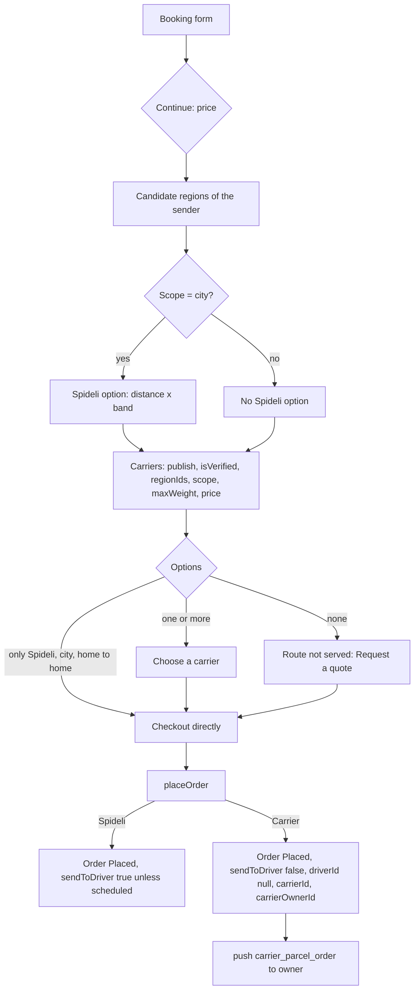
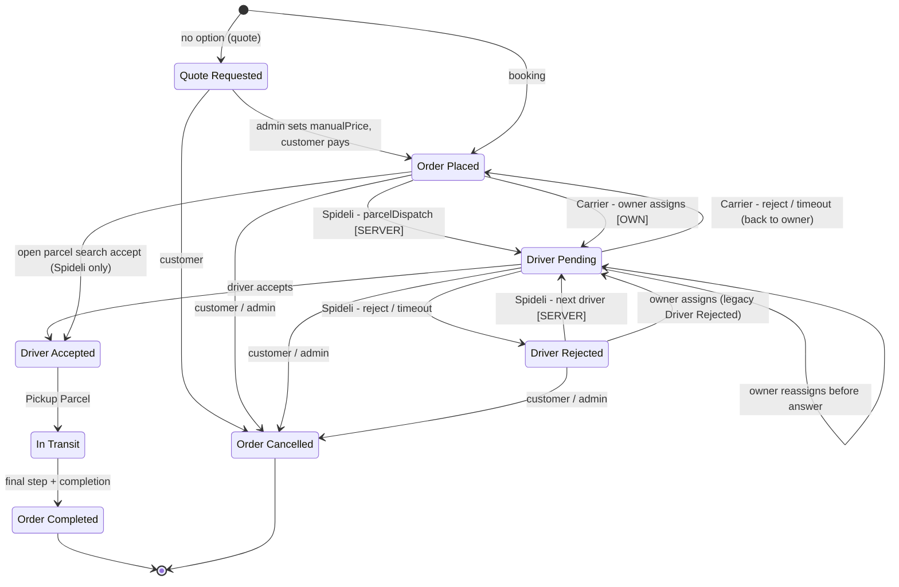
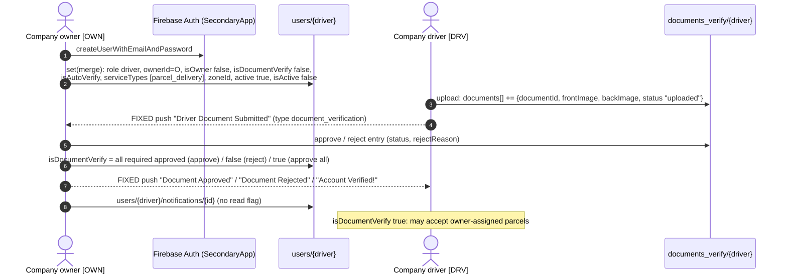
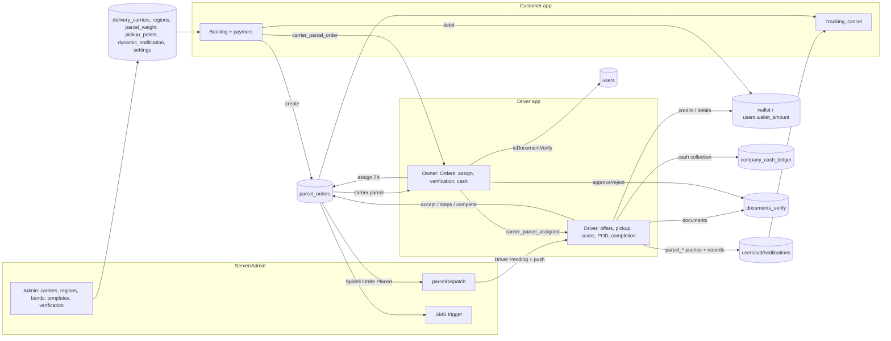
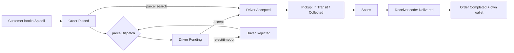
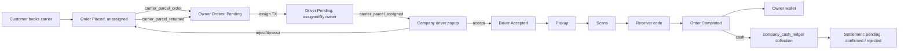

# Spideli Parcel Management and Delivery Flow (as built)

> **Verified on 13 Oct 2026, commit `a0eaf11`** (branch `feature/restaurant-app-panel-parity`).
> Every collection, field, status, notification type, template placeholder and rule below was read in the code of this repository at that commit. The live `dynamic_notification` collection was compared with a read-only snapshot of all 64 documents taken the same day.
>
> **The code is the source of truth.** Where a contract in `.claude/` says something else, the difference is listed in [section 10](#10-where-the-code-and-the-contracts-disagree).
>
> **Not in this repository, so not verified here:** the Cloud Functions (`parcelDispatch`, the receiver-SMS trigger, `deleteUser`), the admin panel and website, the live Firestore rules and the live Firestore indexes. Statements about them are marked **[SERVER]** or **[ADMIN]** and describe only what the apps expect from them.

Companion document: [`docs/PARCEL-FLOW.md`](PARCEL-FLOW.md) (written earlier the same day). It has longer pricing examples, a full `parcel_orders` field reference and a write log, and stays valid except where this document corrects it (see [section 10.2](#102-corrections-to-docsparcel-flowmd)).

**Labels used in this document**

| Label | Meaning |
|---|---|
| **[CUST]** | Customer app (`customer/`) |
| **[DRV]** | Driver app (`driver/`), a normal (platform) or a company driver |
| **[OWN]** | Driver app, company **owner** screens (the "Parcel Company App") |
| **[SERVER]** | Cloud Function or server trigger (not in this repository) |
| **[ADMIN]** | Admin panel or website (not in this repository) |
| IMPLEMENTED / PARTIAL / MISSING | Status labels used in section 9 |

---

## Table of contents

0. [The four roles and the apps](#0-the-four-roles-and-the-apps)
1. [Parcel order creation and service selection](#1-parcel-order-creation-and-service-selection)
2. [Order assignment flow](#2-order-assignment-flow)
3. [Company driver registration and verification](#3-company-driver-registration-and-verification)
4. [Pickup and delivery workflow](#4-pickup-and-delivery-workflow)
5. [Application interactions](#5-application-interactions)
6. [Firebase collections and data flow](#6-firebase-collections-and-data-flow)
7. [Dynamic notification flow](#7-dynamic-notification-flow)
8. [End-to-end workflow](#8-end-to-end-workflow)
9. [Existing issues and missing integrations](#9-existing-issues-and-missing-integrations)
10. [Where the code and the contracts disagree](#10-where-the-code-and-the-contracts-disagree)
11. [Glossary](#11-glossary)
12. [Source-file index](#12-source-file-index)

---

## 0. The four roles and the apps

| Role | App | `users/{uid}` markers | Job in the parcel flow |
|---|---|---|---|
| **Customer** (sender) | Customer app | customer account | Books the parcel, picks **Spideli drivers** or a **delivery company** (carrier), pays, tracks, may cancel before hand-over, gives the receiver code to the receiver. |
| **Normal driver** (Spideli / platform driver) | Driver app | `role: "driver"`, no `ownerId`, `isOwner` not `true` | Receives platform parcels from the `parcelDispatch` Cloud Function **[SERVER]** or takes them from the open **parcel search**. Picks up, delivers with the receiver code, is paid into its own wallet. |
| **Company owner** (fleet owner, "Parcel Company App") | Driver app, owner dashboard | `isOwner: true`, `driverType: "company"`, `carrierId` = its `delivery_carriers` document (set by **[ADMIN]**) | Receives every parcel booked with its carrier, assigns it to one of its drivers, reassigns returned parcels, verifies its drivers' documents, edits carrier prices, manages the drivers' cash. Never receives offers and never delivers. |
| **Company driver** | Driver app | `role: "driver"`, `ownerId` = owner uid, `isOwner: false` | Sees a carrier parcel only after the owner assigns it, accepts or rejects within the countdown, then picks up and delivers like any driver. Earnings go to the **owner's** wallet; cash collected goes to `company_cash_ledger`. |

> A company driver is still a driver: platform parcels without a carrier are not hidden from it (parcel search, or a `parcelDispatch` offer if the function chooses it). The earnings of those also go to the owner's wallet (`ParcelAmounts.walletUserFor`, `driver/lib/services/parcel_tracking_service.dart:489-490`).

---

## 1. Parcel order creation and service selection

Files: `customer/lib/screen_ui/parcel_service/book_parcel_screen.dart`, `customer/lib/controllers/book_parcel_controller.dart`, `customer/lib/screen_ui/parcel_service/parcel_carrier_selection_screen.dart`, `customer/lib/controllers/parcel_order_confirmation_controller.dart`, `customer/lib/service/parcel_shipping_service.dart`, `customer/lib/utils/parcel_pricing.dart`, `customer/lib/models/parcel_shipping_models.dart`, `customer/lib/utils/carrier_owner_link.dart`.

### 1.1 The booking form [CUST]

| Section | Fields | Rules (code) |
|---|---|---|
| What are you sending? | Parcel / Mail → `shipmentType` = `parcel` / `mail` | |
| Where to? | Same city / Other city / Other country → `scope` = `city` / `intercity` / `intercountry` | Scope is checked against the two addresses (`ParcelPricing.scopeFor`, `parcel_pricing.dart:383`); a mismatch asks the customer to pick the right scope. |
| Sender | location (GPS prefilled), name, mobile **with country code**, email (optional), city / country, note | Saved as `sender: {address, name, phone: "(+237) 6…", email}` plus `senderLatLong`. |
| Receiver | the same | The receiver mobile is required with its code. Also written flat: `receiverName`, `receiverPhone` (national digits), `receiverCountryCode` (`+237`) (`book_parcel_controller.dart:593-595`). |
| **Parcel details** | **one "Weight in kg" field** (required), L / W / H in cm (all three or none), declared value, content description | Under the weight field: **"Price band: <band title>"** on Same city, else *"Enter the parcel weight in kg. It sets the price."* (`book_parcel_screen.dart:241-252`). Validation: *"Please enter the parcel weight"*, and on Same city with no band covering the weight *"No price is set for this weight. Please contact support."* (`book_parcel_controller.dart:338-341`). |
| Pickup method | Home pickup / Drop-off at a pickup point → `pickupMethod` = `home` / `pickup_point` | Only published points of the order's region (`pickup_points`). |
| Delivery method | Home delivery / Collection at a pickup point → `deliveryMethod` | Point in the receiver's region. |
| Delivery type | As soon as possible / Scheduled (date + time) → `isSchedule`, `senderPickupDateTime` | A scheduled Spideli parcel is written `sendToDriver: false` (`book_parcel_controller.dart:555`). |
| Photos | optional images | Uploaded at checkout to Storage; URLs in `parcelImages` (`parcel_order_confirmation_controller.dart:297-305`). |
| Receiver SMS (checkout) | "Notify receiver via SMS" | Offered only when `settings/SMSGateway.isEnabled == true`, not a quote request, and the receiver phone and code exist (`parcel_order_confirmation_controller.dart:132-139`). Fee = `regions/{id}.parcelSmsFee` (default 50). Written `sendReceiverSms`, `smsCharge` (`:352-354`). The SMS itself is sent by **[SERVER]**. |

### 1.2 Price calculation (tap **Continue**, `bookNow`, `book_parcel_controller.dart:407-466`)

1. **Candidate regions** (`ParcelPricing.orderRegionCandidates`, `parcel_pricing.dart:527-555`), in this order:
   1. every existing region of the published **zones that contain the sender**;
   2. else the published regions of the sender's country;
   3. else the customer's own region.

   Sorted: the customer's own region first if it is a candidate, then the most specific region (served by the fewest zones). The first candidate is the **primary region R** (Spideli option, pickup points, currency).
2. **Distance:** Same city = road route (Google Directions or OSRM); other scopes = straight line. Same city must be at least 0.5 (*"…should be more than 1 km."*, `:445-449`).
3. **Weights:** `volumetricKg = L×W×H / divisor` (carrier's `regionPricing[Rc].volumetricDivisor`, else `regions/{R}.parcelPricing.volumetricDivisor`, else none); `chargeableKg = max(weightKg, volumetricKg)`.
4. **Spideli option** (`source: "default"`, **Same city only**, `:487-505`): `price = distance × band.delivery_charge` where the band is the `parcel_weight` document whose `minKg ≤ chargeableKg ≤ maxKg` (a gap takes the next band up).
5. **Carrier options** (`source: "rate_card"`, `ParcelCarrierOption.carrierOffers`, `parcel_shipping_models.dart:249-286`):
   `price = max(minimumCharge, baseCharge + perKmCharge × km + perKgCharge × chargeableKg)` from `regionPricing[Rc]` else the flat fields; plus options (pickup / delivery charges) and the region's fixed intercity / intercountry tax. Commission is added only when `settings/ParcelPricing.commissionAsExtra` and the section commission are on (`book_parcel_controller.dart:521-525`).
6. **Checkout total** (`calculatePrice`, `parcel_order_confirmation_controller.dart:225-241`):
   `TOTAL = (subTotal − discount) + platformFee + taxes + fixedTax + options + smsCharge`.

The full pricing reference with two worked examples is in `docs/PARCEL-FLOW.md` section 3.2 (still correct).

### 1.3 Choosing "Spideli drivers" or a delivery company

**Which carriers are offered** (`DeliveryCarrierModel.isEligible` + `servedRegion`, `parcel_shipping_models.dart:193-213`). A `delivery_carriers` document is offered only when **all** of these hold:

| Rule | Field | Code |
|---|---|---|
| Has a name | `name` non-empty | `parcel_shipping_service.dart:54` |
| Published | `publish != false` | `parcel_shipping_models.dart:194` |
| Not explicitly unverified | `isVerified != false` (missing counts as verified) | `:194` |
| **Serves ANY candidate region** | `regionIds` empty (= everywhere), **or** contains at least one candidate region of the sender; it is then priced in `Rc` = the **first** candidate it serves | `:207-213`, `:265-266` |
| Handles the scope | `scope` in `deliveryScopes` (missing / empty = all three) | `:195` |
| Can carry the weight | `maxWeight` unset or `≥ chargeableKg` | `:198` |
| Has a price | the rate card gives a price | `parcel_pricing.dart:606` |

**What the customer sees** ("Choose a carrier", `parcel_carrier_selection_screen.dart`):

- **"Spideli drivers" – "Standard same-city delivery"** first (Same city only), then the carriers **cheapest first** (`parcel_shipping_models.dart:284`).
- Each card: logo, name, estimated time, rating, total **in the currency of the option's own region** (`regionId` = `Rc` for a carrier, `R` for Spideli).
- **Selection screen skipped** when the shipment is Same city, home → home, and the only option is the Spideli option (`isLegacyShape`, `book_parcel_controller.dart:75` and `:456-459`): checkout opens directly.
- **No option at all** (for example Other city with no carrier): *"Route not served"* and **"Request a quote"** (`parcel_carrier_selection_screen.dart:84-117`). This writes a `Quote Requested` order with **no carrier**; the admin sets `manualPrice` **[ADMIN]** and the customer pays it later.

**What the chosen option writes on the order** (`goToCart`, `book_parcel_controller.dart:532-641`): `regionId` (and with it the currency, payment methods, SMS fee), `carrierId`, `carrierName`, `carrierOwnerId` (first from `delivery_carriers.ownerId`), `sendToDriver` (`false` for a carrier or a scheduled parcel, else `true`).

### 1.4 Placing the order (`placeOrder`, `parcel_order_confirmation_controller.dart:285-461`)

| Step | What is written | Code |
|---|---|---|
| Payment rules | "Receiver pays" (cash on delivery) only on Same city without pickup points; cash refused when a pickup point is used | `:92-95`, `:290-293` |
| Status | `Order Placed` (or `Quote Requested`) | `:324` |
| **Carrier parcel** | `sendToDriver: false`, `driverId: null`, `driverID: null`, no `driver`; **`carrierOwnerId` resolved again**: `users where carrierId == <carrierId>` then `where deliveryCarrierId == …`, first **company account** (`isOwner`, `driverType: company` or `isCompany`), else `delivery_carriers.ownerId` | `:325-336`, `parcel_shipping_service.dart:70-85`, `carrier_owner_link.dart:32-41`, `:276-283` |
| `companyOwnerId` | always the same value as `carrierOwnerId` | `customer/lib/models/parcel_order_model.dart:354-355` |
| Codes | `trackingNumber` = `SPD-yyMMdd-XXXXXX` (unique check), `qrValue` = `<websiteUrl>/track-parcel/<id>` else `spideli:parcel:<id>`, **`pickupCode`** = 6 random digits (**the receiver code**) | `:358-361`, `parcel_shipping_service.dart:145-183` |
| First tracking events | `Created`; then `Paid` (paid now) or `Waiting drop-off` (pickup point); `parcelStatus` = last event | `:390-397` |
| Wallet payment | debit + `wallet` row + order in **one transaction** (`FireStoreUtils.payFromWallet`) | `:414-452` |
| Other gateways | gateway charges first, then the order is saved (not atomic) | `:454-455` |
| After save | `users/{uid}.regionIds += regionId`; **carrier parcel: push `carrier_parcel_order` to the owner**; success screen; booking email `new_parcel_book` | `:401-412` |



ASCII fallback:

```
Form ─► Continue ─► candidate regions ─► [city? Spideli price] + eligible carriers
   ├─ only Spideli (city, home→home) ─► checkout
   ├─ none ─► "Route not served" ─► Request a quote (Quote Requested, no carrier)
   └─ list ─► "Choose a carrier" ─► checkout
checkout ─► placeOrder
   ├─ Spideli : Order Placed, sendToDriver = !isSchedule
   └─ Carrier : Order Placed, sendToDriver false, driverId/driverID null,
                carrierId, carrierName, carrierOwnerId = companyOwnerId
                └─► push carrier_parcel_order ─► company owner
```

---

## 2. Order assignment flow

### 2.1 Normal (Spideli) parcels: Cloud Function dispatch [SERVER] + offer popup [DRV]

**What `parcelDispatch` must do** (not in this repository; required by `.claude/DRIVER-DISPATCH-CONTRACT.md` and by the app code that reads it):

| # | Requirement | Why the app needs it |
|---|---|---|
| 1 | Start on `parcel_orders` with `status` `Order Placed` and `Driver Rejected`. | Only these are dispatchable. |
| 2 | **Skip every parcel with a non-empty `carrierId` or `carrierOwnerId`**, and respect `sendToDriver: false` (scheduled / carrier / quote) and `Quote Requested`. | The driver app hands a carrier parcel it was offered without the owner's `assignedBy` straight back to the owner (`incoming_offer_service.dart:666-669`, `:753-757`). |
| 3 | Pick a driver: `serviceTypes` contains `parcel_delivery` (or `parcel-service`), online, not `isOwner`, not in `rejectedByDrivers`, wallet minimums, `settings/DriverNearBy.singleOrderReceive`. | Matches the listeners and gates in the app. |
| 4 | Write `status: "Driver Pending"`, `driverId` = `driverID` = driver, **`dispatchedAt` (server time)**, and `users/{driver}.orderRequestData` arrayUnion id, in a transaction that re-checks the status. | The countdown starts from `dispatchedAt` (`OfferTiming.dispatchedAt`). |
| 5 | Push `{type: "parcel", orderId, id, click_action: "FLUTTER_NOTIFICATION_CLICK", status: "Driver Pending"}` on channel `spideli`. | Opens the offer dialog (`DispatchPush.parse`). |
| 6 | After `Driver Rejected`: offer the next driver. Server-side timeout of offers older than `driverOrderAcceptRejectDuration`. | The app times out only while it runs. |

**How the driver app shows the offer** (`driver/lib/services/incoming_offer_service.dart`):

- Started for every driver account, stopped for an owner (`isOwner == true`, `:166-169`).
- One live query per served module: `parcel_orders where driverId == me && status == "Driver Pending"` (`:253-262`), plus a document listener for every id in `users/{me}.orderRequestData`, plus the push.
- **Popup** (`app/incoming_offer/incoming_offer_dialog.dart`): pickup / drop addresses, the fare (= total the customer was charged), distance, weight, receiver name, **Accept**, **Reject** (reason sheet), countdown of `settings/DriverNearBy.driverOrderAcceptRejectDuration` seconds (default 120).
- **Accept gates** (`DispatchGateRules.check`, `dispatch_offer_rules.dart:635-652`; `_gate`, `incoming_offer_service.dart:858-874`): documents pending (`DocumentVerification.isPending`) blocks a timed offer; a driver with `ownerId` needs the **owner's** `wallet_amount ≥ ownerMinimumDepositToRideAccept`; an independent driver needs its own `wallet_amount ≥ minimumDepositToRideAccept`.

**Answer writes** (all in a transaction on the live order, `driver/lib/services/dispatch_offer_service.dart`):

| Action | Precondition (`acceptCheck` / `canReject`, `dispatch_offer_rules.dart:480-529`) | `parcel_orders/{id}` | `users/{me}` | Push |
|---|---|---|---|---|
| Accept | `Driver Pending` naming me (or open search: `Order Placed`, nobody named, **not** a carrier parcel) | `status: "Driver Accepted"`, `driverId` = `driverID` = me, `driver` = my profile, `receiverPickupDateTime` = now (`:125-128`, `acceptFields :535`) | `inProgressOrderID` += id, `orderRequestData` −= id (`:141-145`) | `parcel_accepted` → customer (`:296-297`) |
| Reject (reason) | `Driver Pending` naming me | `status: "Driver Rejected"`, `driverId`/`driverID` null, `rejectedByDrivers` += me, `driverRejections` += `{driverId, reason, code, at, afterAccept:false}` (`rejectFields :547`) | `orderRequestData` −= id | none |
| Timeout | still `Driver Pending` naming me | same, without `driverRejections` | same | none |
| Late accept | window over | answered as a timeout (`:79-82`) | | |

**Open parcel search** (`driver/lib/controllers/parcel_search_controller.dart`): `parcel_orders where sectionId in <my sectionIds> and status == "Order Placed"` within `settings/DriverNearBy.parcelRadius` km (default 50) of the searched source (`:144-160`), then filtered by `DispatchOrderRules.listedInParcelSearch` (`dispatch_offer_rules.dart:466-471`: names nobody else, not passed by me, **not a carrier parcel**). Accept requires verified documents and online (`isActive`) (`:96-104`).

### 2.2 Company (carrier) parcels: owner assignment [OWN] → company driver [DRV]

**1. Order arrives unassigned** ([section 1.4](#14-placing-the-order-placeorder-parcel_order_confirmation_controllerdart285-461)): `Order Placed`, `sendToDriver: false`, `driverId`/`driverID` null, `carrierId`, `carrierOwnerId` = `companyOwnerId`. Push `carrier_parcel_order` to the owner.

**2. Owner's Orders page** (owner dashboard → Orders → parcel section; `driver/lib/controllers/owner_order_list_controller.dart`, `app/owner_screen/owner_order_list.dart`). One-time fetch (`FireStoreUtils.getParcelOrdersBySection`, `driver/lib/utils/fire_store_utils.dart:1905-1962`):

```
parcel_orders where carrierOwnerId == me
parcel_orders where companyOwnerId == me
parcel_orders where carrierId == users/{me}.carrierId        (if set)
parcel_orders where driverId == <each of my drivers> orderBy createdAt desc
```

Tabs (`owner_order_list_controller.dart:41`, `:220-227`): **All**, **Pending** (`Order Placed` / `Driver Rejected`, nobody named), **Assigned** (`Driver Pending` with a driver), **In Transit**, **Delivered**, **Cancelled**. Card text: *"Waiting for driver assignment"*, *"Waiting for <name> to accept"* or *"Driver: <name>"*; button **Assign Driver** / **Reassign** (`owner_order_list.dart:694-703`).

**3. Driver picker** (`owner_order_list.dart:766-830`): drivers from `users where ownerId == me and isOwner == false` (`fire_store_utils.dart:605-617`), filtered by `CarrierParcelRules.isAssignableDriver` (same `ownerId`, not an owner, `role` driver, `active != false`; `carrier_parcel_rules.dart:234-240`), online first then by name. Each row: Online / Offline, **"Rejected this order before"**, phone. **No verification status is shown and none is checked** (see [9.3](#93-missing)).

**4. Assign transaction** (`CarrierParcelService.assign`, `driver/lib/services/carrier_parcel_service.dart:61-131`):

`CarrierParcelRules.assignCheck` (`carrier_parcel_rules.dart:172-187`), read inside the transaction:

| Order state | Result | Owner sees |
|---|---|---|
| not this company's (`carrierOwnerId`/`companyOwnerId` ≠ me and `carrierId` ≠ my `carrierId`) | refused | "This order is no longer available." |
| `Order Completed` / `Order Cancelled` / `Order Rejected` | refused | same |
| `Driver Accepted` / `Order Shipped` / `In Transit` | refused | "A driver already accepted this order." |
| `Quote Requested` | refused | "This quote is not paid yet." |
| `Driver Pending` to the same driver | refused | "This order is already waiting for this driver." |
| `Order Placed`, `Driver Rejected`, `Driver Pending` (other driver) | **OK** | "Order sent to the driver. Waiting for the driver to accept." |

Writes (`assignFields`, `carrier_parcel_rules.dart:205-218`; `carrier_parcel_service.dart:76-79`, `:88-97`):

```jsonc
// parcel_orders/{id}  (tx.update)
{ "status": "Driver Pending", "driverId": "<driver>", "driverID": "<driver>",
  "assignedBy": "<ownerUid>", "assignedAt": "<serverTimestamp>", "dispatchedAt": "<serverTimestamp>",
  "sendToDriver": false, "rejectedByDrivers": "arrayRemove(<driver>)", "driver": "<deleted>" }
// users/{driver}  (same transaction)
{ "orderRequestData": "arrayUnion(<orderId>)" }
// users/{replacedDriver}  (after the transaction, best effort, reassign only)
{ "orderRequestData": "arrayRemove(<orderId>)" }
```

Then the push `carrier_parcel_assigned` to the driver's **live** `fcmToken` on the job channel, with the parcel-offer data `{type: "parcel", orderId, id, click_action, status: "Driver Pending"}` (`:111-126`).

**5. Company driver answers** (same popup and countdown as section 2.1; `dispatchedAt` = `assignedAt`):

- **Accept**: only if the order names the driver **and** `assignedBy` == the order's owner (`ownerAssignedTo`, `carrier_parcel_rules.dart:132-138`; `acceptCheck`, `dispatch_offer_rules.dart:489`). Same writes as a normal accept. Customer gets `parcel_accepted`.
- **Reject / timeout**: back to the **owner**, never to dispatch (`returnToOwnerFields`, `carrier_parcel_rules.dart:223-230`; `dispatch_offer_service.dart:207-210`):

  ```jsonc
  { "status": "Order Placed", "sendToDriver": false, "driverId": null, "driverID": null,
    "rejectedByDrivers": "arrayUnion(<me>)",
    "driverRejections": "arrayUnion({...})"   // manual reject only
  }
  // users/{me}: orderRequestData −= id, inProgressOrderID −= id
  ```

  Then the owner gets `carrier_parcel_returned` (`carrier_parcel_service.dart:137-160`; recipient `carrierOwnerId`, else the driver's `ownerId`). `assignedBy` / `assignedAt` stay until the next assignment overwrites them.
- **Foreign offer** (a `Driver Pending` carrier parcel naming the driver **without** the owner's `assignedBy`, for example a dispatch function that does not skip carrier parcels): never shown; answered at once with the timeout write, so it returns to the owner (`incoming_offer_service.dart:666-669`, `:753-757`).

**6. Reassign**: allowed while `Order Placed`, `Driver Rejected`, or `Driver Pending` (not yet answered). The same driver may be chosen again (they are removed from `rejectedByDrivers`).

### 2.3 Statuses and transitions

`parcel_orders.status` (order lifecycle) and `parcel_orders.parcelStatus` (tracking step; each step also appends to `trackingEvents`):

| `status` | Set by | Meaning |
|---|---|---|
| `Quote Requested` | [CUST] | No option for the route; waits for `manualPrice` [ADMIN] |
| `Order Placed` | [CUST]; [DRV] company hand-back | Booked, nobody named (Spideli: waiting for dispatch; carrier: waiting for the owner) |
| `Driver Pending` | [SERVER] dispatch; [OWN] assign | Offered to one driver |
| `Driver Rejected` | [DRV] normal reject / timeout | Back to dispatch |
| `Driver Accepted` | [DRV] | Driver took it |
| `In Transit` | [DRV] pickup | Picked up |
| `Order Completed` | [DRV] final step | Delivered / handed to the destination point; earnings paid |
| `Order Cancelled` | [CUST], [ADMIN], [SERVER] | Cancelled |
| `Order Rejected`, `Order Shipped` | read by the apps, **not written by any app** for parcels | panel / legacy values |

| `parcelStatus` (rank) | Written by |
|---|---|
| `Created` (0), `Paid` (1), `Waiting drop-off` (1) | [CUST] at booking |
| `Collected` (2) | [DRV] pickup (home) |
| `At origin pickup point` (2) | [ADMIN] / pickup-point operator |
| `In transit` (3), `Arrived destination` (4), `Out for delivery` (5) | [DRV] scans |
| `At destination pickup point` (5) | [DRV] final step when `deliveryMethod = pickup_point` |
| `Delivered` (6) | [DRV] final step (home), or [ADMIN] when the receiver collects at the point |
| `Returned` (7), `Cancelled` (7) | `Cancelled`: [CUST] cancel; `Returned`: no app writes it |

Ranks: `ParcelTrackingStatus.rank`, `driver/lib/services/parcel_tracking_service.dart:30-56`. A step is never written backwards.



ASCII fallback:

```
            (no option)                      (booking)
   [*] ──► Quote Requested ──(paid)──► Order Placed ◄──────────────┐ carrier reject/timeout
                                         │      │                   │ (back to owner)
                     Spideli: dispatch   │      │ Carrier: owner     │
                     [SERVER]            ▼      ▼ assigns [OWN]      │
                                       Driver Pending ───────────────┘
                     reject/timeout ◄─────┘   │  ▲ owner reassigns
                 Driver Rejected ─(next)──────┘  │
                                              accept
                                                 ▼
          (search accept, Spideli) ──────► Driver Accepted ─Pickup─► In Transit ─final step─► Order Completed
  Cancel (customer/admin): from Quote Requested, Order Placed, Driver Pending, Driver Rejected ─► Order Cancelled
```

---

## 3. Company driver registration and verification

Files: `driver/lib/controllers/driver_create_controller.dart`, `driver/lib/app/owner_screen/driver_create_screen.dart`, `driver/lib/controllers/signup_controller.dart`, `driver/lib/utils/document_verification.dart`, `driver/lib/controllers/verification_controller.dart`, `driver/lib/controllers/verification_details_upload_controller.dart`, `driver/lib/services/owner_verification_service.dart`, `driver/lib/app/owner_screen/owner_driver_verification_list_screen.dart`, `driver/lib/app/owner_screen/owner_driver_verification_screen.dart`, `driver/lib/utils/fire_store_utils.dart`.

### 3.1 How a company driver account is created

**Path A: the owner creates the driver in the app** (IMPLEMENTED). Owner home → the add button (hidden while the owner itself is pending verification, `owner_home_screen.dart:222`) → `DriverCreateScreen` → `DriverCreateController.signUp` (`driver_create_controller.dart:304-345`):

1. Creates the Firebase Auth account (email + password) on a **secondary Firebase app** named `SecondaryApp`, so the owner stays signed in (`:294-312`).
2. Reads `settings/document_verification_settings` now (`FireStoreUtils.loadDocumentVerificationSettings`, `fire_store_utils.dart:387-397`).
3. Writes `users/{newUid}` with `set(merge)` (`updateUser(isNew: true)`, `fire_store_utils.dart:239-278`), then opens `wallet_amount: 0`, `orderRequestData: []`, `inProgressOrderID: []` if absent (`_openWallet`, `:284-299`).
4. Signs the secondary app out.

Fields written by `_applyCommonFields` (`driver_create_controller.dart:392-434`):

| Field | Value |
|---|---|
| `firstName`, `lastName`, `email` (lower-case), `phoneNumber`, `countryCode`, `countryISOCode` | form |
| `role` | `"driver"` |
| `active` | `true` (on create and on every edit) |
| `isActive` | `false` on create only (offline); an edit never changes it |
| **`isDocumentVerify`** | **`false`** on create (`DocumentVerification.initialFlags`, `document_verification.dart:51-56`) |
| **`isAutoVerify`** | `true` only when the admin switched driver verification off (`settings/document_verification_settings.isDriverVerification == false`), else `false` |
| `zoneId` | one zone out of the company's zones (`CompanyZones.forDriverPicker`) |
| `isOwner` | **`false`** (explicit) |
| **`ownerId`** | the owner's uid |
| `driverType` | `"individual"` |
| `regionId` | the owner's `regionId` when the driver has none |
| `sectionIds`, `sectionNames` | sections chosen among the owner's sections |
| **`serviceTypes`** | from the chosen sections' `serviceTypeFlag` (`Constant.driverServiceTypeFor`, `constant.dart:155-158`): a parcel section gives **`parcel_delivery`** |
| `vehicleDetails` | per cab / rental section only |
| `appIdentifier`, `provider: "email"`, `createdAt` | |

Edit (`updateDriver`, `:368-387`) never writes `isDocumentVerify`, `isActive`, `fcmToken`, `orderRequestData`, `inProgressOrderID` (`userSaveData`, `fire_store_utils.dart:200-225`). Delete goes through the **`deleteUser` Cloud Function** **[SERVER]** (`fire_store_utils.dart:2002-2004`, `owner_home_controller.dart:170`).

**Path B: self sign-up "under an owner"** (MISSING). The driver sign-up form offers only **Individual** or **Company** (`signup_controller.dart:97`, `:456`, `:470`). An Individual sign-up writes `isOwner: false`, `driverType: "individual"` and **no `ownerId`**; there is no field or flow to join an existing company. A self-registered driver can only become a company driver if **[ADMIN]** sets `ownerId` (not verifiable here). A Company sign-up creates an **owner** account (`isOwner: true`, `driverType: "company"`, `companyName`, `operatingLicence`, …), never linked to a carrier by the app (`carrierId` is admin-only).

| Sign-up field | Owner-created driver | Self-registered individual |
|---|---|---|
| `ownerId` | owner uid | absent |
| `isOwner` | `false` | `false` |
| `driverType` | `individual` | `individual` |
| `active` | `true` | `settings/DriverNearBy.auto_approve_driver == true` ? `true` : `false` (`signup_controller.dart:441`) |
| `isDocumentVerify` | `false` | `false` |
| `isAutoVerify` | `isDriverVerification == false` | same |

### 3.2 Document submission by the driver

1. **Required document types** = enabled `documents` of the driver's types (`documentTypesForCurrentUser`, `fire_store_utils.dart:1090-1098`): `"driver"` (or `"owner"` for an owner account), plus `"vehicle"` for a cab or rental driver. Query: `documents where type in [...] and enable == true` (`:1103-1124`). `documents/{id}` fields: `title`, `type`, `enable`, `frontSide`, `backSide`, `expireAt` (bool).
2. **Upload** (`DetailsUploadController.uploadDocument`, `verification_details_upload_controller.dart:95-151`): images to Storage `driverDocument/<uid>/…`; entry `{documentId, frontImage, backImage, status: "uploaded", expireAt?}` (review reason cleared).
3. **Save** (`FireStoreUtils.uploadDriverDocument`, `fire_store_utils.dart:1260-1302`): `documents_verify/{uid}` = `{id, type: "driver" | "owner", documents: [ … ]}` with `set(merge)`; an existing entry for the same `documentId` is replaced.
4. **Owner notified** (only when the driver has an `ownerId`): **fixed-text push** "Driver Document Submitted" / "<name> submitted <document> for verification.", data `{type: "document_verification", driverId}`, general driver channel (`:118-139`). No `dynamic_notification` template, no notification record.
5. **Status per entry** (`Documents.verificationStatus`, `driver/lib/models/driver_document_model.dart:84-90`): `not_submitted` (no entry) → `pending` (`uploaded`) → `approved` / `rejected` → `expired` (when `expireAt` is past). A rejected or expired document can be uploaded again (`canUpload`, `verification_details_upload_controller.dart:27-30`).

### 3.3 Owner verification in the app (IMPLEMENTED, with gaps)

Entry points: owner dashboard menu **"Driver Verification"** (`owner_dashboard_screen.dart:249-256`) → `OwnerDriverVerificationListScreen`; also from the driver lists (`owner_home_screen.dart:186`, `view_all_drivers.dart:50`) → `OwnerDriverVerificationScreen`.

**List screen** (`owner_driver_verification_list_screen.dart:39-79`): `users where ownerId == me` (no `isOwner` filter), each driver's `documents_verify/{driverId}`; category: `isDocumentVerify == true` → Verified; no entries → Not submitted; any `rejected` → Rejected; else Pending. Tabs: Pending, Verified, Incomplete (rejected + not submitted), All.

**Detail screen** (`owner_driver_verification_screen.dart`): required documents from `OwnerVerificationService.getRequiredDocuments()` and the driver's entries; per document **Approve** (needs an image) / **Reject** (reason mandatory); **Approve All** (refused while any required document has no image, `:177-195`).

**Writes** (`driver/lib/services/owner_verification_service.dart`):

| Action | `documents_verify/{driverId}` (`set(merge)`) | `users/{driverId}` | Push to the driver (**fixed text**, `sendOneNotification`, recipient driver) | Record |
|---|---|---|---|---|
| Approve one (`approveDocument`, `:83-168`) | entry `status: "approved"`, reason removed | `isDocumentVerify` = **true only if every required document is now `approved`, else `false`** (`:108-121`) | "Document Approved" / "Your <title> has been approved by your Company Owner." or "All Documents Approved!" / "All your documents have been approved by your Company Owner. You can now accept deliveries!" (`:131-134`) | `users/{driverId}/notifications/{id}` = `{id, title, body, type: "document_verification", createdAt}` (`:152-161`) |
| Reject one (`rejectDocument`, `:172-250`) | entry `status: "rejected"`, `rejectReason` = `rejectionReason` = `reason` = text | `isDocumentVerify: false` (`:199-201`) | "Document Rejected" / "Your <title> was rejected by your Company Owner. Reason: <reason>. Please re-upload." (`:213-214`) | same shape + `reason` |
| Approve all (`approveAllDocuments`, `:253-323`) | every required entry `approved` | `isDocumentVerify: true` (`:279-281`) | "Account Verified!" / "All your documents have been approved by your Company Owner. You can now accept deliveries!" (`:289-290`) | same shape |

Push data: `{type: "document_verification", status: "approved" | "all_approved" | "rejected", documentId?, reason?, title, body}`. A tap opens the **VerificationScreen** of whoever receives it (`driver/lib/utils/notification_service.dart:766-767`).

**What changes for the driver:** `isDocumentVerify == true` (or `isAutoVerify == true` while the admin keeps verification off) clears `DocumentVerification.isPending` (`document_verification.dart:43-47`), which is the gate for:
- accepting a **timed** offer, including an owner-assigned carrier parcel (`DispatchGateRules.check`, `dispatch_offer_rules.dart:645`);
- accepting from the parcel search (`parcel_search_controller.dart:96-99`);
- the home screens' "Document Verification in Pending" state.
A rejected or expired required document also blocks going online (`documentBlockReason`, `fire_store_utils.dart:1137-1159`).

### 3.4 Owner verification vs admin verification

| Aspect | Owner (driver app) | Admin panel [ADMIN] |
|---|---|---|
| Who it covers | drivers with `ownerId == owner` | every holder (`documents_verify/{holderId}`) |
| Required types | **only `type == "driver"`** documents (`getRequiredDocuments`, `owner_verification_service.dart:33-64`); fallback: all enabled documents not of type `owner` (`:58-59`) | per role (not verifiable here) |
| Account flag | writes `users/{driverId}.isDocumentVerify` true / false | per `.claude/BUG-REPORT-01-ADMIN.md` §"One screen…": the panel's driver document screen sets `isDocumentVerify` **and `isActive` together** (not verifiable in this repository) |
| Contract | `driver/lib/utils/document_verification.dart:6-10` says *"This app never sets it to `true`"* (only the administrator does) | contradicted by `OwnerVerificationService` (see [9.3](#93-missing)) |

### 3.5 Verification sequence



ASCII fallback:

```
Owner ─(SecondaryApp Auth)─► users/{driver}: ownerId, isOwner false, isDocumentVerify false, serviceTypes, zoneId
Driver ─► documents_verify/{driver}: entry status "uploaded" ─► FIXED push to owner "Driver Document Submitted"
Owner ─► approve/reject entry ─► users/{driver}.isDocumentVerify ─► FIXED push to driver (+ notifications record)
Driver verified ─► offer gate open ─► can accept owner-assigned parcels
```

---

## 4. Pickup and delivery workflow

Identical code for normal and company drivers (`driver/lib/services/parcel_tracking_service.dart`, `driver/lib/controllers/parcel_home_controller.dart`, `driver/lib/app/parcel_screen/parcel_tracking/*`). Differences are listed in [4.6](#46-normal-vs-company-driver-differences).

### 4.1 Pickup ("Pickup Parcel", `onLegacyPickup`, `:326-357`)

1. Refused when `pickupMethod == "pickup_point"` and the parcel is not yet at the origin point: *"The sender has not dropped the parcel off at the origin pickup point yet."*
2. **Transaction** `ParcelPickupRules.pickupFields` (`driver/lib/services/parcel_flow_rules.dart:21-31`): the order must name me, `status` `Driver Accepted` / `Order Shipped` (or already `In Transit`: nothing written), `parcelStatus` not `Cancelled` / `Returned`. Writes `status: "In Transit"`. Otherwise *"This parcel can no longer be picked up."*
3. Tracking step: `Collected` (home pickup) or `In transit` (taken from the origin point), with `trackingEvents` arrayUnion `{status, at, by, role: "driver", lat, lng}` (`_writeStatus`, `:274-306`).
4. Pushes: `parcel_picked_up` to the customer (only for `Collected`), and `carrier_parcel_picked_up` to the company owner (only for `Collected`) (`:297-303`).

### 4.2 Scans ("Parcel run" + Scan)

`nextActions` (`:172-212`): `Collected`/`At origin pickup point` → `In transit` (+ final leg on Same city) → `Arrived destination` (+ final leg on Same city) → final leg `Out for delivery` (home) / `At destination pickup point` (point) → `Delivered`. Members of the fleet (owner and its drivers) may record intermediate scans of a fleet parcel (`isInMyFleet`, `:146-151`); only the assigned driver records the final step.

| Step | Customer push (`ParcelStatusPush.customerTemplate`, `parcel_flow_rules.dart:42-52`) |
|---|---|
| `Collected` | `parcel_picked_up` |
| `In transit` | `parcel_in_transit` |
| `Arrived destination` | `parcel_arrived_destination` |
| `Out for delivery`, `At destination pickup point`, `Delivered` | none (completion sends `parcel_completed`) |

Data of these pushes: `{type: "parcel_order", orderId, parcelStatus}`; each also writes the customer's Notification Center record (section 7.3).

### 4.3 Delivery with the receiver code (POD)

"Deliver Parcel" (`completeParcel`, `parcel_home_controller.dart:127-170`; `prepareLegacyDeliver`, `parcel_tracking_service.dart:359-372`):

- Same city, home → home, already picked up: completes in one go. Any other parcel: only when the next scan step is the final one, else *"Scan the parcel to update its status"*.
- **Proof sheet** (`app/parcel_screen/parcel_tracking/parcel_proof_sheet.dart`): if the order has a `pickupCode`, the driver **must type the code the receiver gives**; it is compared on the device with the order's `pickupCode` (`:97-111`); wrong → *"Invalid code"* (no attempt limit). Proof `deliveryProof: {type: "otp", at, by}`. Orders without a code: photo to `parcelDeliveryProof/<orderId>/…`, proof `{type: "photo", photoUrl, at, by}`.
- Delivery to a pickup point: confirmation *"Hand over at the pickup point"*; the final step is `At destination pickup point`; the receiver later collects with the same code at the point **[ADMIN / website]**.
- The **order-POD contract** (`.claude/POD-OTP-CONTRACT.md`, `order_pod`) explicitly does **not** apply to parcels.

### 4.4 Completion, wallet and commission (`completeOrder`, `:415-463`)

1. **Claim once** (transaction `_claimCompletion`, `:382-403`): refused if `driverCredited == true`, completed, cancelled, rejected, or `parcelStatus` `Cancelled` / `Returned`; writes `{status: "Order Completed", driverCredited: true}`.
2. `users/{me}.inProgressOrderID` −= id.
3. **Wallet** (`_updateWalletAmount`, `:465-616`). Wallet user = the driver, or the **owner** for a driver with `ownerId`:

   | Payment | Credit (`wallet` row, `isTopUp: true`) | Debits (`wallet` row each, then `users/{walletUser}.wallet_amount`) |
   |---|---|---|
   | Online | `subTotal − discount + orderTax + options`, note *"Booking amount credited"* | *"Admin commission deducted"* |
   | Cash (`payment_method == "cod"`) | none (the driver holds the cash = `ParcelAmounts.total`) | commission; *"Parcel fixed tax deducted"*; *"Parcel receiver SMS fee deducted"*; *"Parcel platform fee deducted"* |
4. **Pushes**: `parcel_completed` → customer; `carrier_parcel_delivered` → owner (`:436-440`).
5. **Company cash** (cash parcel by a driver with `ownerId`): `company_cash_ledger` row `type: "collection"` + `company_cash_collected` → owner (`:443-455`; `company_cash_service.dart:27-94`).
6. **Referral** on the customer's first parcel (`updateParcelReferralAmount`, `:458-462`).

### 4.5 Customer communication during the trip

| Channel | What | Code |
|---|---|---|
| Push + Notification Center record | `parcel_accepted`, `parcel_picked_up`, `parcel_in_transit`, `parcel_arrived_destination`, `parcel_completed` | driver `send_notification.dart:166-180`, `:340-376` |
| Live screens | My Bookings (chip: "Looking for a driver" while `Driver Pending` / `Driver Rejected`), order details, "Track a parcel" (tracking number, QR, id) with `trackingEvents` and a map | `customer/lib/utils/booking_status_tabs.dart:42-51` |
| Chat | customer ↔ assigned driver, `chat/{orderId}` + `chat/{orderId}/thread/{msgId}`, chat push (`sendChatFcmMessage`) | `customer/lib/screen_ui/parcel_service/parcel_order_details.dart:257-283`, `driver/lib/app/parcel_screen/parcel_home_screen.dart:210-235`, `driver/lib/utils/fire_store_utils.dart:2032-2045` |
| Phone | call the driver | `parcel_order_details.dart:252` |
| Receiver SMS | `placed`, `atPickupPoint`, `delivered` events, if `sendReceiverSms` | **[SERVER]** trigger on `parcel_orders`; the apps only write `sendReceiverSms`, `smsCharge`, `receiverName`, `receiverPhone`, `receiverCountryCode`, `smsOptOut: false` |
| Receipt / receiver code | order details show `pickupCode` with copy; receipt PDF with QR | `customer/lib/utils/parcel_receipt_pdf.dart` |
| Email | `email_templates` type `new_parcel_book` after a new booking | `customer/lib/service/fire_store_utils.dart:2300` |

The company owner has **no chat** with the customer or its driver in the parcel flow.

### 4.6 Normal vs company driver differences

| Topic | Normal driver | Company driver |
|---|---|---|
| Offer source | `parcelDispatch` [SERVER] or parcel search | owner assignment (carrier parcels); platform parcels like a normal driver |
| Reject / timeout result | `Driver Rejected` → next driver | carrier parcel: `Order Placed` → owner (`carrier_parcel_returned`) |
| Accept wallet gate | own `wallet_amount ≥ minimumDepositToRideAccept` | owner's `wallet_amount ≥ ownerMinimumDepositToRideAccept` |
| Earnings | own wallet | owner's wallet |
| Cash collected | kept; debits on own wallet | `company_cash_ledger` `collection` + `company_cash_collected`; settles with the owner |
| Owner pushes | none | `carrier_parcel_picked_up`, `carrier_parcel_delivered` (also for platform parcels the company driver carries, via the driver's `ownerId`) |

### 4.7 Company cash ledger (`driver/lib/services/company_cash_service.dart`)

| `type` | Written by | `status` | Push |
|---|---|---|---|
| `collection` | driver app at cash completion (`:27-94`) | `confirmed` | `company_cash_collected` → owner |
| `settlement` | driver, Cash settlement screen (`:97-145`, `app/driver_cash_settlement_screen.dart`) | `pending` → `confirmed` / `rejected` by the owner (transaction, owner only, `:147-255`) | `company_cash_settlement_submitted` → owner; `…_confirmed` / `…_rejected` → driver |
| `adjustment` | owner (`:257-310`) | `confirmed` | `company_cash_adjustment` → driver |

Row fields: `id`, `ownerId`, `driverId`, `driverName`, `orderId`, `orderType: "parcel"`, `type`, `amount`, `isCredit`, `paymentMethod`, `status`, `createdAt`, `confirmedAt`, `verifiedBy`, `rejectionReason`, `notes`.

---

## 5. Application interactions

### 5.1 Responsibility matrix

| Stage | Customer app | Normal driver | Owner (Parcel Company App) | Company driver | Server / admin |
|---|---|---|---|---|---|
| Configuration | reads | reads | edits own carrier prices, scopes, times (`delivery_carriers` field paths) | | creates carriers, binds `users.carrierId` / `delivery_carriers.ownerId`, `publish`, `isVerified`, `regionIds`, regions, bands, pickup points, templates, settings |
| Driver onboarding | | self sign-up, uploads documents | creates drivers, verifies their documents | uploads documents | verifies documents, `active`, `ownerId` for self sign-ups |
| Booking | form, price, option, payment, order create, owner push | | receives `carrier_parcel_order` | | SMS `placed` |
| Assignment | sees "Looking for a driver" | offer popup / search | assigns, reassigns | accepts / rejects | `parcelDispatch` (Spideli) |
| Pickup / transit | tracking, pushes | pickup, scans | pushes; can scan fleet parcels | pickup, scans | origin point drop-off scan |
| Delivery | gives the receiver code | code, completion, wallet | `carrier_parcel_delivered`, cash pushes | code, completion, owner wallet, cash ledger | receiver collection at point, SMS `delivered` |
| Cancel | cancel + refund (before hand-over) | | | | admin cancel, auto-cancel |

### 5.2 Normal (Spideli) parcel

```mermaid
sequenceDiagram
    autonumber
    actor C as Customer app
    participant DB as parcel_orders
    participant CF as parcelDispatch [SERVER]
    actor D as Normal driver
    C->>DB: create: Order Placed, sendToDriver true, parcelStatus Created/Paid, pickupCode
    CF->>DB: Driver Pending, driverId=driverID=D, dispatchedAt; users/D.orderRequestData += id
    CF-->>D: push type "parcel" (channel spideli)
    alt accept
        D->>DB: Driver Accepted, driver snapshot
        D-->>C: parcel_accepted (+ notifications record)
    else reject / timeout
        D->>DB: Driver Rejected, rejectedByDrivers += D
        CF->>DB: next driver
    end
    D->>DB: In Transit / Collected
    D-->>C: parcel_picked_up
    D->>DB: In transit, Arrived destination, Out for delivery
    D-->>C: parcel_in_transit, parcel_arrived_destination
    D->>DB: Delivered + deliveryProof(otp), then Order Completed + driverCredited
    D->>DB: wallet rows (own wallet)
    D-->>C: parcel_completed
```

### 5.3 Company parcel

```mermaid
sequenceDiagram
    autonumber
    actor C as Customer app
    participant DB as parcel_orders
    actor O as Owner (Parcel Company App)
    actor CD as Company driver
    C->>DB: create: Order Placed, sendToDriver false, driverId null, carrierId, carrierOwnerId
    C-->>O: carrier_parcel_order (driver_jobs)
    O->>DB: TX Driver Pending, driverId=CD, assignedBy=O, assignedAt=dispatchedAt; users/CD.orderRequestData += id
    O-->>CD: carrier_parcel_assigned (offer data, popup + countdown)
    alt accept (documents verified, owner wallet minimum)
        CD->>DB: Driver Accepted
        CD-->>C: parcel_accepted
    else reject / timeout
        CD->>DB: Order Placed, nobody named, rejectedByDrivers += CD
        CD-->>O: carrier_parcel_returned
        O->>DB: assign again
    end
    CD->>DB: In Transit / Collected
    CD-->>C: parcel_picked_up
    CD-->>O: carrier_parcel_picked_up
    CD->>DB: scans … Delivered (receiver code) → Order Completed
    CD->>DB: wallet rows on the OWNER's wallet; cash: company_cash_ledger collection
    CD-->>C: parcel_completed
    CD-->>O: carrier_parcel_delivered (+ company_cash_collected if cash)
```

ASCII fallback for 5.2 and 5.3:

```
SPIDELI:  C ─create─► DB ─► CF dispatch ─► D (popup) ─accept─► DB ─► C:parcel_accepted
                                  ▲            └─reject/timeout─► Driver Rejected ─┘
          D: pickup ─► C:parcel_picked_up ; scans ─► C:in_transit/arrived ; code ─► Completed ─► C:parcel_completed

COMPANY:  C ─create(unassigned)─► DB ; C ─carrier_parcel_order─► O
          O ─assign TX─► DB ; O ─carrier_parcel_assigned─► CD (popup)
          CD ─accept─► DB ─► C:parcel_accepted
          CD ─reject/timeout─► Order Placed ─► O:carrier_parcel_returned ─► O assigns again
          CD: pickup ─► C:parcel_picked_up + O:carrier_parcel_picked_up
          CD: code ─► Completed ─► owner wallet (+ cash ledger) ─► C:parcel_completed + O:carrier_parcel_delivered
```

---

## 6. Firebase collections and data flow

### 6.1 Collections

| Collection / document | Key fields used by the parcel flow | Read by | Written by |
|---|---|---|---|
| `parcel_orders/{orderId}` | see 6.2 | CUST, DRV, OWN, ADMIN, SERVER | CUST (create, cancel, quote pay), SERVER (dispatch, SMS), OWN (assign), DRV (answer, steps, complete), ADMIN (price quote, point scans, cancel) |
| `users/{uid}` | `role`, `isOwner`, `ownerId`, `driverType`, `isCompany`, `carrierId` (old `deliveryCarrierId`), `companyName`, `serviceTypes`, `sectionIds`, `zoneId`/`zoneIds`, `regionId`, `regionIds` (customer), `isActive`, `active`, `isDocumentVerify`, `isAutoVerify`, `fcmToken`, `wallet_amount`, `orderRequestData`, `inProgressOrderID` | all | each app for itself; OWN: its drivers (create / edit / `orderRequestData` / `isDocumentVerify`); DRV: owner's `wallet_amount` (company earnings); CUST: own `wallet_amount`, `regionIds`; ADMIN: `carrierId`, `active`, verification |
| `users/{uid}/notifications/{id}` | `id, title, body, type, category, orderId, status, data, read, createdAt, source` | CUST (Notification Center) | DRV (with every customer push); CUST (fallback); OWN (document verification records on the **driver's** document, different shape) |
| `delivery_carriers/{carrierId}` | `name`, `photo`, `publish`, `isVerified`, `regionIds`, `regionPricing.<R>.*`, flat prices, `deliveryScopes`, `maxWeight`, `min/maxDeliveryTime`, `deliveryTimeUnit`, `conditions`, `rating`, `ownerId`, `phone`, `email`, `countryCode` | CUST, OWN | ADMIN; OWN (allowed fields, `update()` with field paths, `carrier_dispatch_service.dart:84-96`) |
| `regions/{regionId}` | `parcelPricing.{volumetricDivisor, homePickupCharge, pointDropoffCharge, homeDeliveryCharge, pointCollectionCharge, intercityFixedTax, intercountryFixedTax}`, `parcelSmsFee`, currency | CUST, DRV | ADMIN |
| `zone/{id}` | `regionIds`, polygon, `publish` | CUST, DRV | ADMIN |
| `parcel_weight/{id}` | `title`, `delivery_charge` (string), `minKg`/`maxKg` (or `min_kg`/`max_kg`) | CUST | ADMIN |
| `parcel_categories`, `parcel_coupons` | category, coupons | CUST | ADMIN |
| `pickup_points/{id}` | `publish`, `regionId`/`regionIds`, `name`, location, `openingHours`, `phone` | CUST, DRV | ADMIN |
| `documents/{id}` | `title`, `type` (`driver` / `owner` / `vehicle` / …), `enable`, `frontSide`, `backSide`, `expireAt` | DRV, OWN | ADMIN |
| `documents_verify/{uid}` | `id`, `type` (`driver` / `owner`), `documents: [{documentId, frontImage, backImage, status, expireAt?, rejectReason/rejectionReason/reason}]` | DRV, OWN, ADMIN | DRV (upload), OWN (approve / reject), ADMIN |
| `dynamic_notification/{id}` | `type`, `subject`, `message`, `service_type` | CUST, DRV (query `type ==`, first doc) | ADMIN |
| `email_templates` | type `new_parcel_book` | CUST | ADMIN |
| `wallet/{txId}` | `id, user_id, amount, isTopUp, order_id, payment_method, payment_status, transactionUser, note, regionId, serviceType, date` | apps, ADMIN | CUST (debit, refund), DRV (credits, debits, for itself or its owner) |
| `company_cash_ledger/{txId}` | section 4.7 | OWN, company drivers | DRV, OWN |
| `chat/{orderId}` + `/thread/{msgId}` | inbox + messages (customer ↔ driver) | CUST, DRV | CUST, DRV |
| Storage | `driverDocument/<uid>/…`, `parcelDeliveryProof/<orderId>/…`, `images/<uuid>.png` (parcel photos) | | DRV, CUST |
| `sms_log`, `parcel_sms_outbox`, `parcel_orders.smsSent` | SMS | SERVER | SERVER only |

**`settings/*` read by the parcel flow**

| Document.field | Used for | Default in code |
|---|---|---|
| `DriverNearBy.driverOrderAcceptRejectDuration` | offer countdown (s) | 120 |
| `DriverNearBy.minimumDepositToRideAccept` / `ownerMinimumDepositToRideAccept` | accept gates | 0 |
| `DriverNearBy.parcelRadius` | parcel search radius (km) | 50 |
| `DriverNearBy.singleOrderReceive` | home layout; dispatch [SERVER] | false |
| `DriverNearBy.auto_approve_driver` | `active` at self sign-up | null |
| `document_verification_settings.isDriverVerification` / `isOwnerVerification` | `isAutoVerify` at creation; live release of the gate | null (= on) |
| `ParcelPricing.commissionAsExtra` | commission added to the carrier price | false |
| `SMSGateway.isEnabled` | offer the receiver SMS | off |
| `cancellationReasons.<role>` | reason lists | app defaults |
| `globalSettings.order_ringtone_url` | job channel ringtone | none |
| `Version.websiteUrl` | QR = `<websiteUrl>/track-parcel/<id>` | `spideli:parcel:<id>` |
| `notification_setting.{senderId, serviceJson, serverPushUrl}` | how pushes are sent (FCM v1 from the device, or via a server URL) | |
| section `adminCommision`, `platformFee` | commission, platform fee | |

### 6.2 `parcel_orders` fields by stage

| Stage | Writer | Fields |
|---|---|---|
| Create | CUST | `id, sectionId, regionId, author, authorID, createdAt, status, sendToDriver, isSchedule, senderPickupDateTime, receiverPickupDateTime, sender, receiver, receiverName, receiverPhone, receiverCountryCode, senderLatLong, receiverLatLong, sourcePoint, destinationPoint, senderZoneId, receiverZoneId, distance, parcelType, parcelCategoryID, parcelWeight, parcelWeightCharge, weightKg, dimensions, declaredValue, contentDescription, parcelImages, note, receiverNote, shipmentType, scope, origin, destination, pickupMethod, deliveryMethod, originPickupPointId, destinationPickupPointId, dropoffPointId, pickupPointId, trackingNumber, qrValue, pickupCode, subTotal, discount, discountType, discountLabel, taxSetting, platformFee, platformTax, adminCommission, adminCommissionType, payment_method, paymentCollectByReceiver, parcelScopeTax, priceBreakdown, sendReceiverSms, smsCharge, smsOptOut:false, quoteRequested, carrierId, carrierName, carrierOwnerId, companyOwnerId, driverId:null, driverID:null, parcelStatus, trackingEvents` |
| Dispatch | SERVER | `status, driverId, driverID, dispatchedAt` |
| Assign | OWN | `status, driverId, driverID, assignedBy, assignedAt, dispatchedAt, sendToDriver, rejectedByDrivers(−), driver(deleted)` |
| Accept | DRV | `status, driverId, driverID, driver, receiverPickupDateTime` |
| Reject / timeout | DRV | Spideli: `status: Driver Rejected, driverId, driverID, rejectedByDrivers(+), driverRejections(+)`; carrier: `status: Order Placed, sendToDriver:false, driverId, driverID, rejectedByDrivers(+), driverRejections(+)` |
| Pickup / scans | DRV | `status: In Transit`, `parcelStatus`, `trackingEvents(+)` |
| Final step | DRV | `parcelStatus, trackingEvents(+), deliveryProof`, then `status: Order Completed, driverCredited: true` |
| Cancel | CUST | `status: Order Cancelled, driverId/driverID null (before accept), cancelReason, cancelReasonCode, cancelledBy, cancelledByName, cancelledAt, cancelAction, parcelStatus: Cancelled, trackingEvents(+)` |
| Quote | ADMIN / CUST | `manualPrice` (ADMIN); payment (CUST) as create |
| SMS | SERVER | `smsSent.{placed, atPickupPoint, delivered}`, `smsOptOut` |

### 6.3 Data flow between the apps



ASCII fallback:

```
Admin ─► delivery_carriers, regions, parcel_weight, pickup_points, dynamic_notification, settings ─► Customer app
Customer ─► parcel_orders (create) + wallet ─► (Spideli) parcelDispatch ─► driver offer
                                          └─► (carrier) owner Orders ─► assign ─► company driver offer
Driver ─► parcel_orders (accept, steps, complete) + wallet (+ company_cash_ledger) + users/{customer}/notifications
Driver ─► documents_verify ◄─ Owner (approve/reject) ─► users/{driver}.isDocumentVerify
SMS trigger [SERVER] ◄─ parcel_orders (create / update)
```

### 6.4 Rules and indexes (dependencies)

- **Live rules**: not in the repository. `firestore.rules.draft` is **not deployed** (header, lines 3-20; last updated 7 Oct 2026, before the 12 Oct carrier assignment flow).
- In the draft, `company_cash_ledger` has **no rule** (falls to the admin-only wildcard, `:1077-1079`); `parcel_orders` updates go through `dispatchUpdateOk` (`:769-773`, `:830-834`) and nothing mentions `assignedBy` / `carrierOwnerId`; the owner's `delivery_carriers` allowlist (`:958-968`) lacks `email` and `deliveryScopes`, which the owner app writes (`driver/lib/models/delivery_carrier_model.dart:48`, `:74`); `users/{id}/notifications` creates require `read == false` (`:495-503`), which the owner-verification records do not write; `documents_verify` is open to any signed-in user (`:1034-1042`).
- **Indexes**: no `firestore.indexes.json` in the repository. Composite indexes needed by the parcel queries: `parcel_orders (driverId ASC, createdAt DESC)` (owner Orders, `fire_store_utils.dart:1941-1944`); `parcel_orders (sectionId, status, sourcePoint.geohash)` (parcel search); `parcel_orders (authorID, sectionId, createdAt DESC)` (My Bookings). Equality-only queries (`carrierOwnerId`, `companyOwnerId`, `carrierId`, `trackingNumber`, `status + driverId`, `users ownerId + isOwner`, `company_cash_ledger orderId + type`, `documents type in + enable`) need no composite index.

---

## 7. Dynamic notification flow

### 7.1 How a push is built

| | Customer app sender | Driver app sender (driver and owner) |
|---|---|---|
| Template lookup | `dynamic_notification where type == <type>` (first doc) (`customer/lib/service/fire_store_utils.dart:1912-1925`) | `… where type == <type> limit 1` (`driver/lib/utils/fire_store_utils.dart:1061-1066`) |
| Placeholders | `{name}`, case-insensitive, `PushTemplateText.fill`; unknown names stay visible | same (`driver/lib/services/push_template_text.dart`) |
| **Template missing** | **push still sent** with fallback text *"setup notification"* / *"Notification setup is pending"* (`:1921`) | **nothing sent, nothing recorded** (logged) (`driver/lib/constant/send_notification.dart:225-229`) |
| No token | not sent | not sent; a **customer** push still writes the Notification Center record (`:218-244`) |
| Transport | FCM v1 from the device (service-account key from `settings/notification_setting.serviceJson`) or `serverPushUrl` when set | same |

Channels (Android): customer `high_importance_channel`; driver jobs `driver_jobs` (or `driver_jobs_rt_<key>` with the admin ringtone); driver general `driver_notifications_channel`; dispatch offers `spideli`.

### 7.2 Every parcel-related notification

| # | Trigger | Sender (code) | Template `type` | Recipient | Channel | Data | Placeholders the code fills |
|---|---|---|---|---|---|---|---|
| 1 | Carrier parcel placed | CUST `parcel_order_confirmation_controller.dart:248-268`, called `:406` | `carrier_parcel_order` | owner (`users/{carrierOwnerId}.fcmToken`) | `driver_jobs` | `{type: carrier_parcel_order, orderId, trackingNumber}` | `{customerName}`, `{trackingNumber}` |
| 2 | Spideli offer | **[SERVER]** `parcelDispatch` | not known (server) | chosen driver | `spideli` | `{type: parcel, orderId, id, click_action, status: Driver Pending}` | n/a |
| 3 | Owner assigns | OWN `carrier_parcel_service.dart:99-129` | `carrier_parcel_assigned` | company driver (live token) | `driver_jobs` | `{type: parcel, orderId, id, click_action: FLUTTER_NOTIFICATION_CLICK, status: Driver Pending}` | `{companyName}` (carrier name, else owner `companyName`, else owner name: `carrier_dispatch_service.dart:67-77`), `{trackingNumber}` (else order id), `{driverName}` |
| 4 | Company driver rejects / times out (or foreign offer handed back) | DRV `carrier_parcel_service.dart:137-160` | `carrier_parcel_returned` | owner (`carrierOwnerId`, else driver's `ownerId`) | `driver_jobs` | `{type: carrier_parcel_order, orderId}` | `{driverName}`, `{trackingNumber}`, `{companyName}` |
| 5 | Driver accepts | DRV `dispatch_offer_service.dart:286-306` | `parcel_accepted` | customer + record | `high_importance_channel` | `{type: parcel_order, orderId, notificationId}` | none |
| 6 | `Collected` | DRV `parcel_tracking_service.dart:297-302` | `parcel_picked_up` | customer + record | `high_importance_channel` | `{type: parcel_order, orderId, parcelStatus}` | none |
| 7 | `Collected` | DRV `:303`, `:312-322` | `carrier_parcel_picked_up` | owner (`carrierOwnerId`, else driver's `ownerId`; never self) | `driver_notifications_channel` | `{type: carrier_parcel_status, orderId}` | **none** |
| 8 | `In transit` | DRV `:297-302` | `parcel_in_transit` | customer + record | `high_importance_channel` | same as 6 | none |
| 9 | `Arrived destination` | DRV `:297-302` | `parcel_arrived_destination` | customer + record | `high_importance_channel` | same as 6 | none |
| 10 | Completion | DRV `:435-437` | `parcel_completed` | customer + record | `high_importance_channel` | `{type: parcel_order, orderId}` | none |
| 11 | Completion | DRV `:440` | `carrier_parcel_delivered` | owner (as 7) | `driver_notifications_channel` | `{type: carrier_parcel_status, orderId}` | **none** |
| 12 | Cash parcel completed by a company driver | DRV `company_cash_service.dart:70-87` | `company_cash_collected` | owner (driver's `ownerId`) | `driver_notifications_channel` | `{type: company_cash_collection, orderId, driverId, amount}` | `{driverName}`, `{amount}`, `{orderId}`, `{companyName}` |
| 13 | Settlement submitted | DRV `:121-138` | `company_cash_settlement_submitted` | owner | same | `{type: company_settlement_submitted, settlementId, driverId, amount}` | `{driverName}`, `{amount}`, `{reference}`, `{companyName}` |
| 14 | Settlement confirmed | OWN `:183-197` | `company_cash_settlement_confirmed` | driver | same | `{type: company_settlement_confirmed, settlementId}` | same as 13 |
| 15 | Settlement rejected | OWN `:232-247` | `company_cash_settlement_rejected` | driver | same | `{type: company_settlement_rejected, settlementId}` | + `{reason}` |
| 16 | Cash adjustment | OWN `:285-300` | `company_cash_adjustment` | driver | same | `{type: company_cash_adjustment, adjustmentId}` | + `{signedAmount}`, `{reason}` |
| 17 | Driver uploads a document | DRV `verification_details_upload_controller.dart:118-139` | **none (fixed text)** "Driver Document Submitted" | owner | `driver_notifications_channel` | `{type: document_verification, driverId}` | n/a |
| 18 | Owner approves a document | OWN `owner_verification_service.dart:131-150` | **none (fixed text)** "Document Approved" / "All Documents Approved!" | driver | same | `{type: document_verification, status, documentId, title, body}` | n/a |
| 19 | Owner rejects a document | OWN `:213-231` | **none (fixed text)** "Document Rejected" | driver | same | `+ reason` | n/a |
| 20 | Owner approves all | OWN `:289-305` | **none (fixed text)** "Account Verified!" | driver | same | `{type: document_verification, status: all_approved, title, body}` | n/a |
| 21 | Booking email | CUST `fire_store_utils.dart:2300` | `email_templates` `new_parcel_book` | customer email | email | | `{passengername}`, `{parcelid}`, `{date}`, `{sendername}`, `{senderphone}`, `{note}`, `{deliverydate}`, subject `{orderid}` |
| 22 | Receiver SMS | **[SERVER]** | `settings/SMSGateway.templates.<event>` | receiver phone | SMS | | server |
| 23 | Chat message | CUST / DRV `chat_controller.dart` | none (message text) | the other party | chat channel | `{type: orderChat, …}` | n/a |

Tap routing: driver app — `carrier_parcel_order`, `carrier_parcel_returned`, `carrier_parcel_status` open the owner's Orders (`notification_service.dart:761-765`, `CarrierParcelRules.ownerPushTypes`); `parcel` opens the offer dialog; `document_verification` opens `VerificationScreen` (`:766-767`); the `company_*` data types have **no route** (the app just opens). Customer app — a `parcel_order` push tap only opens the app (`customer/lib/utils/push_tap.dart:31-53`); the Notification Center row opens the parcel details (`customer/lib/utils/notification_service.dart:277-294`).

### 7.3 Comparison with the live `dynamic_notification` collection (snapshot 13 Oct 2026)

**Every template type the code sends in the parcel flow exists live** (16 documents with `service_type: "Parcel Delivery Service"`):

| `type` (doc id) | Live subject / message | Placeholders in the template | Filled by the code | Result |
|---|---|---|---|---|
| `carrier_parcel_order` (`q74bfr6cSZlG79KgScBe`) | "New parcel order {trackingNumber}" / "{customerName} booked a parcel with your company. Tracking number: {trackingNumber}. Open Orders to assign a driver." | `customerName`, `trackingNumber` | both | OK |
| `carrier_parcel_assigned` (`4Zswp3kR2NUrc5hi7zaC`) | "New parcel from {companyName}" / "{companyName} assigned you parcel {trackingNumber}. Accept or reject it before the time runs out." | `companyName`, `trackingNumber` | + `driverName` (unused) | OK |
| `carrier_parcel_returned` (`40LhUj6tAsplut5xw85X`) | "Parcel {trackingNumber} not taken" / "{driverName} did not take parcel {trackingNumber}. Open Orders to assign another driver." | `trackingNumber`, `driverName` | + `companyName` (unused) | OK |
| `carrier_parcel_picked_up` (`K8JgKqMfWRQpFnpAf60b`) | "Parcel picked up" / "Your driver has picked up a parcel. Open Orders to follow it." | none | none | OK, but the text does not say which parcel |
| `carrier_parcel_delivered` (`sDrxSwOQhYBqlZoSD0OW`) | "Parcel delivered" / "Your driver has delivered a parcel. Open Orders to see the details." | none | none | OK, same remark; also sent when the parcel is only handed to the destination pickup point |
| `parcel_accepted` (`8eczXS85ToOyisZKyu83`) | "Parcel Accepted" / "Your parcel will be pickup as soon as possible." | none | none | OK (wording: "picked up") |
| `parcel_picked_up` (`2GfvLUCDS0VqCsQp7bGv`) | "Parcel picked up" / "Your parcel has been picked up and is on its way." | none | none | OK |
| `parcel_in_transit` (`XOk0DDWH8VSvSvioLclv`) | "Parcel in transit" / "Your parcel is in transit to its destination." | none | none | OK |
| `parcel_arrived_destination` (`IpH0TG4zJ6PrF4hgfJMV`) | "Parcel arrived" / "Your parcel has arrived at its destination and will be delivered soon." | none | none | OK |
| `parcel_completed` (`3zmxTNR2FAygk06Oz7Kr`) | "Parcel Delivered" / "Our delivery agent delivered the parcel." | none | none | **Wrong for pickup-point delivery**: sent when the driver hands the parcel to the destination point, before the receiver has it |
| `company_cash_collected` (`1NMAQxCpHg4TwuwGM8CG`) | "Cash collected" / "{driverName} collected {amount} in cash for order #{orderId}." | `driverName`, `amount`, `orderId` | + `companyName` | OK (shows the internal order id, not the tracking number) |
| `company_cash_settlement_submitted` (`3PlZTHJ3YITChnSP5Ruy`) | "Cash settlement to review" / "{driverName} handed in a cash settlement of {amount}. Please review it." | `driverName`, `amount` | + `reference`, `companyName` | OK |
| `company_cash_settlement_confirmed` (`6JHOHPx2aE4DODRz91h2`) | "Settlement confirmed" / "{companyName} confirmed your cash settlement of {amount}." | `companyName`, `amount` | + `driverName`, `reference` | OK |
| `company_cash_settlement_rejected` (`mqBr4VveBUMxCIfrrmuQ`) | "Settlement rejected" / "{companyName} rejected your cash settlement of {amount}: {reason}" | `companyName`, `amount`, `reason` | all | OK |
| `company_cash_adjustment` (`CG3j0h80CDTolNxXAIUh`) | "Cash balance adjusted" / "{companyName} adjusted your cash balance by {signedAmount}. Reason: {reason}" | `companyName`, `signedAmount`, `reason` | all | OK |
| `parcel_rejected` (`iR4JtTwwZ520LcTHNp67`) | "Parcel Rejected" / "Your parcel has been rejected" | none | — | **Live but never sent by any app** |

**Missing templates (types the code sends that are not live):** none.

**Live parcel templates never sent by the apps:** `parcel_rejected`.

**Notifications sent with fixed text, bypassing `dynamic_notification`:** rows 17-20 of 7.2 (document verification, both directions). Their texts are built with string interpolation and then passed to `.tr`, so they cannot be translated (the translation key would contain the driver / document name).

**Events with no notification at all (no template exists; a new type would have to be created and wired):**

| Event | Who should know | Today |
|---|---|---|
| Owner assigns / reassigns a carrier parcel | customer | nothing (status chip only) |
| Company driver rejects / times out | customer | nothing (chip "Order Placed") |
| Customer cancels | owner, offered or assigned driver | nothing (the offer just disappears) |
| `Out for delivery` | customer | nothing |
| Parcel at the destination pickup point (ready for collection) | customer / receiver | only the misleading `parcel_completed`; receiver SMS `atPickupPoint` is [SERVER] |
| Admin / auto cancel | customer, owner, driver | [SERVER] / [ADMIN], not verifiable |
| Admin approves / rejects the owner or a driver's documents | owner, driver | [ADMIN], not verifiable |
| Pickup from the origin pickup point (`In transit` step) | owner | no `carrier_parcel_picked_up` (sent only on `Collected`) |

---

## 8. End-to-end workflow

### 8.1 Normal driver flow (Spideli parcel)

| # | App | Actor | Action | `status` / `parcelStatus` | Notification |
|---|---|---|---|---|---|
| 1 | CUST | customer | fills the form, weight → price band | — | |
| 2 | CUST | customer | Continue: Spideli option (Same city) ± carriers | — | |
| 3 | CUST | customer | picks "Spideli drivers" (or skipped) and pays | `Order Placed` / `Created`, `Paid` or `Waiting drop-off` | email `new_parcel_book`; SMS `placed` [SERVER] |
| 4 | SERVER | parcelDispatch | offers to a driver | `Driver Pending` | push `parcel` |
| 4b | DRV | any driver | (alternative) takes it from the parcel search | `Driver Accepted` | `parcel_accepted` |
| 5 | DRV | driver | accept / reject / timeout | `Driver Accepted` or `Driver Rejected` (→ step 4) | `parcel_accepted` |
| 6 | DRV | driver | Pickup Parcel | `In Transit` / `Collected` | `parcel_picked_up` |
| 7 | DRV | driver | scans | `In transit`, `Arrived destination`, `Out for delivery` | `parcel_in_transit`, `parcel_arrived_destination` |
| 8 | DRV | driver + receiver | receiver code → Delivered | `Delivered` | |
| 9 | DRV | driver | completion: claim, own wallet credit / debits | `Order Completed` | `parcel_completed`; SMS `delivered` [SERVER] |



ASCII fallback:

```
Customer ─► Order Placed ─► parcelDispatch ─► Driver Pending ─accept─► Driver Accepted ─► Pickup ─► Scans ─► Code ─► Completed (own wallet)
                 │                               └─reject/timeout─► Driver Rejected ─► parcelDispatch
                 └─ parcel search accept ─────────────────────────────► Driver Accepted
```

### 8.2 Parcel Company + Company Driver flow

| # | App | Actor | Action | `status` / `parcelStatus` | Notification |
|---|---|---|---|---|---|
| 0 | ADMIN | admin | creates the carrier, binds `users.carrierId` and `delivery_carriers.ownerId`, `publish`, `isVerified`, `regionIds` | — | |
| 0a | OWN | owner | creates drivers (`ownerId`, `isOwner:false`, `parcel_delivery`) | — | |
| 0b | DRV / OWN | driver / owner | documents uploaded and approved → `isDocumentVerify: true` | — | fixed-text pushes |
| 1 | CUST | customer | picks the company on "Choose a carrier", pays | `Order Placed` (unassigned) / `Created`, `Paid` … | `carrier_parcel_order` → owner |
| 2 | OWN | owner | Orders → Pending → Assign Driver (transaction) | `Driver Pending` (`assignedBy`) | `carrier_parcel_assigned` → driver |
| 3a | DRV | company driver | accept | `Driver Accepted` | `parcel_accepted` → customer |
| 3b | DRV | company driver | reject / timeout | `Order Placed` (back to owner) | `carrier_parcel_returned` → owner; go to 2 |
| 4 | DRV | company driver | Pickup | `In Transit` / `Collected` | `parcel_picked_up` → customer; `carrier_parcel_picked_up` → owner |
| 5 | DRV | company driver (or fleet scan) | scans | `In transit` … `Out for delivery` | customer pushes as 8.1 |
| 6 | DRV | company driver | receiver code → Delivered → completion | `Order Completed` | `parcel_completed` → customer; `carrier_parcel_delivered` → owner |
| 7 | DRV | company driver | owner wallet credit / debits; cash: ledger `collection` | — | `company_cash_collected` → owner |
| 8 | DRV / OWN | driver / owner | settlement submit → confirm / reject; adjustments | — | `company_cash_settlement_*`, `company_cash_adjustment` |



ASCII fallback:

```
Customer ─► Order Placed (unassigned, carrierId, carrierOwnerId) ─► push ─► OWNER Orders/Pending
OWNER ─assign TX─► Driver Pending (assignedBy) ─► push ─► COMPANY DRIVER popup
   accept ─► Driver Accepted ─► Pickup ─► Scans ─► Code ─► Completed ─► OWNER wallet (+ cash ledger ─► settlement)
   reject/timeout ─► Order Placed ─► push carrier_parcel_returned ─► OWNER assigns again
```

---

## 9. Existing issues and missing integrations

### 9.1 IMPLEMENTED

| Area | Evidence |
|---|---|
| Single weight field with derived price band | `customer/lib/screen_ui/parcel_service/book_parcel_screen.dart:241-252`; `book_parcel_controller.dart:197`, `:338-341` |
| Candidate regions and "serves ANY region" carrier rule | `customer/lib/utils/parcel_pricing.dart:527-555`; `customer/lib/models/parcel_shipping_models.dart:193-213`, `:249-286` |
| Selection skipped when only Spideli exists (city, home → home) | `book_parcel_controller.dart:75`, `:456-459` |
| Carrier parcel written unassigned, owner resolved on every save | `parcel_order_confirmation_controller.dart:325-336`; `parcel_shipping_service.dart:70-85`, `:276-283` |
| Wallet checkout atomic with the order | `parcel_order_confirmation_controller.dart:414-452` |
| Owner assignment in a transaction, reassign, same-driver guard | `driver/lib/services/carrier_parcel_rules.dart:172-218`; `carrier_parcel_service.dart:61-131` |
| Reject / timeout of a carrier parcel returns to the owner | `carrier_parcel_rules.dart:223-230`; `dispatch_offer_service.dart:207-220` |
| Carrier parcels hidden from search, accept only from the owner's assignment, foreign offers handed back | `dispatch_offer_rules.dart:466-471`, `:489`; `incoming_offer_service.dart:666-669`, `:753-757` |
| Guarded pickup, forward-only steps, completion claimed once | `parcel_flow_rules.dart:21-31`; `parcel_tracking_service.dart:253-261`, `:382-403` |
| Receiver code mandatory at home delivery | `app/parcel_screen/parcel_tracking/parcel_proof_sheet.dart:94-111` |
| Company earnings to the owner's wallet, cash ledger, settlements | `parcel_tracking_service.dart:489-490`, `:443-455`; `company_cash_service.dart` |
| All 15 parcel / company templates sent by the code are live | section 7.3 |
| Owner creates drivers with `ownerId`, `isOwner:false`, `isDocumentVerify:false` | `driver_create_controller.dart:392-434` |
| Owner approves / rejects driver documents | `owner_verification_service.dart:83-323` |

### 9.2 PARTIAL

| # | Issue | Evidence | Effect / recommendation |
|---|---|---|---|
| P1 | **Spideli dispatch depends on `parcelDispatch` [SERVER]**, which is not in this repository (`functions/` is referenced by `firebase.json` but absent). | `firebase.json:2-6`; no `functions/` directory | Without it, Spideli parcels stay `Order Placed`; only the open parcel search moves them. The function must also skip carrier parcels, write `dispatchedAt`, and time out offers server-side (section 2.1). |
| P2 | Owner's Orders list is a **one-time fetch** (no live listener); relies on the push and the Search button. | `fire_store_utils.dart:1905-1962` (`.get()`), `owner_order_list_controller.dart:331` | An owner without a token, or who missed the push, does not see new carrier parcels until it refreshes. |
| P3 | Offer timeout runs only while the driver app runs; an offline company driver keeps a parcel in `Driver Pending` indefinitely. | `incoming_offer_service.dart:773` (`_expire`, client timer) | Owner must notice and Reassign; no server timeout for owner assignments. |
| P4 | Owner verification only covers documents of `type == "driver"`; a cab / rental company driver's `vehicle` documents are not required for `isDocumentVerify: true`. Fallback (no typed documents) treats every enabled non-owner document (vendor, provider, worker…) as required. | `owner_verification_service.dart:33-64` vs `fire_store_utils.dart:1090-1098` | Owner may verify a driver whose vehicle documents are missing; or require unrelated documents. |
| P5 | `approveDocument` sets `isDocumentVerify` to **false** when not every required document is `approved`, even if the admin had already verified the account. | `owner_verification_service.dart:108-121` | An owner approving one document can revoke an admin verification. |
| P6 | Owner-verification Notification Center records lack `read`, `category`, `source`, `data`, and nothing in the driver app reads `users/{uid}/notifications`. | `owner_verification_service.dart:152-161`, `:233-243`, `:307-316`; compare `driver/lib/services/customer_notification.dart:66-90` | Records are orphaned; refused by the draft rule `read == false` (`firestore.rules.draft:497-499`). |
| P7 | `document_verification` tap opens the receiver's own `VerificationScreen`: for the **owner** (push "Driver Document Submitted") it opens the owner's own documents, not the driver review. | `driver/lib/utils/notification_service.dart:766-767` | Route owner taps to `OwnerDriverVerificationScreen`. |
| P8 | `parcel_completed` and `carrier_parcel_delivered` fire on the driver's final step, which for `deliveryMethod = pickup_point` is `At destination pickup point` (not yet with the receiver). | `parcel_tracking_service.dart:268-270`, `:435-440`; `driverFinalStatus` `:215-216` | Customer told "Parcel Delivered" too early. |
| P9 | `carrier_parcel_picked_up` is sent only for `Collected`; a pickup from the origin pickup point (`In transit`) does not tell the owner. | `parcel_tracking_service.dart:303`, `:345-349` | Owner misses that event. |
| P10 | Completion: the claim, the wallet rows, the pushes and the cash-ledger row are separate writes; ledger duplicate check is a query, not a transaction. | `parcel_tracking_service.dart:415-463`; `company_cash_service.dart:40-49` | A crash after the claim loses the credit (a retry will not pay); admin reconciliation needed. |
| P11 | Customer cancel refund is written after the cancel transaction, in two separate writes. | `customer/lib/controllers/parcel_my_booking_controller.dart:97-125` | Cancelled without refund if the app dies in between. |
| P12 | Card / mobile-money gateways charge before the order is saved. | `parcel_order_confirmation_controller.dart:454-455` | Money without an order if the save fails. |
| P13 | Receiver code is compared on the driver's device, read from the order; no attempt limit; `parcel_orders` is readable by any signed-in user (draft rules). | `parcel_proof_sheet.dart:97-111`; `firestore.rules.draft:831` | Weak proof of delivery compared with the order POD contract. |
| P14 | Customer push taps for parcels only open the app (no parcel route); the Notification Center row does open the details. | `customer/lib/utils/push_tap.dart:31-53`; `customer/lib/utils/notification_service.dart:277-294` | Add a `parcel_order` tap route. |
| P15 | `company_*` cash pushes have no tap route in the driver app. | `driver/lib/utils/notification_service.dart:754-800` (no `company_` case) | Tap just opens the app. |
| P16 | Parcel-search accept checks verification and online, but **not** the wallet minimums applied to offers. | `parcel_search_controller.dart:90-111` vs `incoming_offer_service.dart:858-874` | Inconsistent gate. |
| P17 | Customer-app fallback text: a missing `carrier_parcel_order` template still sends "setup notification / Notification setup is pending". | `customer/lib/service/fire_store_utils.dart:1921` | Driver app sends nothing in the same case; behaviours differ. |
| P18 | Owner push recipient comes from `carrierOwnerId`; for cash it comes from the driver's `ownerId`. A carrier whose `carrierOwnerId` differs from the driver's company would split the pushes. | `parcel_flow_rules.dart:66-70`; `company_cash_service.dart:32`, `:69` | Normally the same uid; worth a check on data. |

### 9.3 MISSING

| # | Missing piece | Evidence | Effect |
|---|---|---|---|
| M1 | **Owner can assign an unverified driver.** The picker neither shows nor checks `isDocumentVerify` / `isAutoVerify`; the driver then cannot accept (documents gate) and the offer times out back to the owner. | `carrier_parcel_rules.dart:234-240`; `owner_order_list.dart:816-823`; `dispatch_offer_rules.dart:645` | Wasted round trips; add a "Verified / Not verified" mark or filter. |
| M2 | **Self sign-up under an owner** does not exist. | `signup_controller.dart:434-489` (no `ownerId`) | Company drivers come only from the owner's create screen (or admin). |
| M3 | **No `dynamic_notification` templates for document verification**: 4 fixed-text pushes. | section 7.2 rows 17-20 | Not editable by the admin, not translatable. |
| M4 | **No notification to the customer** when the owner assigns / a company driver returns the parcel, or on `Out for delivery`; **none to the owner / driver** when the customer cancels. | `carrier_parcel_service.dart` (no customer push); `parcel_flow_rules.dart:42-52`; `customer/lib/service/parcel_cancellation.dart:90-114` | Customer and fleet learn only from screens. |
| M5 | `parcel_rejected` template is live but unused. | grep: no reference in `customer/lib`, `driver/lib` | Either wire it or delete it in the panel. |
| M6 | **Carriers without a linked owner**: order written with `carrierId` and empty `carrierOwnerId`; no push; dispatch must skip it; it waits until the admin acts or an owner gets that `carrierId`. | `parcel_order_confirmation_controller.dart:249-250`, `:335-336` | Stuck parcels; admin must bind both sides (`users.carrierId`, `delivery_carriers.ownerId`). |
| M7 | **Owner or driver without `fcmToken`**: push skipped; the driver still sees the offer from Firestore (listener), the owner only after a manual refresh (P2). | `driver/lib/constant/send_notification.dart:218-223`; `carrier_parcel_service.dart:99-104` | |
| M8 | **Firestore rules for this flow are not written / deployed**: no `company_cash_ledger` rule, no owner-assignment / company hand-back branch on `parcel_orders`, carrier allowlist lacks `email` / `deliveryScopes`, `documents_verify` open; live rules unknown. | `firestore.rules.draft` header and `:830-834`, `:958-968`, `:1042`, `:1077-1079` | Deploying the draft as it is would break the company flow; the live rules must already allow it for the apps to work. |
| M9 | **No `firestore.indexes.json`**: the composite indexes in 6.4 must exist in the live project (not verifiable). | repository root | Missing index = owner Orders per driver silently empty (query errors are only logged, `fire_store_utils.dart:1950-1952`). |
| M10 | Pickup-point operator steps (`At origin pickup point`, receiver collection at the destination point → `Delivered`) have no screen in the apps. | `parcel_tracking_service.dart:184-186`, `:200-201` | [ADMIN / website] only; not verifiable. |
| M11 | No in-app owner ↔ customer or owner ↔ driver chat for parcels. | `parcel_order_details.dart:257-283` (driver only) | |
| M12 | Scheduled Spideli parcels (`sendToDriver: false`): when they are dispatched is entirely [SERVER]. | `book_parcel_controller.dart:551` | Not verifiable. |
| M13 | Admin auto-cancel / cancel reasons for carrier parcels, and whether auto-cancel excludes them: [SERVER] / [ADMIN]. | `.claude/DRIVER-DISPATCH-CONTRACT.md` | Not verifiable. |

### 9.4 External dependencies (checklist)

| Dependency | Needed for | Status from this repository |
|---|---|---|
| `parcelDispatch` Cloud Function | Spideli offers, re-offers, server timeouts | not in repo |
| Receiver-SMS trigger | `smsSent`, `sms_log` | not in repo |
| `deleteUser` Cloud Function | owner deleting a driver | not in repo (`fire_store_utils.dart:2002-2004`) |
| Admin: carrier ↔ owner binding (`users.carrierId`, `delivery_carriers.ownerId`), `publish`, `isVerified`, `regionIds` | carrier offered, owner receives parcels | admin only |
| Admin: `parcel_weight` with `minKg`/`maxKg`, `regions.parcelPricing`, `pickup_points` | pricing | admin only |
| Admin: `settings/document_verification_settings` | verification on/off | admin only |
| Live Firestore rules and indexes | every write and query above | not in repo |
| `dynamic_notification` templates | all templated pushes | all 15 used types are live |

---

## 10. Where the code and the contracts disagree

The code wins in each case.

### 10.1 Contracts in `.claude/`

| # | Contract says | Code does |
|---|---|---|
| 1 | `COMPANY-CARRIER-LINK.md` §5.1: carrier fields on "every path — normal, scheduled, quote request, quote payment" | A quote request is offered only when no option exists and is created with **no carrier**; the carrier quote path is unreachable. |
| 2 | `PUSH-CHANNELS.md:542-543`: `{companyName}` = the company's `companyName`, else the owner's name | Since `a0eaf11`: the **carrier's name** first, then `companyName`, then the owner's name (`company_cash_push.dart:68-74`, `carrier_dispatch_service.dart:67-77`). `PUSH-CHANNELS.md:812` already says so for `carrier_parcel_assigned`. |
| 3 | `PUSH-CHANNELS.md`: `carrier_parcel_assigned` placeholders `{companyName}`, `{trackingNumber}` | `{driverName}` is filled too (unused by the live text). |
| 4 | `COMPANY-CARRIER-LINK.md` §5.1: owner push data `{type, orderId}` | `{type: carrier_parcel_order, orderId, trackingNumber}`. |
| 5 | `CANCEL-REASON-CONTRACT.md:54`: "Pass" on an open **parcel / rental** in the search list | Implemented for rentals only (`rejectOrPassOpen` is called from `rental_booking_search_controller.dart:67`); the parcel search has no pass. |
| 6 | `PARCEL-PRICING.md`: "with no kg typed the chosen band's top weight stands for the parcel" | The weight is required and the band is derived from it; the chosen-band fallback is unreachable. |
| 7 | `DRIVER-DISPATCH-CONTRACT.md` §7 lists `Order Accepted` among parcel in-transit statuses | No app writes `Order Accepted` for parcels. |
| 8 | `driver/lib/utils/document_verification.dart:6-10` (in-code contract): "This app never sets it [`isDocumentVerify`] to `true`" | `OwnerVerificationService` sets it `true` (`owner_verification_service.dart:119-121`, `:279-281`). |
| 9 | `firestore.rules.draft:417-418` comment: fleet owner writes its driver's `isDocumentVerify` | Consistent with the code; but the same draft's `notPrivilegedAtCreate` (`:442-446`) refuses a created driver with `isAutoVerify: true`, which the app writes when driver verification is off. |
| 10 | `PARCEL-SMS-CONTRACT.md` §3 lists the driver-app fields | The driver app also writes `assignedBy`, `assignedAt`, `dispatchedAt`, `sendToDriver` (owner) and `driverCredited`. |

### 10.2 Corrections to `docs/PARCEL-FLOW.md`

| Section there | Said | Correct (this commit) |
|---|---|---|
| 5.4 | `{companyName}` = `companyName`, else the owner's name | carrier name, else `companyName`, else owner name (commit `a0eaf11`) |
| 9.5 | rules "needed" listed as if partly present | the draft has **no** rule for `company_cash_ledger` or the owner assignment; carrier allowlist lacks `email` / `deliveryScopes` |
| (absent) | — | driver registration and document verification by the owner (this document, section 3) |

---

## 11. Glossary

| Term | Meaning |
|---|---|
| Spideli option / Spideli drivers | The platform's own drivers, priced by weight band × distance, Same city only (`priceBreakdown.source = "default"`). |
| Carrier / delivery company | A `delivery_carriers` document; priced by its rate card (`source = "rate_card"`). |
| Owner / company owner / fleet owner | Driver-app account with `isOwner: true`, linked to a carrier by `users.carrierId`. The "Parcel Company App" is the owner dashboard in the driver app. |
| Company driver | Driver account with `ownerId` = owner uid, `isOwner: false`. |
| Normal driver | Independent platform driver (no `ownerId`). |
| R / Rc | Primary candidate region of the order / the region a carrier is priced in. |
| Chargeable kg | `max(actual kg, volumetric kg)`. |
| Price band | The `parcel_weight` document covering the chargeable kg. |
| Offer | `Driver Pending` naming a driver, with a countdown. |
| Timed offer | An offer whose id is in `orderRequestData` or announced by a dispatch push (`isTimedOffer`). |
| Foreign offer | A carrier parcel offered to a driver without the owner's `assignedBy`. |
| Hand-back / return to owner | A company driver's reject or timeout: `Order Placed`, nobody named. |
| Receiver code | `parcel_orders.pickupCode`, 6 digits, the proof of delivery. |
| `driverCredited` | Flag claimed once at completion so earnings are paid once. |
| Fleet scan | An intermediate tracking step recorded by the owner or another driver of the same company. |
| Template | A `dynamic_notification` document (`type`, `subject`, `message`). |
| Record | A `users/{customerId}/notifications/{id}` entry written next to a customer push. |

---

## 12. Source-file index

| Area | Files |
|---|---|
| Booking form, pricing, options | `customer/lib/screen_ui/parcel_service/book_parcel_screen.dart`, `customer/lib/controllers/book_parcel_controller.dart`, `customer/lib/utils/parcel_pricing.dart`, `customer/lib/models/parcel_shipping_models.dart`, `customer/lib/screen_ui/parcel_service/parcel_carrier_selection_screen.dart` |
| Checkout, save, owner link | `customer/lib/controllers/parcel_order_confirmation_controller.dart`, `customer/lib/service/parcel_shipping_service.dart`, `customer/lib/utils/carrier_owner_link.dart`, `customer/lib/models/parcel_order_model.dart`, `customer/lib/service/parcel_receiver_sms.dart` |
| Customer tracking, cancel, push routing | `customer/lib/screen_ui/parcel_service/parcel_order_details.dart`, `customer/lib/utils/booking_status_tabs.dart`, `customer/lib/service/parcel_cancellation.dart`, `customer/lib/controllers/parcel_my_booking_controller.dart`, `customer/lib/utils/push_tap.dart`, `customer/lib/utils/notification_service.dart` |
| Customer push sender | `customer/lib/service/send_notification.dart`, `customer/lib/service/push_message.dart`, `customer/lib/service/fire_store_utils.dart` |
| Offers, dispatch rules, gates | `driver/lib/services/incoming_offer_service.dart`, `driver/lib/services/dispatch_offer_service.dart`, `driver/lib/services/dispatch_offer_rules.dart`, `driver/lib/app/incoming_offer/incoming_offer_dialog.dart` |
| Parcel search | `driver/lib/controllers/parcel_search_controller.dart`, `driver/lib/services/parcel_dispatch_service.dart` |
| Company parcels (owner) | `driver/lib/services/carrier_parcel_rules.dart`, `driver/lib/services/carrier_parcel_service.dart`, `driver/lib/services/carrier_dispatch_service.dart`, `driver/lib/controllers/owner_order_list_controller.dart`, `driver/lib/app/owner_screen/owner_order_list.dart`, `driver/lib/app/owner_screen/owner_dashboard_screen.dart` |
| Pickup, scans, POD, completion | `driver/lib/services/parcel_tracking_service.dart`, `driver/lib/services/parcel_flow_rules.dart`, `driver/lib/controllers/parcel_home_controller.dart`, `driver/lib/app/parcel_screen/parcel_home_screen.dart`, `driver/lib/app/parcel_screen/parcel_tracking/parcel_proof_sheet.dart`, `driver/lib/app/parcel_screen/parcel_tracking/parcel_scan_result_screen.dart` |
| Company cash | `driver/lib/services/company_cash_service.dart`, `driver/lib/services/company_cash_push.dart`, `driver/lib/app/driver_cash_settlement_screen.dart`, `driver/lib/app/owner_screen/owner_cash_settlements_screen.dart` |
| Driver registration, documents, verification | `driver/lib/controllers/driver_create_controller.dart`, `driver/lib/app/owner_screen/driver_create_screen.dart`, `driver/lib/controllers/signup_controller.dart`, `driver/lib/utils/document_verification.dart`, `driver/lib/controllers/verification_controller.dart`, `driver/lib/controllers/verification_details_upload_controller.dart`, `driver/lib/services/owner_verification_service.dart`, `driver/lib/app/owner_screen/owner_driver_verification_list_screen.dart`, `driver/lib/app/owner_screen/owner_driver_verification_screen.dart`, `driver/lib/models/driver_document_model.dart`, `driver/lib/models/document_model.dart` |
| Carrier settings | `driver/lib/app/owner_screen/carrier_settings_screen.dart`, `driver/lib/controllers/carrier_settings_controller.dart`, `driver/lib/models/delivery_carrier_model.dart` |
| Driver push sender, routing | `driver/lib/constant/send_notification.dart`, `driver/lib/services/push_message.dart`, `driver/lib/services/push_template_text.dart`, `driver/lib/services/customer_notification.dart`, `driver/lib/utils/notification_service.dart` |
| Firestore helpers | `driver/lib/utils/fire_store_utils.dart` (`updateUser`, `userSaveData`, `getOwnerDriver`, `getParcelOrdersBySection`, `uploadDriverDocument`, `getDocumentListForTypes`, `getNotificationContent`, `applyDriverNearBy`) |
| Rules / config | `firestore.rules.draft`, `firebase.json` |
| Contracts | `.claude/PARCEL-PRICING.md`, `.claude/COMPANY-CARRIER-LINK.md`, `.claude/DRIVER-DISPATCH-CONTRACT.md`, `.claude/PARCEL-SMS-CONTRACT.md`, `.claude/POD-OTP-CONTRACT.md`, `.claude/PUSH-CHANNELS.md`, `.claude/CANCEL-REASON-CONTRACT.md`, `.claude/CUSTOMER-NOTIFICATIONS.md`, `.claude/BUG-REPORT-01-ADMIN.md` |
| Live template snapshot | `dynamic_notification` read on 13 Oct 2026 (64 documents, 16 with `service_type: "Parcel Delivery Service"`) |
